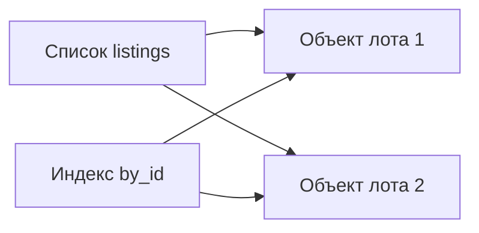

[[Python]]

# Python — выбор ключа и согласованность индексов

> [!abstract] Суть
> Хороший ключ обозначает именно нужную сущность и сохраняет её идентичность при изменении описания. Дополнительный словарь-индекс ускоряет доступ, но требует согласованного обновления с основными данными.

## Техническая пригодность и смысл ключа

Строка хешируема, но название игры всё равно может быть неудобным ключом: его можно переименовать, локализовать или повторить у другого объекта. Это отдельная проблема от технической хешируемости.

В демонстрации лекции игра с идентификатором 730 меняет название, а похожая строка появляется у другой записи:

```python
store = {730: "Counter-Strike: Global Offensive"}
reviews = {"Counter-Strike: Global Offensive": ["отличная игра"]}

store[730] = "Counter-Strike 2"
store[4465480] = "Counter-Strike:Global Offensive"
print(store)
print(reviews.get(store[730]))  # None
```

Отзыв привязан к прежней строке, поэтому по новому названию он не находится. Числа и названия здесь — данные учебного примера. Вывод: связь отзывов с игрой лучше строить через её устойчивый идентификатор, оставляя название значением.

На скриншотах источника эта мысль показана несколькими способами. Числовой `app id` остаётся идентификатором игры после переименования. В адресе вида `/app/400/Portal/` текст после номера служит подписью: демонстрация с другой подписью всё равно открывает объект по номеру 400. У профиля могут меняться ник и личная текстовая ссылка, а в качестве устойчивого ключа показан SteamID. Эти иллюстрации объясняют отделение идентичности объекта от его отображаемого имени.

## Составной ключ сохраняет структуру признаков

На примере торговой площадки один тип предмета различается оружием, оформлением, состоянием и признаком StatTrak. Цена относится к конкретному сочетанию, а не просто к слову `Redline`.

```python
listings = {  # цены из примера источника на 24.10.2026, в долларах
    "AK-47 | Redline (Field-Tested)": 31.99,
    "StatTrak™ AK-47 | Redline (Field-Tested)": 72.79,
    "AK-47 | Redline (Minimal Wear)": 178.50,
}
field_tested = [
    name for name in listings if name.endswith("(Field-Tested)")
]
print(field_tested)
# ['AK-47 | Redline (Field-Tested)',
#  'StatTrak™ AK-47 | Redline (Field-Tested)']

by_tuple = {
    (False, "AK-47", "Redline", "Field-Tested"): 31.99,
    (True, "AK-47", "Redline", "Field-Tested"): 72.79,
    (False, "AK-47", "Redline", "Minimal Wear"): 178.50,
}
print([key for key in by_tuple if key[3] == "Field-Tested"])
# [(False, 'AK-47', 'Redline', 'Field-Tested'),
#  (True, 'AK-47', 'Redline', 'Field-Tested')]
```

У склеенной строки признаки приходится извлекать из оформления текста. В кортеже каждому признаку соответствует отдельная позиция; проверка состояния не зависит от разделителей и подписи. Приведённые цены сохраняют расчётный пример лекции и не являются текущими котировками.

Такой ключ описывает **вид предмета**, но ещё не отдельный экземпляр. Для экземпляра нужен его собственный номер.

## Название объединяет экземпляры

```python
items = [
    ("53805522425", "Kilowatt Case"),
    ("53093171791", "Kilowatt Case"),
    ("52364346364", "Kilowatt Case"),
    ("50911691311", "Kilowatt Case"),
    ("52694160310", "Revolution Case"),
]

by_name = {name: asset for asset, name in items}
by_asset = {asset: name for asset, name in items}
print(len(by_name), len(by_asset))  # 2 5
print(by_name["Kilowatt Case"])    # 50911691311
```

Четыре экземпляра имеют равное название. При построении `by_name` новые значения заменяют прежние, поэтому остаётся номер последнего кейса. `by_asset` содержит все пять экземпляров: номера различаются.

Если нужен поиск всех экземпляров по названию, значение должно быть списком номеров:

```python
cases = {}
for asset, name in items:
    if name not in cases:
        cases[name] = []
    cases[name].append(asset)

print(len(cases))  # 2
print(cases["Kilowatt Case"])
# ['53805522425', '53093171791', '52364346364', '50911691311']
```

Выбор структуры зависит от нужной связи: «номер → экземпляр» отличается от «название → все экземпляры».

## Индекс хранит второй путь к объекту

```python
listings = [
    {"id": 1, "item": "Inscribed Arms of Desolation", "price": 9.29},
    {"id": 2, "item": "Inscribed Magus Apex", "price": 2.68},
]
by_id = {listing["id"]: listing for listing in listings}

listings[0]["price"] = 8.00
print(by_id[1]["price"])  # 8.0

listings.pop(1)
print(len(listings), len(by_id), 2 in by_id)  # 1 2 True
```

Индекс `by_id` — новый контейнер, но значения в нём ссылаются на исходные словари лотов. Поэтому изменение цены видно обоими путями. Удаление ссылки из списка не удаляет независимую запись из индекса. Тот продолжает хранить объект второго лота.



Стрелки — ссылки на общие объекты, а не копии записей. Изменение содержимого объекта и изменение состава контейнера — разные операции. Основа: [[Присваивание и изменение]], [[Копирование объектов]].

## Согласованное удаление и повторный вызов

Наивная функция удаляет объект только из списка:

```python
def cancel(lot_id):
    listings.remove(by_id[lot_id])
```

Если построить исходные структуры заново и вызвать `cancel(2)` дважды, после первого вызова индекс ещё содержит ключ 2. Второй вызов находит объект в индексе, но `remove` уже не находит его в списке и даёт `ValueError`.

В исправленном варианте обновляются обе структуры:

```python
def cancel(lot_id):
    if lot_id not in by_id:
        return False
    lot = by_id.pop(lot_id)
    listings.remove(lot)
    return True

# Для заново созданных согласованных listings и by_id:
print(cancel(2), cancel(2))                   # True False
print(len(listings), len(by_id), 2 in by_id)  # 1 1 False
```

Отсутствие ключа проверяется до изменений. Первый вызов снимает лот, повторный возвращает `False` без попытки удалить его снова. Это работает при исходной согласованности списка и индекса, как в примере. Функция не является общим механизмом восстановления уже повреждённых данных: если индекс ссылается на объект, которого нет в списке, `remove` всё равно завершится ошибкой.

Связи: [[Python — хешируемость и равенство ключей]], [[Python — словари, множества и отсутствующие значения]].

## Источник

[[L08.pdf]] — раздел «Выбор ключа», включая изображения об идентификаторах и примеры согласования списка с индексом.
