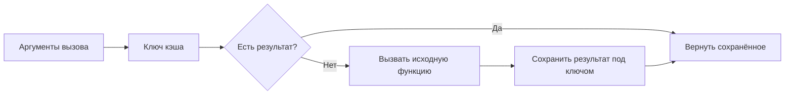

[[Python]]

# Python — кэширование вызовов

> [!abstract] Суть
> Кэширующий декоратор сохраняет результат под ключом, построенным из аргументов вызова. Повторный ключ позволяет вернуть прежний результат без выполнения тела, поэтому аргументы должны быть хешируемыми.

## cache и аргументы как ключ

```python
from functools import cache

@cache
def bundle_price(app_ids):
    print("считаю...")
    return 9.99 * len(app_ids)

print(bundle_price((220, 400)))
print(bundle_price((220, 400)))
print(bundle_price([220, 400]))
```

В первом вызове кортеж аргумента позволяет сформировать ключ: тело печатает `считаю...` и возвращает 19.98. Второй вызов получает 19.98 из кэша, поэтому сообщение о вычислении больше не появляется. Третий передаёт список и завершается `TypeError`: список нехешируем, новый результат не вычисляется.

```text
считаю...
19.98
19.98
TypeError: unhashable type: 'list'
```

Сообщение ошибки может различаться между версиями. Кортеж пригоден для ключа не просто из-за круглых скобок: его элементы тоже должны быть хешируемыми. Кэш использует словарь, поэтому повторяет требования к ключам из [[Python — хешируемость и равенство ключей]].



Схема показывает последовательные вызовы учебного примера. Она не утверждает, что любая работа тела выполняется заново: как раз печать позволяет увидеть, когда вычисление пропущено.

## Порядок именованных аргументов

```python
from functools import lru_cache

@lru_cache
def price(app_id, region):
    return 9.99

price(app_id=400, region="ru")
price(region="ru", app_id=400)
print(price.cache_info().misses)  # 2 в примере лекции
```

Для тела функции параметры имеют одинаковые значения в обоих вызовах. Однако кэш может учитывать порядок именованных аргументов: разные формы вызова могут создавать разные записи. Поэтому во втором вызове из демонстрации снова происходит промах кэша.

Слайд формулирует это как «порядок входит в ключ». Точная оговорка документации: разные порядки **могут** учитываться как отдельные вызовы; это не обещание нормализации всех форм аргументов и не универсальная характеристика любого кэширующего декоратора. [Документация `lru_cache`](https://docs.python.org/3/library/functools.html#functools.lru_cache).

Связывание аргументов и построение ключа кэша решают разные задачи: [[Python — сигнатуры и связывание аргументов]]. Связь с оборачиванием функций: [[Python — декораторы и композиция]].

## Источники

- [[L08.pdf]] — вводный пример с `cache` и бонусный пример с `lru_cache`.
- Документация `functools` по ссылке выше уточняет утверждение о порядке именованных аргументов.
