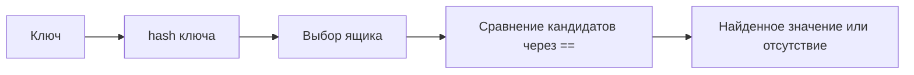

[[Python]]

# Python — поиск и устройство хеш-таблицы

> [!abstract] Суть
> Хеш-таблица вычисляет место поиска по ключу, а затем проверяет равенство кандидатов. При хорошем распределении ключей и достаточном размере таблицы поиск в среднем занимает постоянное число шагов.

## От перебора к вычислению места

Операция `app_id in library_list` ищет игру последовательным просмотром списка. Если нужного элемента нет, приходится проверить весь список; если он есть, поиск останавливается на совпадении. В худшем случае время — $O(n)$ по числу элементов. Для обычных целых чисел отдельное сравнение здесь считаем операцией постоянной стоимости.

В лекции одинаковые запросы сравниваются на списке и множестве:

```python
import random
import time

random.seed(8)
library_list = list(range(200_000))
library_set = set(library_list)
visits = [random.randrange(400_000) for _ in range(1000)]

start = time.perf_counter()
badges = sum(app_id in library_list for app_id in visits)
list_time = time.perf_counter() - start

start = time.perf_counter()
badges_again = sum(app_id in library_set for app_id in visits)
set_time = time.perf_counter() - start

print(badges == badges_again)
print(f"список: {list_time:.3f} с")
print(f"множество: {set_time * 1000:.3f} мс")
```

Результаты проверок совпадают. В показанном запуске список потребовал 0.940 секунды, множество — 0.420 миллисекунды. Эти числа описывают один эксперимент, зависят от окружения и не являются гарантией скорости. Создание `set(library_list)` в измеряемый интервал не включено: подготовка структуры имеет свою стоимость.

## Бинарный поиск требует порядка

В отсортированном списке можно на каждом шаге отбрасывать половину оставшегося диапазона:

```python
library = list(range(0, 400_000, 2))
target = 273_958

def binary_search(items, target):
    low, high = 0, len(items) - 1
    steps = 0
    while low <= high:
        steps += 1
        middle = (low + high) // 2
        if items[middle] == target:
            return middle, steps
        if items[middle] < target:
            low = middle + 1
        else:
            high = middle - 1
    return None, steps

print(len(library))                       # 200000
print(binary_search(library, target))      # (136979, 15)
print(binary_search(library, 273_959))      # (None, 17)
```

Элемент с индексом 136979 при линейном поиске потребовал бы 136980 проверок. Здесь достаточно 15 итераций. Число шагов бинарного поиска — $O(\log n)$, но список должен быть отсортирован, а доступ к середине — быстрым. Обычный оператор `in` у списка сам на бинарный поиск не переключается.

## Прямой адрес и его ограничения

Если ключ — небольшой неотрицательный целый номер, его можно использовать как индекс:

```python
shelf = [None] * 1000
shelf[400] = "Portal"
shelf[440] = "Team Fortress 2"
print(shelf[440])  # Team Fortress 2
```

Но присваивание `shelf[4465480] = "Counter-Strike:Global Offensive"` выходит за выделенный диапазон и даёт `IndexError`. Строковый индекс `shelf["Portal"]` даёт `TypeError`: список не сопоставляет произвольные ключи значениям. Прямой адрес требует места под диапазон индексов, даже если большинство ячеек пусты.

## Хеш выбирает место, равенство подтверждает ключ

`hash(obj)` возвращает целое число для хешируемого объекта. В примерах `hash(400) == 400`; хеши равных строк `"Portal"` и равных кортежей `("AK-47", "Redline")` совпадают. Сравнение хешей `"Portal"` и `"Patrol"` в показанном запуске даёт `False`, однако разные объекты вообще могут иметь один хеш.

В учебной таблице из $m$ ящиков выбирается индекс

$$b(k)=\operatorname{hash}(k)\bmod m.$$

```python
drawers = [None] * 8
for app_id in [220, 400, 570]:
    number = hash(app_id) % 8
    drawers[number] = app_id

print(drawers)
# [400, None, 570, None, 220, None, None, None]
```

Числа 220, 400 и 570 попадают в ящики 4, 0 и 2. Для запроса 400 проверяем ящик 0 и находим 400. Запрос 620 ведёт в ящик 4, но там 220: сравнение `220 == 620` ложно. Попадание в ящик само по себе ещё не означает совпадения ключа.



## Коллизия требует сохранения обоих ключей

Для 400 и 440 остаток от деления на 8 равен нулю. Если просто выполнить `drawers[hash(440) % 8] = 440`, прежний элемент 400 пропадёт. В лекции после этого таблица имеет вид `[440, None, 570, None, 220, None, None, None]`, а проверка наличия 400 даёт `False`.

Учебное решение — хранить в каждом ящике список кандидатов:

```python
drawers = [[] for _ in range(8)]
for app_id in [220, 400, 570, 440, 500, 730]:
    drawers[hash(app_id) % 8].append(app_id)

print(drawers)
# [[400, 440], [], [570, 730], [], [220, 500], [], [], []]

wanted = 440
for app_id in drawers[hash(wanted) % 8]:
    print(app_id, "==", wanted, app_id == wanted)
# 400 == 440 False
# 440 == 440 True
```

Коллизия индекса — совпадение выбранного ящика; сами хеши при этом могут различаться. Коллизия хеша — совпадение полных хеш-значений разных ключей. Во втором случае ключи попадут в один ящик при любом одинаковом модуле. Ни один вид коллизии не разрешается отказом от проверки равенства.

## Учебный словарь: пары ключ — значение

В модели множества достаточно хранить ключи. Для словаря храним пары. Вставка сначала ищет равный ключ и обновляет его значение; при отсутствии добавляет новую пару:

```python
def put(table, key, value):
    drawer = table[hash(key) % len(table)]
    for pair in drawer:
        if pair[0] == key:
            pair[1] = value
            return
    drawer.append([key, value])

table = [[] for _ in range(8)]
put(table, 400, "Portal")
put(table, 440, "Team Fortress 2")
put(table, 730, "Counter-Strike: Global Offensive")
put(table, 730, "Counter-Strike 2")
print(table[0], table[2])
# [[400, 'Portal'], [440, 'Team Fortress 2']] [[730, 'Counter-Strike 2']]
```

Поиск использует тот же расчёт ящика:

```python
def get(table, key):
    for pair in table[hash(key) % len(table)]:
        print(" сравниваю", pair[0], "==", key)
        if pair[0] == key:
            return pair[1]
    return None

table = [
    [[400, "Portal"], [440, "Team Fortress 2"]], [],
    [[570, "Dota 2"], [730, "Counter-Strike 2"]], [],
    [[220, "Half-Life 2"], [500, "Left 4 Dead"]], [], [], [],
]
print(get(table, 440))  # сравнения с 400 и 440; Team Fortress 2
print(get(table, 620))  # сравнения с 220 и 500; None
```

Это модель с цепочками, а не буквальное устройство Python `dict`. В CPython коллизии разрешаются поиском других позиций в таблице, без списка пар в каждом ящике. Модель объясняет роль хеша и равенства; внутренний алгоритм нужно отличать от этой аналогии. [Уточнение по исходному коду CPython](https://github.com/python/cpython/blob/3.14/Objects/dictobject.c).

## Рост таблицы меняет размещение

Когда ящиков мало, в каждом накапливается больше кандидатов. При увеличении таблицы ключи распределяются заново:

```python
old = [[400, 440], [], [570, 730], [], [220, 500], [], [], []]
new = [[] for _ in range(16)]
for drawer in old:
    for app_id in drawer:
        new[hash(app_id) % 16].append(app_id)
for number, drawer in enumerate(new):
    if drawer:
        print(number, drawer)
# 0 [400]
# 4 [500]
# 8 [440]
# 10 [570, 730]
# 12 [220]
```

400 и 440 перестали быть соседями, 570 и 730 остались вместе. Добавить пустые ящики в конец старого списка недостаточно: формула индекса изменилась.

В лекции рост настоящего словаря наблюдается через память:

```python
import sys

library = {}
jumps = []
for app_id in range(100):
    library[app_id] = "игра"
    size = sys.getsizeof(library)
    if not jumps or jumps[-1][1] != size:
        jumps.append((len(library), size))
print(jumps)
print([places * 2 // 3 + 1 for places in [8, 16, 32, 64, 128]])
```

В приведённом запуске пары «число элементов, байты» равны `(1, 224)`, `(6, 352)`, `(11, 632)`, `(22, 1168)`, `(43, 2264)`, `(86, 4688)`. Ёмкости 8, 16, 32, 64, 128 допускают соответственно 5, 10, 21, 42, 85 записей до следующего роста; пороги вставок — 6, 11, 22, 43, 86.

Ограничение заполнения примерно двумя третями и конкретные размеры относятся к рассматриваемому устройству CPython, а не к гарантии языка для любого словаря. `sys.getsizeof` здесь показывает размер самого контейнера, а не суммарный размер всех объектов ключей и значений. [Порог заполнения в реализации CPython](https://github.com/python/cpython/blob/3.14/Objects/dictobject.c).

## Распределение важнее одного количества ящиков

Коэффициент заполнения учебной таблицы:

$$\alpha=\frac{n}{m},$$

где $n$ — число ключей, $m$ — число ящиков. Он характеризует среднюю длину цепочки, но сам по себе не исключает одного очень длинного ящика.

```python
def longest_bucket(keys, size):
    table = [[] for _ in range(size)]
    for key in keys:
        table[hash(key) % size].append(key)
    return max(len(bucket) for bucket in table)

library = range(200_000)
for size in [1, 8, 1024, 262_144]:
    print(size, longest_bucket(library, size))
print(10, longest_bucket(range(0, 2_000_000, 10), 10))
```

| Ящиков | Набор ключей | Самая длинная цепочка |
|---|---|---|
| 1 | `range(200_000)` | 200000 |
| 8 | тот же | 25000 |
| 1024 | тот же | 196 |
| 262144 | тот же | 1 |
| 10 | `range(0, 2_000_000, 10)` | 200000 |

В последнем случае все числа кратны 10 и идут в один ящик. Хорошее среднее время требует подходящего распределения ключей и контроля заполнения. В модели цепочек поиск имеет среднюю стоимость $O(1+\alpha)$ при равномерном распределении; при $m$, растущем соразмерно $n$, это $O(1)$. В плохом случае остаётся перебор $O(n)$. Оценки не включают неограниченно дорогие пользовательские хеширование и сравнение.

## Плохая хеш-функция для строк

```python
def toy_hash(word):
    return sum(ord(letter) for letter in word)

for title in ["Portal", "Dota", "Patrol"]:
    code = toy_hash(title)
    print(title, code, code % 8, code % 16)
# Portal 626 2 2
# Dota 392 0 8
# Patrol 626 2 2
```

Сумма кодов букв не учитывает их порядок: `Portal` и `Patrol` всегда дают 626. Увеличение таблицы не разделяет эти ключи. Если много ключей имеют один хеш, поиск снова превращается в последовательный просмотр кандидатов.

Связи: [[Python — хешируемость и равенство ключей]], [[Python — выбор ключа и согласованность индексов]], [[Python — словари, множества и отсутствующие значения]].

## Источники

- [[L08.pdf]] — «Ключ от библиотеки. Словари и множества», разделы о поиске, хеш-таблице и бонус о заполнении.
- Ссылки на CPython выше уточняют границы учебной модели; дополнительная тема устройства интерпретатора здесь не разворачивается.
