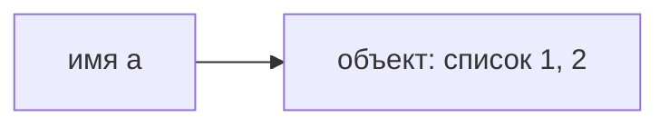
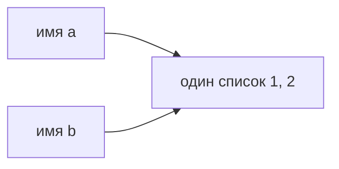

[[Python — имена, объекты и копирование]]

# Имена и объекты

> [!abstract] Суть
> Имя позволяет обратиться к объекту. Объект хранит значение и обладает типом; имя можно связать с другим объектом, не меняя старый.

## Что именно создаёт присваивание

Когда выполняется `a = [1, 2]`, выражение справа создаёт список, а имя `a` связывается с ним. Полезно мысленно разделять **имя**, **объект** и **связь между ними**:



Список не «лежит внутри переменной». Если затем выполнить `b = a`, новый список не создаётся: имя `b` получает ссылку на тот же объект.



Эта схема объясняет, почему изменение списка через `a` впоследствии видно и через `b`. Подробный разбор — в [[Присваивание и изменение]].

## Тип относится к объекту

У списка есть тип `list`, у числа `7` — `int`. Имя не закреплено за одним типом:

```python
x = [1, 2]  # x связано со списком
x = 7       # теперь x связано с целым числом
```

Вторая строка не превращает список в число. Она создаёт или получает другой объект и меняет связь имени `x`. Если на старый список ссылались другие имена, он остаётся доступным через них.

## Равенство и тождественность

```python
first = [1, 2]
second = [1, 2]
alias = first
```

`first == second` истинно: содержимое списков одинаково. `first is second` ложно: это два созданных отдельно списка. `first is alias` истинно: оба имени указывают на один объект. Оператор `is` сравнивает тождественность объектов, `==` — значения по правилу соответствующего типа.

> [!note] Граница модели
> Схема «имена → объекты» помогает понимать присваивание, но не описывает целиком устройство памяти Python. Не стоит выводить тождественность чисел или строк из того, что интерпретатор иногда переиспользует объекты. Для сравнения значений используйте `==`; `is` нужен, когда важно именно тождество, в частности для проверки `is None`.

## Истинность и логические операторы

Ложны нули числовых типов, пустые стандартные контейнеры и строки, `None` и `False`. Непустые `"0"`, `"False"` и `[0]` истинны: содержание не делает их ложными. Это правило стандартных типов; пользовательские объекты могут определять истинность отдельно.

`2 == True` даёт `False`, поскольку `True` численно равен единице, а `bool(2)` даёт `True`. Поэтому проверка истинности имеет форму `if flag:`, а не `if flag == True:`. `all([])` возвращает `True`: среди элементов пустого набора нет ни одного ложного.

`and` возвращает первый ложный операнд или последний, если все истинны. `or` — первый истинный или последний, если все ложны. Вычисление прекращается, как только результат определён; возвращается сам операнд, не обязательно `bool`.

```python
"ada" and "grace"  # 'grace'
"ada" or "grace"   # 'ada'
"" or "новичок"    # 'новичок'
```

`rating or 1800` заменяет на 1800 как `None`, так и корректный ноль. Когда отсутствие означает только `None`, нужна проверка `rating is None`. Та же причина объясняет потерю переданного пустого списка в [[Python — значения по умолчанию]].

## Тождественность и особенности реализации

В CPython некоторые небольшие целые переиспользуются. В примере PDF `int("256") is int("256")` истинно, а для 257 — ложно; приведён диапазон кэша от −5 до 256. Это деталь реализации, на которой нельзя строить сравнение числовых значений. `is` нужен для тождественности, в частности `is None`; правило «is только с None» из PDF является чрезмерным упрощением.

`id()` характеризует идентичность объекта в течение его жизни. Если у двух одновременно живущих объектов разные `id`, это разные объекты. Неизменный `id` после операции не доказывает, что объект был изменён: операция могла ничего не менять.

## Компактное представление range

`range` — неизменяемая последовательность с компактным описанием диапазона, а не готовый список чисел. В примере PDF `sys.getsizeof(range(1_000_000))` даёт 48 байт, тогда как `list(range(...))` занимает около 8 МБ только под сам список ссылок. Размеры зависят от реализации и платформы; `sys.getsizeof` не суммирует память всех объектов, на которые ссылается контейнер.

## Источник и продолжение

[[PYTHON.pdf]] и [[PYTHON.pdf]] описывают модель имён и различие `==`/`is`. Далее — [[Присваивание и изменение]].
