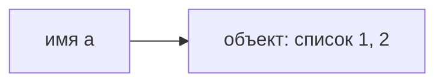
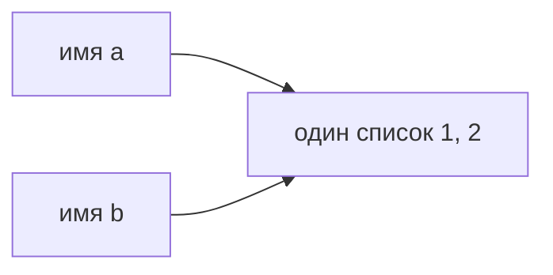

[[Python — имена, объекты и копирование]]

# Имена и объекты

> [!abstract] Суть
> Имя позволяет обратиться к объекту. Объект хранит значение и обладает типом; имя можно связать с другим объектом, не меняя старый.

## Что именно создаёт присваивание

Когда выполняется `a = [1, 2]`, выражение справа создаёт список, а имя `a` связывается с ним. Полезно мысленно разделять **имя**, **объект** и **связь между ними**:



Список не «лежит внутри переменной». Если затем выполнить `b = a`, новый список не создаётся: имя `b` получает ссылку на тот же объект.



Эта схема объясняет, почему изменение списка через `a` впоследствии видно и через `b`. Подробный разбор — в [[Присваивание и изменение]].

## Тип относится к объекту

У списка есть тип `list`, у числа `7` — `int`. Имя не закреплено за одним типом:

```python
x = [1, 2]  # x связано со списком
x = 7       # теперь x связано с целым числом
```

Вторая строка не превращает список в число. Она создаёт или получает другой объект и меняет связь имени `x`. Если на старый список ссылались другие имена, он остаётся доступным через них.

## Равенство и тождественность

```python
first = [1, 2]
second = [1, 2]
alias = first
```

`first == second` истинно: содержимое списков одинаково. `first is second` ложно: это два созданных отдельно списка. `first is alias` истинно: оба имени указывают на один объект. Оператор `is` сравнивает тождественность объектов, `==` — значения по правилу соответствующего типа.

> [!note] Граница модели
> Схема «имена → объекты» помогает понимать присваивание, но не описывает целиком устройство памяти Python. Не стоит выводить тождественность чисел или строк из того, что интерпретатор иногда переиспользует объекты. Для сравнения значений используйте `==`; `is` нужен, когда важно именно тождество, в частности для проверки `is None`.

## Источник и продолжение

[[PYTHON.pdf#page=1|Исходный конспект, с. 1]] и [[PYTHON.pdf#page=2|с. 2]] описывают модель имён и различие `==`/`is`. Далее — [[Присваивание и изменение]].
