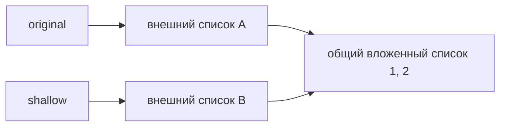
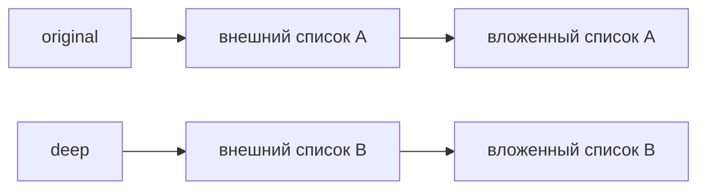

[[Python — имена, объекты и копирование]]

# Копирование объектов

> [!abstract] Суть
> Новая ссылка, поверхностная копия и глубокая копия создают разные отношения между объектами. Вложенные изменяемые объекты показывают эту разницу особенно ясно.

## Сначала — присваивание

```python
original = [[1, 2]]
alias = original
```

Здесь один внешний список и один вложенный. `alias` — второе имя для внешнего списка; копии нет. Изменение через любое имя видно через другое. Это следует из [[Присваивание и изменение]].

## Поверхностная копия: новый внешний контейнер

```python
import copy

original = [[1, 2]]
shallow = copy.copy(original)
```

`shallow` — новый внешний список. Однако его первый элемент ссылается на тот же вложенный список, что и первый элемент `original`:



Поэтому `shallow.append([9])` изменит лишь новый внешний список, а `shallow[0].append(3)` изменит общий вложенный список. После второго действия `original[0]` тоже будет `[1, 2, 3]`.

## Глубокая копия: обход вложенных объектов

```python
deep = copy.deepcopy(original)
deep[0].append(4)
```

Для обычных вложенных списков `deep` получает отдельный внешний и отдельный внутренний список. Изменение `deep[0]` уже не затрагивает `original[0]`. Идею можно представить как построение нового графа объектов по связям исходного.



Глубокая копия запоминает уже обработанные объекты. Поэтому она может сохранить повторные ссылки и справиться с циклом, например когда словарь содержит ссылку на самого себя.

## Сравнение

| Действие | Внешний контейнер | Вложенный список |
|---|---|---|
| `alias = original` | Тот же | Тот же |
| `copy.copy(original)` | Новый | Общий |
| `copy.deepcopy(original)` | Новый | Обычно новый |

> [!note] Граница модели
> Для разных типов копирование может быть настроено по-разному. Глубокая копия не обещает создать самостоятельную копию любого внешнего ресурса и может быть затратной по времени и памяти. Выбор определяется тем, какие вложенные данные должны оставаться общими.

## Циклы и словарь memo

```python
a = []
a.append(a)
print(a)  # [[...]]
```

Объект может прямо или косвенно ссылаться на себя. Многоточие в выводе обозначает уже встреченный контейнер. `deepcopy` хранит отображение уже обработанных объектов в `memo`, поэтому повторные ссылки не требуют бесконечного обхода:

```python
import copy

a = {}
a["self"] = a
c = copy.deepcopy(a)
# c is not a
# c["self"] is c
```

Глубокая копия сохраняет структуру этого цикла, но создаёт новый словарь. Она не обязана копировать буквально каждый достижимый объект: неизменяемые объекты могут переиспользоваться, а некоторые типы определяют собственные правила копирования.

## Граница копирования определяется задачей

Если объект игрока связан с вещами, характеристиками и гильдией, полный рекурсивный обход может скопировать значительно больше ожидаемого. В примере лекции характеристики и вещи должны стать независимыми, а гильдия остаться общей. Поэтому ни поверхностная, ни глубокая копия не являются автоматически правильными: нужно определить, какие связи сохраняются.

Изменяемость — свойство отдельного объекта, а не всего подграфа. Неизменяемый кортеж может вести к изменяемому списку. Жизнь графа и освобождение циклов рассматривает [[Python — время жизни и сборка мусора]].

## Источник и продолжение

[[PYTHON.pdf]] и [[PYTHON.pdf]] разбирают копирование графа объектов. Дальше в обзоре блока — [[Python — имена, объекты и копирование#Время жизни|время жизни объектов]].
