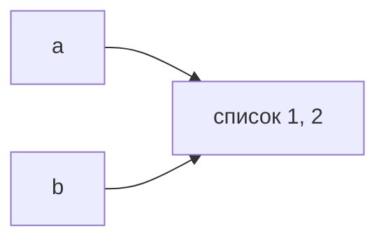
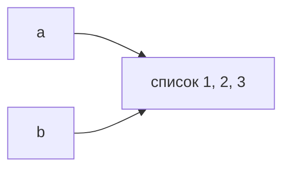
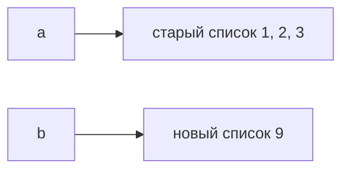

[[Python — имена, объекты и копирование]]

# Присваивание и изменение

> [!abstract] Суть
> Присваивание меняет связь имени с объектом. Операция над изменяемым объектом меняет сам объект; результат виден через все имена, которые на него ссылаются.

## Один список, два имени

После этих строк `a` и `b` ведут к одному списку:

```python
a = [1, 2]
b = a
```



Выполнение `b.append(3)` меняет этот список. Оба имени теперь дают `[1, 2, 3]`:



Если вместо этого выполнить `b = [9]`, выражение справа создаст другой список. Изменится связь имени `b`, а объект, доступный через `a`, сохранит `[1, 2, 3]`:



Разница определяется действием: метод `append` изменяет существующий список, а присваивание имени связывает его с результатом выражения справа.

## Вызов функции подчиняется той же модели

```python
def add_item(items):
    items.append(3)

def replace_local(items):
    items = [9]

values = [1, 2]
add_item(values)       # values теперь [1, 2, 3]
replace_local(values)  # values всё ещё [1, 2, 3]
```

При вызове параметр `items` становится ещё одним именем для переданного объекта. Первая функция меняет общий список. Вторая связывает только своё локальное имя с новым списком. Если функция должна сообщить вызывающему о новом объекте, она может вернуть его, а вызывающий — присвоить результат своему имени.

## Изменяемость принадлежит объекту

Списки и словари изменяемы. Целые числа и строки неизменяемы: операция, похожая на изменение их значения, даёт другую связь с объектом. Кортеж не позволяет заменить свои элементы, но может содержать изменяемый список:

```python
pair = ([1, 2], 3)
pair[0].append(4)  # сам кортеж хранит те же два элемента; вложенный список изменился
```

> [!note] Граница модели
> Название операции само по себе не обещает изменение на месте. Например, поведение `+=` зависит от типа объекта. Чтобы понять эффект, нужно знать, изменяет ли конкретная операция существующий объект или возвращает новый.

## Источник и продолжение

См. [[PYTHON.pdf#page=2|исходный конспект, с. 2]] и [[PYTHON.pdf#page=3|с. 3]]. Предпосылка — [[Имена и объекты]]. Следующий случай: [[Копирование объектов]].
