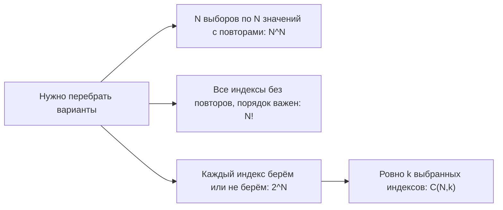

# Полный перебор, маски и стоимость комбинаторных алгоритмов

[[Алгоритмы и C]]

Полный перебор рассматривает все допустимые варианты и выбирает подходящий или лучший. Его стоимость — число вариантов, умноженное на работу обработки одного варианта. Удаление повторных вариантов помогает, но не всегда превращает экспоненциальный рост в полиномиальный.

## Пары, тройки и фиксированное число элементов

В лекции 11 пример с транзакциями сводится к количествам купленных/проданных акций: найти пары чисел с суммой ноль. В исходной таблице для TSLA количества $+1,+2,-1,+3,+7,-3,-7$; пары $+1/-1$, $+3/-3$, $+7/-7$ выделены цветами. Даты и цены сопровождают записи, но показанный алгоритм сравнивает именно количества, не доходность сделок.

Далее дан массив `[1,2,-1,4,-2,1,1,5]` и фрагмент:

```c
for (int i = 0; i < N; i++) {
    for (int j = 0; j < N; j++) {
        if (i != j && arr[i] + arr[j] == 0) {
            PairInt pair = {arr[i], arr[j]};
            appendVectorItem(vector, &pair);
        }
    }
}
```

Это $N^2$ проверок, то есть $\Theta(N^2)$ времени при постоянной стоимости проверки и амортизированного добавления. Разные позиции равных значений остаются разными записями. Код выдаёт обе ориентации каждой пары; если нужны неупорядоченные пары индексов, достаточно $j>i$. Для общих `int` сумма требует проверки диапазона: знаковое переполнение не является корректной проверкой нулевой суммы. В показанном маленьком массиве переполнения нет.

Три полных вложенных цикла дают $\Theta(N^3)$ кандидатов, пять — $\Theta(N^5)$. Чтобы выбирать разные транзакции, нужно запрещать повторное использование индексов. Если число выбираемых элементов $k$ фиксировано, $N^k$ — полиномиальный рост.

Условная модель лекции: один внутренний шаг стоит $1$ микросекунду. При $N=1000$:

| Количество полных циклов | Число внутренних шагов | Условное время |
|---|---|---|
| 2 | $10^6$ | 1 секунда |
| 3 | $10^9$ | 1000 секунд, около 16.7 минуты |
| 5 | $10^{15}$ | $10^9$ секунд, около 31.7 года |

«1000 итераций» в подписи источника означает размер входа 1000, а не всего тысячу внутренних операций. Это модель для сравнения роста, не измеренная скорость конкретного компьютера.

## N в степени N, перестановки и подмножества

Если имеется $N$ позиций выбора, на каждой из которых независимо выбирается один из $N$ индексов, вариантов $N^N$. Повторные индексы и разный порядок входят в этот подсчёт. При $N=1000$ получается $10^{3000}$ вариантов; множитель микросекунды и перевод в годы не меняют непрактичность масштаба.

Если выбираем последовательность из всех $N$ **различных** индексов, число вариантов
$$N(N-1)\cdots1=N!.$$
Такой подсчёт соответствует перестановкам, а не неупорядоченным подмножествам.

**Уточнение перехода слайдов:** фраза «не смотреть элементы до текущего» означает рост индексов и убирает разные порядки одного набора. Для $k$ выбранных позиций тогда число вариантов $\binom Nk$, а для подмножеств любого размера
$$\sum_{k=0}^N\binom Nk=2^N.$$
Факториал считает упорядоченные перестановки. Его нельзя выводить как точное число всех подмножеств из ограничения на возрастающие индексы. Также число вариантов ещё не учитывает стоимость их построения и проверки: выписывание каждого варианта длины $N$ добавляет множитель $N$.



**Дополнительная схема к стрелкам источника.** Зелёные стрелки от позиции к последующим индексам означают увеличение индексов; красная обратная стрелка показывает порядок, который нужно исключить, если набор не зависит от порядка. Схема различает варианты, смешанные в исходном переходе.

![[Перебор — степени и N в степени N.png]]

Первый график автора сравнивает $N^2,N^3,N^5,N^N$ на малых входах. Вертикальная ось логарифмическая, в условных часах при заданной стоимости шага; поэтому экспоненциальное/сверхэкспоненциальное различие визуально сжато.

![[Перебор — факториал.png]]

Красная кривая $N!$ ниже $N^N$, но при росте $N$ всё равно быстро превосходит фиксированные степени. Её пересечения с $N^5$ на малых $N$ не означают полиномиальную асимптотику.

## Пример полного перебора двух кластеров

Пусть числа разбиваются на два **непустых** кластера $C_0,C_1$. Центр в примере — арифметическое среднее:
$$\mu(C)=\frac1{|C|}\sum_{x\in C}x.$$
Оценка кластера и общая цель:
$$s(C)=\sum_{x\in C}|x-\mu(C)|,\qquad
S(C_0,C_1)=s(C_0)+s(C_1)\longrightarrow\min.$$
Это точно функция исходного кода, а не сумма квадратов отклонений. **Дополнительное уточнение:** при свободном выборе центра абсолютные отклонения минимизирует медиана; здесь же центр заранее определён как среднее, и менять его молча нельзя.

Авторские иллюстрации группировки:

- `[1,2,100,3,101,4]` → `[1,2,3,4]` и `[100,101]`.
- `[1,2,3,4,5,6]` → `[1,2,3]` и `[4,5,6]`.
- `[1,2,3,4,5,1000]` → `[1,2,3,4,5]` и `[1000]`; на слайде в первом выходном кластере ошибочно приписана ещё `6`, отсутствующая во входе.

Примеры показывают смысл группировки; отдельного доказательства оптимальности каждого из этих разбиений в лекции нет.

Для `[1,2,10]` полностью перечислены восемь масок:

| $C_0$ | $C_1$ | $s(C_0)$ | $s(C_1)$ | Сумма |
|---|---|---|---|---|
| `[1,2,10]` | `[]` | — | — | Недопустимо |
| `[1,2]` | `[10]` | 1 | 0 | 1 |
| `[1,10]` | `[2]` | 9 | 0 | 9 |
| `[1]` | `[2,10]` | 0 | 8 | 8 |
| `[2,10]` | `[1]` | 8 | 0 | 8 |
| `[2]` | `[1,10]` | 0 | 9 | 9 |
| `[10]` | `[1,2]` | 0 | 1 | 1 |
| `[]` | `[1,2,10]` | — | — | Недопустимо |

**Промежуточное вычисление:** для `[1,2]` среднее 1.5 и сумма $0.5+0.5=1$; для `[1,10]` среднее 5.5 и сумма $4.5+4.5=9$; для `[2,10]` среднее 6 и сумма $4+4=8$. Заголовок `Score(mean)` в таблице фактически содержит сумму двух оценок, а не их среднее.

## Двоичная маска и ProductIterator

Каждому элементу соответствует бит: 0 отправляет его в первый кластер, 1 — во второй. Всего $2^N$ масок: для $N=3,4,5,10$ это 8,16,32,1024. Пустые кластеры исключают две маски. Если имена кластеров не различаются, пары взаимно дополнительных масок задают одно разбиение, поэтому для $N\ge1$ непустых неименованных разбиений $2^{N-1}-1$; это **дополнительное пояснение симметрии**, не использованная автором оптимизация.

Исходная структура:

```c
typedef struct {
    Vector *elements; /* [0,1] */
    int repeat;       /* длина маски N */
    Vector *indices;  /* N индексов в elements */
    bool done;
} ProductIterator;
```

Векторы `[0,0,0,0]`, `[0,0,0,1]`, `[0,0,1,0]`, `[0,0,1,1]`, `[0,1,0,0]`, `[0,1,0,1]` — начало двоичного счёта. `repeat` — число позиций, не число $2^{repeat}$ результатов.

Конструктор источника создаёт `elements` из `{0,1}`, `indices` длины `repeat`, устанавливает `done=false` и возвращает структуру. Контракт `createVectorBySize` должен гарантировать нулевое заполнение `indices`, иначе начальная маска неопределённа. На слайде нет проверок `malloc`, создания обоих векторов и допустимости отрицательного `repeat`; они необходимы для готовой реализации.

Тело получения следующей маски:

```c
Vector *nextIteration(ProductIterator *iter) {
    if (!iter || iter->done) return NULL;
    Vector *mask = createVectorBySize(iter->repeat, sizeof(int));
    for (int i = 0; i < iter->repeat; ++i) {
        int index = *(int *)getVectorItem(iter->indices, i);
        int value = *(int *)getVectorItem(iter->elements, index);
        setVectorItem(mask, i, &value);
    }
    incrementIteration(iter);
    return mask;
}
```

Элементы маски копируются из текущего состояния, затем состояние сдвигается к следующему. При последней маске результат ещё возвращается, но `done` уже станет истинным для следующего вызова. Выделенный `mask` принадлежит вызывающему.

```c
void incrementIteration(ProductIterator *iter) {
    if (!iter) return;
    int zero = 0;
    for (int i = iter->repeat - 1; i >= 0; --i) {
        int val = *(int *)getVectorItem(iter->indices, i);
        if (val + 1 < iter->elements->size) {
            val++;
            setVectorItem(iter->indices, i, &val);
            return;
        }
        setVectorItem(iter->indices, i, &zero);
    }
    iter->done = true;
}
```

Движение справа налево переносит разряд: 0 заменяется на 1 и завершает шаг; 1 заменяется на 0 с продолжением переноса. Если перенос вышел за начало, все варианты исчерпаны. Для большего алфавита это счётчик в системе с основанием `elements->size`.

Создание состояния требует $\Theta(N)$ памяти и времени с инициализацией. Инкремент в худшем случае $O(N)$, поскольку маска из одних единиц требует полного переноса. В лекции написано $O(N/2)$; это тот же класс $O(N)$, но не обоснованная средняя оценка. Копирование очередной полной маски само стоит $\Theta(N)$, поэтому `nextIteration` остаётся $\Theta(N)$ независимо от среднего числа переносимых битов.

## Основной алгоритм и функции оценки

В опубликованном коде вход `[0,1,10,11]`, `best_score=INFINITY`, затем:

```text
создать ProductIterator(N)
пока итератор не закончен:
    получить mask
    создать cluster1 и cluster2
    для i=0..N-1:
        добавить arr[i] в кластер по mask[i]
    если оба кластера непусты:
        вычислить среднее каждого
        score = scoreCluster(cluster1,mean1) + scoreCluster(cluster2,mean2)
        если score<best_score:
            сохранить новое лучшее разбиение и score
        иначе освободить оба новых кластера
    иначе освободить оба новых кластера
вывести лучшее разбиение
```

Авторские вспомогательные функции:

```c
double meanVal(Vector *arr) {
    double sum_ = 0;
    for (int i = 0; i < arr->size; i++)
        sum_ += *(int *)getVectorItem(arr, i);
    return sum_ / arr->size;
}
double scoreCluster(Vector *arr, double center) {
    double score = 0;
    for (int i = 0; i < arr->size; i++)
        score += fabs((double)*(int *)getVectorItem(arr, i) - center);
    return score;
}
```

Вызывать `meanVal` допустимо для непустого кластера; сумма накапливается в `double`, а не в `int`. Численная точность и диапазон `double` конечны. Оба прохода линейны по длине кластера; в сумме по двум кластерам за маску просматривается $O(N)$ элементов.

**Дополнительный разбор ресурсов исходника:**

- При улучшении результата старые `best_cluster1/2` нужно освободить до замены, иначе они утекут.
- Каждую выделенную маску нужно освободить после использования; в слайде этого нет.
- После перебора нужны освобождение итератора, его `elements/indices` и окончательных лучших кластеров.
- Лучшие указатели не инициализированы; при $N<2$ допустимого разбиения нет, поэтому вывод по ним некорректен. Нужен отдельный результат «разбиения нет».
- Все отказы выделения и добавления в `Vector` требуют обработки. Слайды не содержат законченной функции очистки по ошибке.

Эти дополнения не превращаются в придуманное тело отсутствующей авторской библиотеки.

## Полная стоимость и границы вывода

Число масок — $\Theta(2^N)$. На одну:

| Действие | Стоимость при геометрическом росте Vector |
|---|---|
| Построить маску | $\Theta(N)$ |
| Распределить значения | Амортизированно $O(N)$ |
| Посчитать центры и отклонения | $O(N)$ |
| Сохранить/освободить текущие контейнеры | $O(N)$ или меньше по размеру данных |

Итого корректная оценка для такого варианта — $\Theta(N2^N)$, дополнительная **живая** память $O(N)$ при своевременном освобождении и хранении только текущего и лучшего разбиений.

Источник пишет для создания кластеров $O(N^2)$ на маску и суммарно $O(N^22^N)$. Эта верхняя оценка соответствует добавлению с линейным переносом на каждом шаге, например росту ровно на один элемент. Для уже принятого геометрически растущего `Vector` последовательность $N$ добавлений амортизированно линейна. Обе оценки сохранены с разными условиями; стоимость плохой реализации контейнера не является обязательным свойством полного перебора. Утечки исходника могут увеличить фактическую накопленную память сверх указанной живой оценки.

![[Перебор — общий график.png]]

График сравнивает $N^2,N^5,2^N,5^N,N!,N^N$ в условных часах; вертикальная шкала логарифмическая. Увеличение основания экспоненты или переход к факториалу резко сужает доступный размер входа. Сравнивать надо полные функции, включая стоимость одного кандидата, и выбранную модель шага.

## Что означает заголовок «NP-полные задачи»

Так называется лекция, но в её слайдах не даны формальные определения классов P и NP, полиномиальной сводимости и NP-полноты; нет доказательства NP-полноты описанной кластеризации. Экспоненциальный полный перебор — свойство **этого алгоритма**, оно само по себе не доказывает, что для задачи не существует более быстрого решения.

Фиксированные $N^2,N^3,N^5$ — полиномы, а $2^N,N!,N^N$ — более быстрые классы роста. Время измеряется относительно выбранного представления входа. **Дополнительное пояснение:** термин NP не расшифровывается как «неполиномиальные» и не обозначает всякую задачу с медленным опубликованным решением.

Лекция перечисляет подбор гиперпараметров, отбор признаков, ансамбли, кластеризацию и генетические алгоритмы как места возникновения больших пространств вариантов. Без точной постановки ни каждую из этих областей, ни любой алгоритм в ней нельзя объявлять NP-полным.

Нотации и модель операций: [[Асимптотика — рост времени и памяти]].

## Источник

[[алгосы1_2025_л11_NP_полные_алгоритмы.pdf]] — пары и наборы транзакций, подсчёт вариантов, графики, полная таблица разбиений, ProductIterator и кластерный перебор. Промежуточные расчёты, различение сочетаний/перестановок, условия стоимости Vector и разбор ресурсов добавлены для понимания и отмечены явно.
