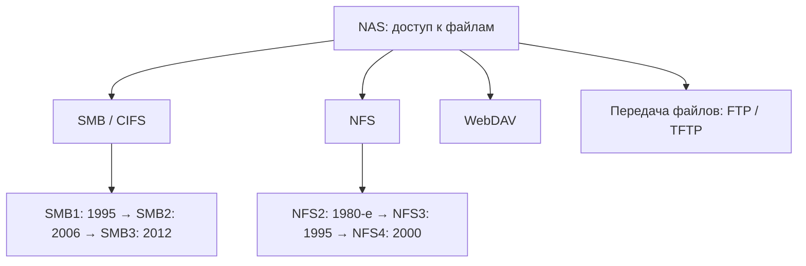

[[Архитектура вычислительных систем]]

# DAS, NAS и SAN

> [!abstract] Суть
> DAS и SAN дают серверу блочное устройство, а NAS — файлы. Основное различие состоит в границе ответственности за файловую систему и способе подключения.

## Блоки, файлы и программное хранение

В DAS и SAN файловая система обычно работает на сервере, СХД предоставляет блоки. В NAS файловая система находится на файловом сервере, а клиент обращается к именам файлов и каталогов. Поэтому SAN может выглядеть для ОС подобно локальному диску, хотя команды проходят через сеть.

SDS (Software Defined Storage) — программно определяемое хранение, например Ceph на серверах с дисками. Это принцип реализации, который может сочетаться с разными способами доступа, а не четвёртый протокол наравне с DAS/NAS/SAN. В исходной лекции он только обозначен.

| Свойство | DAS | NAS | SAN |
|---|---|---|---|
| Расшифровка | Direct Attached Storage | Network Attached Storage | Storage Area Network |
| Доступ | Блоки | Файлы | Блоки |
| Файловая система | Обычно на сервере | На СХД/файловом сервере | Обычно на сервере |
| Подключение | Прямое, например SAS или USB | Обычная сеть | Сеть хранения: FC, Ethernet и другие варианты |
| Механизмы | SCSI/ATA в зависимости от подключения | NFS, SMB; FTP служит передаче файлов | SCSI по FC, iSCSI и другие |
| Совместное использование | Обычно привязано к узлу, возможны многосерверные схемы | Общий доступ к файлам | Выдача томов нескольким серверам с согласованным доступом |
| Типичная экономика | Низкая стоимость | Низкая–средняя | Часто высокая, особенно для специализированной инфраструктуры |
| Применение | Сервер с подключёнными дисками | Документы, папки, датасеты | БД, виртуализация, критичные системы |

![[99 Система/Вложения/АВС — сеть и хранение 2026/avs-storage2-032-image46.png|720]]

Слайд 32: в DAS, SAN и iSCSI файловая система и менеджер томов находятся на стороне компьютера. В NAS клиент передаёт файловые запросы NFS/CIFS, а файловая система работает на сервере хранения. iSCSI Gateway преобразует путь к нижележащей FC-сети. Скорости и названия на исторической схеме не задают текущие пределы.

## DAS

DAS подключено непосредственно к вычислительному узлу. Файловую систему и часть функций управления выполняет узел, но внешний массив может иметь свой RAID-контроллер. Примеры PDF — DEPO Storage 2312 SAS3 и полка Supermicro JBOD, подключённая через SAS HBA и экспандеры к двум серверам. Это показывает, почему запрет совместного подключения в исходной сравнительной таблице нельзя считать абсолютным.

| Подключение | Примеры скоростей в PDF |
|---|---|
| USB | 10–20 Гбит/с |
| eSATA | 3 Гбит/с для приведённого поколения |
| SAS | По поколению |
| FireWire, IEEE 1394 | 400–3200 Мбит/с |
| Thunderbolt | До 20 Гбит/с для приведённого поколения |

Это значения поколений из конспекта, не современные максимумы семейств. Преимущества DAS — сравнительно низкая цена, простота и прямой путь обмена. При раздаче через единственный сервер его отказ прекращает доступ клиентов; запросы проходят через него и нагружают сеть. Привязка ёмкости к узлам может давать избыток места на одном и недостаток на другом. Устойчивость и задержка зависят от конкретной схемы, а не только от названия DAS.

![[99 Система/Вложения/АВС — сеть и хранение 2026/avs-storage2-008-image21.png|600]]

Простая схема DAS со слайда 8: хранилище соединено с одним сервером напрямую, остальные узлы обращаются к нему через этот сервер.
![[99 Система/Вложения/АВС — сеть и хранение 2026/avs-storage2-013-image30.png|720]]

Слайд 13: два сервера с LSI 9207-8e SAS HBA соединены с Supermicro SAS JBOD с двумя экспандерами, двумя блоками питания и 24 местами 2,5″ в 2U. Несколько путей подключения не решают сами по себе согласование одновременной записи.
![[99 Система/Вложения/АВС — сеть и хранение 2026/avs-storage2-014-image31.png|720]]

Слайд 14: сервер управления AD+CD, сеть 1Gb и серверы соединены отдельно от пути SAS 2.0 через LSI SAS Switch 6160 к трём полкам. Зелёные линии показывают обычную сеть, нижние разноцветные — подключение хранения.

## NAS

NAS — файловый сервер в сети с собственной ОС и файловой системой. NFS (Network File System) распространён в Unix/Linux, SMB (Server Message Block) — в Windows, при этом оба доступны на разных платформах. FTP даёт передачу файлов, но не тождественен монтируемой сетевой файловой системе.

Преимущества — общие файлы, простое подключение и управление, гибкое расширение и доступ с разных ОС. Ограничения — файловая модель, нагрузка на сеть, сетевые задержки, требования приложений к поддерживаемому хранилищу. Нельзя универсально утверждать, что NAS всегда медленнее локального диска или что СУБД всегда запрещён сетевой файловый доступ: это зависит от нагрузки и требований ПО.

В PDF перечислены Linux, FreeBSD, Windows Storage Server; специализированные Open-E DSS и RAIDIX; решения для SOHO (Small Office/Home Office): FreeNAS, OpenMediaVault на Debian, XPEnology как вариант Synology DSM и Rockstor. Приведённые названия и ОС-основы относятся к историческим примерам источника, а не гарантированно текущему состоянию продуктов.

На графике NFS, SMB и SSHFS дают примерно 110 МБ/с последовательного чтения и записи. Интерпретация в конспекте: ограничивает гигабитная сеть, теоретически 125 МБ/с до накладных расходов. Это результат конкретного теста, не равенство всех протоколов. Пример более мощного NAS — DEPO Storage 3516, до 96 ТБ, сеть 1/10/40 Гбит/с.

### Файловые протоколы NAS

Схема слайда 18 содержит FTP и TFTP, SMB/CIFS, NFS и WebDAV (Web Distributed Authoring and Versioning). В ней указаны SMB1 — 1995, SMB2 — 2006, SMB3 — 2012; NFS2 — 1980-е, NFS3 — 1995, NFS4 — 2000. Это исторические ориентиры схемы, а не текущий перечень версий или рекомендация использовать старые протоколы.

Дополнительное пояснение: общая ветка не делает FTP/TFTP эквивалентом SMB/NFS. Они выполняют передачу файлов, тогда как сетевой файловый доступ должен обеспечивать требуемую приложению семантику операций. CIFS относится к раннему семейству SMB; этим названием не следует автоматически обозначать все версии SMB.

Уточнение к слайду 17 и прежнему перечислению: Synology DSM — ПО фирменных NAS, а XPEnology — сторонний проект запуска DSM на ином оборудовании; это не два равнозначных названия коммерческой ОС. FreeNAS на FreeBSD и Rockstor на CentOS здесь сохранены именно как исторические подписи лекции.

### Графики сетевого файлового доступа

![[99 Система/Вложения/АВС — сеть и хранение 2026/avs-storage2-019-image34.png|720]]

Слайд 19, последовательное чтение: NFS(AES) 113,292, NFS(plain) 113,845, SMB(AES) 94,317, SMB(plain) 113,072, SSHFS(AES) 112,165, SSHFS(ChaCha20) 112,598 по подписанной оси MB/s. Это конкретное измерение, не универсальное сравнение протоколов.
![[99 Система/Вложения/АВС — сеть и хранение 2026/avs-storage2-019-image35.png|720]]

Слайд 19, последовательная запись: почти все варианты приближаются к насыщению гигабитного канала; NFS(AES) и SMB(AES) ниже остальных. На исходном изображении подписи столбцов записи напечатаны без десятичного разделителя, поэтому их не следует читать как десятки тысяч MB/s.
Под слайдом указан первоисточник: [измерение NAS, SSHFS, NFS и SMB (2019)](https://blog.ja-ke.tech/2019/08/27/nas-performance-sshfs-nfs-smb.html). Слайд 20 связывает близость многих результатов с Gigabit Ethernet. Нагрузка шифрования и реализация протокола тоже могут влиять на результат; один график не доказывает равенство всех вариантов.

По описанию автора исходного измерения сервер имел Intel i3-3220 без AES-NI и два HDD в Btrfs RAID1; тест был устроен так, чтобы почти всегда попадать в серверный кэш. Поэтому графики прежде всего сравнивают сетевой и протокольный путь в этих условиях. [Описание стенда и методики](https://blog.jklr.org/2019/08/27/nas-performance-sshfs-nfs-smb.html).

## SAN: узлы и фабрика

SAN предоставляет удалённые блочные устройства. Серверы-инициаторы отправляют команды целевым массивам; СХД может включать контроллеры и дисковые полки. Ёмкость распределяется между потребителями. Общая видимость тома не делает безопасной одновременную запись произвольных файловых систем: доступ должен быть согласован.

Узлы SAN — серверы и массивы. Сетевая часть — коммутаторы, маршрутизаторы и кабели. Fabric, или фабрика, — сеть коммутаторов; ISL (InterSwitch Link) соединяет коммутаторы. На серверах применяются HBA. Примеры из PDF: HP StorageWorks 4/8 SAN Switch, HP 82E 8Gb FC HBA, Dell PowerVault ME4024, YADRO TATLIN.

SAN даёт масштабирование и возможности производительности, снапшотов, репликации. Плата за это — стоимость и сложность; конкретные функции определяются СХД. iSCSI использует Ethernet и TCP/IP, FC (Fibre Channel) — специализированный транспорт; InfiniBand (IB) также применяется в высокоскоростных схемах хранения и кластеров.

![[99 Система/Вложения/АВС — сеть и хранение 2026/avs-storage2-022-image39.png|620]]

Схема SAN со слайда 22: обычная локальная сеть связывает серверы, а отдельная сеть хранения — их инициаторы с дисковыми и ленточными целевыми устройствами.
Характеристики примеров оборудования со слайдов 26–29: HP StorageWorks 4/8 Base SAN Switch; HP 82E, артикул 489193-001, двухпортовый 8Gb FC HBA на PCIe; Dell PowerVault ME4024 с 24 местами 2,5″ и четырьмя SFP+ FC16 в приведённой конфигурации; YADRO TATLIN. Они показывают разные роли: коммутатор фабрики, адаптер сервера, массив.

## Fibre Channel и варианты транспорта

| Поколение в PDF | Номинальная полезная скорость | Линейная скорость в таблице PDF | Кодирование | Примеры подключения HBA из PDF |
|---|---|---|---|---|
| 1G FC | 100 МБ/с | 1,0625 ГБод | 8b/10b | PCI-X |
| 2G FC | 200 МБ/с | 2,125 ГБод | 8b/10b | PCI-X |
| 4G FC | 400 МБ/с | 4,25 ГБод | 8b/10b | PCI-X 2.0 / PCIe 1.0 x4 |
| 8G FC | 800 МБ/с | 8,5 ГБод | 8b/10b | PCIe 2.0 x4; указание «PCI-X 1.0 x8» в исходной таблице некорректно |
| 16G FC | 1600 МБ/с | 14,025 ГБод | 64b/66b | PCIe 3.0 x4; указание «PCI-X 2.0 x8» в исходной таблице некорректно |
| 32G FC | 3200 МБ/с | 28,05 ГБод | 64b/66b | PCIe 3.0 x8 |
| 64G FC | 6400 МБ/с | 28,9 ГБод | PAM4: два бита на символ; кодирование 64b/66b из исходной строки не описывает это поколение | PCIe 4.0 |

Эти скорости — характеристика поколений из PDF, не гарантированная скорость приложения. В 8b/10b на каждые 8 бит данных передают 10 бит: служебная доля 20%. В 64b/66b накладная доля около 3%. Скорость в бодах нельзя механически приравнивать к битам в секунду для любой модуляции.

| Вариант | Стек передачи команд SCSI | Среда и назначение |
|---|---|---|
| FC | SCSI → FC | Выделенная FC-сеть |
| FCIP | FC → TCP → IP | Соединение FC-сетей через IP-сеть |
| FCoE | FC в Ethernet-кадрах | Ethernet с необходимыми механизмами обслуживания трафика, в PDF — CEE |
| iSCSI | SCSI → iSCSI → TCP → IP | Обычная IP-сеть, часто Ethernet |
| SRP | SCSI поверх RDMA | В том числе InfiniBand |
| iSER | Расширения iSCSI для RDMA | RDMA-транспорт; не ограничен только InfiniBand |

В PDF FC противопоставлен iSCSI как более предсказуемый специализированный вариант. Универсального превосходства скорости нет: результат зависит от поколений сети и конфигурации. iSCSI часто дешевле благодаря обычным NIC и коммутаторам. TOE (TCP Offload Engine) переносит обработку TCP в сетевой адаптер и разгружает CPU.

![[99 Система/Вложения/АВС — сеть и хранение 2026/avs-storage2-031-image45.png|720]]

Слайд 31: SCSI-команды идут через FC, FCIP, FCoE, iSCSI или RDMA-варианты. Читать схему нужно сверху вниз по выбранной ветви. Подписи скоростей и звёздочки Future относятся к исторической иллюстрации; таблица выше отдельно поясняет транспорты.

Связанные темы: [[Накопители и дисковые интерфейсы]], [[RAID и логические тома]], [[Производительность дисковой подсистемы]].

## Источник

[[Конспект Архитектура вычислительных систем.pdf]]. Содержание исходного конспекта переработано по темам; формулировки исправлены без добавления новых учебных тем.

Проверка исправлений: [FCIA — физический интерфейс 64GFC](https://fibrechannel.org/wp-content/uploads/2018/12/FCIA-64GFC-Final-1.pdf).

[[99 Система/Вложения/Лек 5. Слой Storage Ч2 2026.pptx]] — Artem Beresnev, слайды 1–32. Текст, схемы и примеры презентации сверены с прежней заметкой; совпадающая теория сохранена без полного дублирования.
