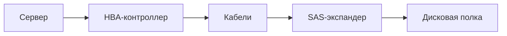

[[Архитектура вычислительных систем]]

# Накопители и дисковые интерфейсы

> [!abstract] Суть
> Устройство носителя, способ подключения и команды управления — разные уровни хранения. Механика HDD и организация NAND объясняют различия задержек, ресурса и параллелизма.

## Задачи Storage и восемь уровней

Storage включает устройства, СХД, DAS/NAS/SAN, абстрагированные и облачные сервисы. Задачи — хранение, требуемая устойчивость к отказам, производительность, версионирование, масштабирование, безопасность и экономическая эффективность. Снапшоты и история изменений реализуются соответствующими средствами системы, а не любым диском автоматически.

| Уровень сверху вниз | Содержание и примеры |
|---|---|
| 1. Прикладные сервисы | Файловые сервисы NAS: SMB, NFS; FTP — передача файлов |
| 2. Подсистема ввода-вывода | API операционной системы |
| 3. Файловая система | ext4, ZFS, NTFS, CephFS |
| 4. Тома | LVM, Storage Spaces |
| 5. Разделы | Разделы блочных устройств |
| 6. Командные механизмы | SCSI, NVMe; AHCI — интерфейс управления SATA-контроллером |
| 7. Подключение и транспорт | SATA, SAS, PCIe, сеть |
| 8. Устройства | HDD, SSD, лента |

Это обобщённая схема. При `open('data.csv').read()` файловый запрос через ОС и файловую систему отображается в обращения к блокам, затем в команды и операции устройства, если данные не получены из кэша. Тома и разделы могут отсутствовать или располагаться иначе, например LVM поверх раздела либо целого диска. Схема показывает функции, а не обязательный порядок любых конфигураций.

## HDD: устройство и адресация

HDD (Hard Disk Drive) содержит магнитные пластины, шпиндельный двигатель, головки чтения/записи для поверхностей, контроллер, обычно энергозависимый кэш, питание и интерфейс. Дорожки — концентрические кольца, разделённые на сектора.

Сектор — единица дисковой адресации. В PDF сравниваются 512 байт и Advanced Format с физическими секторами 4096 байт; логический сектор может отличаться от физического. Кластер относится к файловой системе и состоит из логических секторов. Файловая система переводит операции с файлами и кластерами в блочные запросы; диск получает номера логических блоков, а не номера кластеров файловой системы.

| Параметр | Примеры в PDF и значение |
|---|---|
| Обороты | 4200, 5400, 7200, 10 000, 15 000 об/мин; влияют на ожидание нужного сектора |
| Задержки | Приведён диапазон 2–14 мс; задержка конкретного доступа включает поиск и ожидание вращения |
| Кэш | 8–256 МБ в примерах, помогает буферизации |
| MTBF — Mean Time Between Failures | Пример серверного показателя — около миллиона часов; статистическая характеристика, а не обещанный срок одного диска |
| Ударостойкость | В G, отдельно для работающего и выключенного устройства |
| Другие свойства | Интерфейс, форм-фактор 3,5″/2,5″, шум |

На случайном доступе приходится перемещать головку и ждать поворота пластины. Именно эта механика ограничивает чтение множества мелких фотографий в примере ML-стартапа. В PDF приведены Seagate ST14000DM001 на 14 ТБ и Exos M на 36 ТБ как примеры ёмкости.

## SSD: NAND, страницы и стирание

SSD (Solid-State Drive) содержит энергонезависимую NAND, контроллер, питание, интерфейс и иногда отдельный DRAM-кэш. Движущихся частей нет, поэтому случайный доступ значительно быстрее HDD, но это не делает его равным последовательному по пропускной способности.

NAND делится на блоки стирания и страницы программирования. В PDF приведены условные размеры от 128 КБ на блок и около 4 КБ на страницу; реальная геометрия зависит от чипа. Запись выполняется в подготовленные страницы, стирание — целым блоком. Старую страницу обычно заменяют записью в другую и изменением отображения адресов.

Аналогия источника — тетрадь, написанная ручкой: страницу нельзя просто исправить, её переписывают в другую тетрадь и помечают старую недействительной. Живые страницы затем переносят, а старую тетрадь освобождают целиком.

Garbage Collection переносит действительные страницы и освобождает блоки. TRIM сообщает накопителю, какие логические диапазоны больше не нужны после удаления данных. Без такого уведомления контроллер может продолжать сохранять ненужные страницы. Write amplification — усиление записи: физическая запись NAND больше объёма, присланного пользователем, в том числе из-за переносов.

Файловая система видит блочное устройство, а контроллер переводит логические адреса во внутренние операции. В этом смысле SSD сохраняет знакомую HDD абстракцию диска; NVMe тоже остаётся блочным интерфейсом, хотя лучше приспособлен к параллелизму SSD.

SSD сравнивают по интерфейсу, типу NAND, форм-фактору и толщине, ёмкости, кэшу, MTBF, IOPS, ударостойкости, энергопотреблению, нагреву и ресурсу записи.

## Типы NAND и расчёт ресурса

| Тип | Бит в ячейке | Циклы P/E в примерах PDF | Относительная цена за ГБ |
|---|---|---|---|
| SLC | 1 | около 50 000 | Самая высокая |
| MLC | 2 | около 3000 | Высокая |
| TLC | 3 | около 3000 | Ниже |
| QLC | 4 | около 1000 | Самая низкая |

Большее число бит требует различать больше уровней заряда. Обычно это увеличивает плотность, снижает стоимость гигабайта и усложняет обеспечение ресурса. Значения таблицы — примеры, не фиксированные свойства всех SLC/MLC/TLC/QLC. P/E (Program/Erase) — цикл программирования/стирания. Пример потребительского QLC в источнике — Samsung 870 QVO 8 ТБ.

Упрощённая оценка при равномерном износе:

$$T_{days}=\frac{N_{PE}}{n_{cycles/day}}=\frac{N_{PE}\,C}{W_{day}\,A},$$

где $C$ — ёмкость, $W_{day}$ — пользовательская запись за сутки, $A$ — усиление записи. Для 120 ГБ, 12 ГБ/сутки и $A=10$ физическая запись равна 120 ГБ/сутки — одному полному циклу в сутки. 3000 циклов дают около 3000 дней, то есть 8,2 года, 5000 — около 13,7 года. Это оценка износа, а не гарантия службы: важны и другие отказы. Постоянная серверная запись, например логи и БД, требует внимания к ресурсу, особенно QLC.

## Форм-факторы, ярусы и архивы

M.2 — компактный форм-фактор; в PDF показан вариант длиной около 8 см. Само обозначение M.2 не означает NVMe. E1.S и E1.L семейства EDSFF — серверные форматы с плотным размещением и охлаждением, E1.L в примере около 32 см.

HDD сохраняет смысл благодаря цене за терабайт. Tiering размещает горячие данные на SSD/NVMe, холодные — на HDD, архивы — на ленте. Сравнение «1 ТБ SSD или 8 ТБ HDD за те же деньги» в PDF иллюстрирует ценовой компромисс, а не постоянное соотношение цен.

| Пример из источника | Характеристики и смысл |
|---|---|
| WD Ultrastar Transporter | Перевозимое хранилище 368 ТБ, около 15 кг; Xeon 4310, 12 ядер, 128 ГБ RDIMM, 200GbE и 10GbE; упомянуты FIPS 140-2 и TPM 2.0 |
| AWS Snowmobile | Исторический пример перевозки 100 ПБ грузовиком; в PDF указаны 350 кВт, шифрование, GPS и охрана. Оценка: 10 машин перевозят экзабайт примерно за полгода, тогда как идеальная передача по 10 Гбит/с занимает около 26 лет |
| HPE StoreEver LTO Ultrium | Лента: пример 15 ТБ со сжатием, SAS 6 Гбит/с, 300 МБ/с, AES-256 и до 30 лет хранения при соответствующих условиях |

LTO означает Linear Tape-Open. Сжатая ёмкость зависит от данных. Для ленты характерен последовательный доступ с длительным позиционированием; её достоинства — экономика и долговременное архивирование. Перечень оборудования описывает примеры PDF, а не текущую доступность продуктов.

## SATA и SAS

HDD использует SATA или SAS, исторически также PATA/IDE и параллельный SCSI. SSD бывает SATA, SAS и PCIe/NVMe.

| Свойство | SATA — Serial ATA | SAS — Serial Attached SCSI |
|---|---|---|
| Предшественник | Параллельный ATA/IDE | Параллельный SCSI |
| Поколения в PDF | 1,5 Гбит/с (2003), 3 (2005), 6 (2008) | 3 Гбит/с (2004), 6 (2009), 12 (2013), 22,5, называемое 24G (2017) |
| Передача полезных данных | Ограничения SATA не дают одновременно удваивать поток чтением и записью | Полный дуплекс |
| Организация | Обычно одно устройство на порт | Адресуемые устройства, масштабирование через экспандеры |
| Команды | ATA; AHCI — программный интерфейс контроллера | SCSI |
| Горячее подключение | При поддержке всей конфигурацией | При поддержке всей конфигурацией |
| Совместимость | SATA-диски могут обслуживаться поддерживающими их SAS-контроллерами | SAS-диск не работает на SATA-контроллере |

В PDF указано более 16 384 устройств для SAS и 8/16/32 для разных вариантов старой SCSI-шины. Это характеристики примеров архитектуры; фактические ограничения задаёт оборудование. Разъёмы SAS и SATA отличаются: у SAS на месте промежутка SATA имеется перемычка с контактами. Hot Plug — подключение и отключение без выключения системы при поддержке оборудования и ПО.

Инициатор (initiator) создаёт запросы: HBA (Host Bus Adapter) или программная сущность. Target предоставляет логические блоки, исполняет команды и возвращает результат — отдельный диск либо массив. Service Delivery Subsystem — доставка между ними: кабели и при необходимости экспандеры. Экспандер соединяет множество устройств с инициатором, подобно коммутатору.

## PCIe, NVMe и командные очереди

NVMe (Non-Volatile Memory Express) — семейство спецификаций доступа к энергонезависимой памяти. Локальные NVMe SSD обычно подключаются по PCIe. Интерфейс подключения — путь передачи, командный протокол — правила запросов. AHCI, SCSI и NVMe в таблицах PDF сопоставляются как механизмы управления, но AHCI технически описывает программный интерфейс хост-контроллера.

| Механизм | Очереди и назначение | Сетевая передача |
|---|---|---|
| AHCI/SATA NCQ | До 32 команд на порт; организация возникла для дисков с механическими задержками | Сам AHCI не является сетевым протоколом |
| SCSI | Поддерживает очереди; длина 256 в PDF — пример реализации, не универсальный предел | iSCSI поверх TCP/IP |
| NVMe | Много пар очередей; до 65 535 I/O-пар, до 65 536 элементов в очереди с учётом ограничений реализации | NVMe over TCP и другие транспорты NVMe-oF |

HDD физически ограничен механикой, а SSD способен параллельно обслуживать чипы NAND. Многоочередная модель NVMe уменьшает конкуренцию CPU за общую очередь и позволяет использовать этот параллелизм. Она снижает программные накладные расходы относительно старых путей доступа.

| Примеры накопителей в PDF | Чтение до | Запись до |
|---|---|---|
| PCIe 3.0 x4, обозначено NVMe 1.0/1.3 | 3,5 ГБ/с | 3 ГБ/с |
| PCIe 4.0 x4, обозначено NVMe 1.4 | 7 ГБ/с | 5,5 ГБ/с |
| PCIe 5.0 x4, обозначено NVMe 2.0 | 14 ГБ/с | 10 ГБ/с |

Версия NVMe не определяет обязательное поколение PCIe и скорость накопителя. Это сочетания из исходной таблицы, а не соответствие стандартов один к одному. Для SATA 6 Гбит/с практический потолок потока около 0,6 ГБ/с. Следует различать биты и байты: 1 байт = 8 бит, а полезная скорость также учитывает кодирование и накладные расходы.

SCSI и NVMe не привязаны к одному физическому интерфейсу: передача команд по сети позволяет серверу работать с удалённым блочным устройством. Далее: [[DAS, NAS и SAN]] и [[Производительность дисковой подсистемы]].

## Источник

[[Конспект Архитектура вычислительных систем.pdf]]. Содержание исходного конспекта переработано по темам; формулировки исправлены без добавления новых учебных тем.

Проверка терминов и пределов очередей: [Intel — AHCI](https://www.intel.com/content/www/us/en/io/serial-ata/ahci.html), [NVM Express Base Specification 2.0e](https://nvmexpress.org/wp-content/uploads/NVM-Express-Base-Specification-2.0e-2024.07.29-Ratified.pdf).
