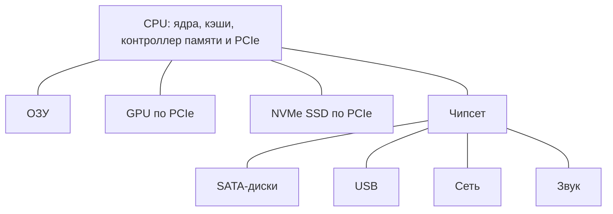

[[Архитектура вычислительных систем]]

# Процессор, память и хранение данных

> [!abstract] Суть
> Вычислительную платформу образуют процессоры, память и ввод-вывод, соединённые шинами. Их организация и характер нагрузки определяют производительность всей системы.

## Развитие вычислительных платформ

| Период | Событие и значение |
|---|---|
| 1945 | Описание архитектуры хранимой программы фон Нейманом: программу можно менять без перестройки оборудования |
| 1947 | Изобретение транзистора — основного элемента современной электроники |
| Середина 1960-х | Развитие больших интегральных схем: множество транзисторов на кристалле |
| Начало 1970-х | Микропроцессор объединяет вычислитель в микросхеме |
| 1980-е | Модульная архитектура IBM PC и развитие совместимых компонентов |

Пять функциональных частей платформы: вычислитель, ОЗУ, ПЗУ, ввод-вывод и шины. Обычная оперативная память энергозависима; постоянная память сохраняет прошивку BIOS/UEFI.

## Принстонская и гарвардская архитектуры

| Свойство | Принстонская, или фон Неймана | Гарвардская |
|---|---|---|
| Команды и данные | Общая память и общий путь доступа в классической модели | Раздельные памяти и пути доступа |
| Преимущество | Гибкое использование общей памяти, возможность обрабатывать код как данные | Параллельное обращение к командам и данным |
| Ограничение | Конкуренция за общий канал — узкое место фон Неймана | Более сложные связи, отдельные ограничения объёмов памяти |

Многие современные CPU сочетают общую основную память с раздельными L1I и L1D — кэшами команд и данных. Это сочетание принципов, а не обязательное устройство любого процессора.

## Модульная система, плата и SoC

Модульная платформа включает один или несколько CPU, материнскую плату, память, диски, блоки питания, GPU, сетевые и дисковые контроллеры и корпус. Плата соединяет компоненты, содержит цепи питания, тактовые генераторы, прошивку, интерфейсы и шины.

Раньше северный мост (Northbridge) связывал CPU с быстрой памятью и графикой AGP/PCIe. Перенос контроллеров памяти и части PCIe в процессор сократил путь и задержки. В источнике переход иллюстрируется Intel Nehalem и AMD Fusion; конкретная история интеграции различается между платформами. Южный мост (Southbridge) обслуживал периферию: SATA, USB, звук, сеть. Его функции выполняет чипсет; названия в примерах — Intel PCH (Platform Controller Hub) и AMD FCH (Fusion Controller Hub).

Схема отражает пример из конспекта; часть PCIe-устройств может подключаться через чипсет.

SoC (System on a Chip) интегрирует процессорные ядра, графику и контроллеры на одном кристалле. Пример — Apple M; упомянутый NVIDIA DGX Spark является системой на основе интегрированной платформы, а не названием отдельного SoC. Интеграция даёт компактность и энергоэффективность, но встроенные блоки нельзя заменить отдельно.

Пример платы в PDF — MSI Z490-A PRO: LGA 1200, Intel Z490, DDR4 без ECC до 128 ГБ, диапазон 2133–4800, шесть SATA 6 Гбит/с, M.2 NVMe, два физических PCIe x16 и три x1, звук Realtek ALC892, сеть Realtek RTL8125. Это характеристики примера из источника; фактические режимы памяти и линий зависят от CPU и конфигурации.

## Три значения архитектуры процессора

1. Подход к организации команд: CISC, RISC, MISC, VLIW.
2. ISA (Instruction Set Architecture): инструкции и архитектурные правила, видимые программе. Примеры — x86-64 (AMD64, Intel 64, ранее EM64T) и ARM64. ARM9, также упомянутое в PDF, — семейство ядер, а не название ISA одного уровня с ARM64.
3. Микроархитектура: конкретная организация конвейера, кэшей и исполнительных блоков, например AMD Zen 4 и Intel Nehalem.

Xeon и EPYC — семейства продуктов, реализующих x86-64. Совместимость набора команд позволяет исполнять один машинный код при наличии требуемых расширений и совместимой программной среды. Для другой ISA обычно нужны перекомпиляция или эмуляция.

## Макрокоманды и микрооперации

Компилятор переводит исходный код в машинный; Python обычно исполняется через интерпретатор, который сам выполняет машинные инструкции. MOV, ADD и JMP — примеры инструкций ISA, называемых в источнике макрокомандами. Одна инструкция может включать обращение к памяти и вычисление.

Современный x86 декодирует инструкции в микрооперации (µops) для АЛУ, блоков загрузки/записи и других исполнительных устройств. Так сложный внешний набор команд сочетается с более простыми внутренними операциями.

| Подход | Расшифровка | Основная идея | Примеры из PDF |
|---|---|---|---|
| CISC | Complex Instruction Set Computer | Богатые команды, в x86 — переменной длины | Intel и AMD x86 |
| RISC | Reduced Instruction Set Computer | Регулярные операции, удобные для конвейера; это не обязательно малое общее число инструкций или строго одна длина | ARM, Apple M, RISC-V |
| MISC | Minimal Instruction Set Computer | Минимальный набор, часто стековая организация | Нишевые и встроенные системы |
| VLIW | Very Long Instruction Word | Длинная команда объединяет параллельные операции, которые планирует компилятор | Эльбрус; Itanium использует родственный подход EPIC |

Современные реализации сочетают разные идеи; по одному названию подхода нельзя определить скорость или энергопотребление.

## Сокеты, ядра и потоки

При одинаковом числе ядер и потоков на каждом сокете:

$$N_{logical}=N_{sockets}\cdot N_{cores/socket}\cdot N_{threads/core}.$$

Два процессора по 16 ядер с двумя потоками на ядро дают 64 логических процессора. Потоки одного ядра делят исполнительные ресурсы; ядра могут делить кэш. Поэтому планировщику нужна топология. В x86 логические процессоры имеют локальные APIC (Advanced Programmable Interrupt Controller) и APIC ID, используемые при адресации прерываний.

| Поле `/proc/cpuinfo` в примере x86 Linux | Значение |
|---|---|
| `processor` | Номер логического процессора |
| `physical id` | Идентификатор физического процессора/сокета |
| `siblings` | Число логических процессоров физического процессора |
| `core id` | Идентификатор ядра внутри него |
| `cpu cores` | Число физических ядер |
| `apicid` | Текущий APIC ID |
| `initial apicid` | Исходный APIC ID |

В однородной конфигурации `siblings = 2 × cpu cores` соответствует двум аппаратным потокам на ядро. `taskset -c 0,1 python train.py` в примере ограничивает процесс логическими CPU 0 и 1; их физическое расположение определяется топологией.

Сокет — разъём CPU. В LGA (Land Grid Array) контакты находятся в сокете, на процессоре — площадки; в PGA (Pin Grid Array) выводы находятся на CPU. Примеры — Intel LGA 1151 и AMD AM4 (PGA). Совпадение сокета необходимо, но само по себе не гарантирует поддержку процессора платой.

## Кэш и локальность

Кэш сокращает ожидание основной памяти. Временная локальность — повторный доступ к недавно использованному, пространственная — к соседним данным. Перенос блоками помогает последовательному обходу массива по сравнению с переходами между разбросанными узлами списка.

| Уровень | Организация в примерах | Размеры из PDF |
|---|---|---|
| L1 | Обычно у каждого ядра; отдельно L1D и L1I | Zen 4: по 32 КБ |
| L2 | Часто у ядра, иногда у группы | Zen 4: 1 МБ на ядро; кластеры Intel E-core: 2–4 МБ |
| L3 | Разделяется группой ядер; не обязательно всеми ядрами сокета | В отдельных EPYC Zen 4 суммарно до 1152 МБ |

Чем ближе уровень к вычислению, тем обычно он меньше и быстрее. Суммарный объём L3 не означает единого одинаково доступного кэша для всех ядер.

## Частота, тепловой режим и конвейер

Частота связана с опорной частотой и множителем. Разблокированный множитель позволяет изменять режим, если платформа это поддерживает. Частота — такты в секунду, а не число полезных операций: важны инструкции за такт, зависимости и ожидание памяти.

TDP (Thermal Design Power) — расчётная тепловая характеристика для проектирования охлаждения в определённых условиях. Это не гарантированная максимальная мощность при любой нагрузке. Для питания и охлаждения стойки нужны соответствующие характеристики оборудования и режимов.

Конвейер перекрывает стадии нескольких инструкций: выборка → декодирование → выполнение → доступ к памяти → запись результата. Аналогия из PDF — заводской конвейер: одна машина красится, следующая сваривается. Предсказатель ветвлений выбирает предполагаемое продолжение после условного перехода; при ошибке спекулятивная работа отменяется, теряются такты.

## Сравнение CPU и экономика

В PDF приведены EPYC, Xeon, Apple M и Cerebras Wafer Scale Engine 3: около 900 тысяч вычислительных ядер, 44 ГБ SRAM, 4 трлн транзисторов и 23 кВт. Это пример специализированного вычислителя масштаба пластины; приведённое в источнике сравнение с тысячей V100 нельзя понимать как универсальную эквивалентность производительности.

Сравнение учитывает класс системы, ядра, частоту, кэш, тепловые характеристики, бенчмарки на нужной задаче и экономику. Упомянутый versus.com — пример сравнительного ресурса в PDF. TCO (Total Cost of Ownership) включает покупку, электричество, охлаждение и обслуживание. ROI (Return on Investment) характеризует отдачу от вложений.

## GPU и CUDA

CPU ориентирован на разнородный код, сложное управление и ветвления; GPU — на массовые однотипные операции над данными, например рендеринг, симуляции и матричные операции машинного обучения. Счёт GPU-ядер нельзя напрямую сравнивать с ядрами CPU.

GPU содержит параллельные исполнительные блоки, включая специализированные тензорные, VRAM (Video RAM), кэши и широкие каналы обмена. CUDA (Compute Unified Device Architecture) — платформа и модель программирования NVIDIA, а не название единственной микроархитектуры GPU.

Иерархия CUDA: grid → thread blocks → threads. Потоки блока могут обмениваться данными через shared memory; физические L1/shared-ресурсы принадлежат исполняющему мультипроцессору, а не навсегда выделяются каждому блоку. L2 разделяется на уровне GPU. В схеме источника у CPU больше площади отведено управлению и кэшу, у GPU — множеству АЛУ.

## Оперативная память

Память характеризуют тип DDR3/4/5, ёмкость, скорость передачи, тайминги, форм-фактор и каналы. DIMM (Dual In-line Memory Module) — полноразмерный модуль, SO-DIMM (Small Outline DIMM) — компактный. UDIMM — небуферизованный модуль; RDIMM (Registered DIMM) содержит регистр командных/адресных сигналов, снижает нагрузку на контроллер и позволяет большие конфигурации. Это не тождественно делению на память с ECC и без него. ECC (Error-Correcting Code) обеспечивает исправление определённых ошибок; типичный вариант исправляет одиночную битовую ошибку.

DRAM организована в строки и столбцы: для доступа активируют строку (RAS), затем выбирают столбец (CAS). Типичная запись таймингов — `16-18-18-38`.

| Тайминг | Смысл |
|---|---|
| CL — CAS Latency | Задержка от команды чтения до начала выдачи данных при нужной открытой строке |
| tRCD — RAS to CAS Delay | Интервал между активацией строки и командой чтения/записи |
| tRP — RAS Precharge | Время предзаряда перед активацией другой строки |
| tRAS — Row Active Time | Минимальное время активности строки до её закрытия |

Тайминги измеряются в тактах. Высокое CL само по себе не доказывает большую задержку в наносекундах: нужно учитывать длительность такта. DDR (Double Data Rate) передаёт данные дважды за такт; приведённые в PDF «МГц» для DDR следует читать как эффективную скорость в MT/s.

| Характеристика | DDR3 | DDR4 | DDR5 |
|---|---|---|---|
| Диапазон из примеров PDF, MT/s | 800–1600 | 2133–3200+ | 4800–8400+ |
| Пропускная способность в приведённых конфигурациях | около 12–15 ГБ/с | около 17–25 ГБ/с | около 38–67+ ГБ/с |
| Напряжение | 1,5 / 1,35 В | 1,2 В | 1,1 В |
| Ёмкости модулей в таблице PDF | до 8 ГБ | до 16–32 ГБ | до 64–128 ГБ |
| Организация данных модуля без учёта ECC | 64 бита | 64 бита | два подканала по 32 бита |
| Предвыборка | 8n | 8n | 16n |

Диапазоны скорости и ёмкости — примеры из конспекта, а не предельные возможности стандартов. Пропускная способность зависит от конкретной скорости и ширины канала. Два канала могут удвоить теоретическую пропускную способность; два модуля по 8 ГБ способны дать больший поток, чем один на 16 ГБ, если размещены в разных каналах. Реальное ускорение зависит от задачи. Память, CPU и плата должны быть совместимы; DDR5 не означает автоматического превосходства любой конфигурации над любой DDR4.

## Корпуса серверов

Tower — отдельно стоящий корпус, используемый в том числе в малых офисах. Rack-mount — исполнение для 19-дюймовой стойки. U (Rack Unit) — единица высоты 44,45 мм; пример типичной стойки — 42U.

## Хранение как часть платформы

Долговременное хранение также влияет на загрузку процессоров. Оно подробно раскрыто в [[Накопители и дисковые интерфейсы]], [[DAS, NAS и SAN]], [[RAID и логические тома]] и [[Производительность дисковой подсистемы]]. DAS предоставляет прямое подключение, NAS — файлы по сети, SAN — блоки по сети. RAID даёт выбранную схему распределения и избыточности; LVM отделяет логическое пространство от физических устройств. Эти механизмы решают разные задачи и не заменяют резервное копирование.

## Источник

[[Конспект Архитектура вычислительных систем.pdf]]. Содержание исходного конспекта переработано по темам; формулировки исправлены без добавления новых учебных тем.

Проверка исправления TDP: [Intel — тепловые характеристики Xeon](https://www.intel.cn/content/dam/www/public/us/en/documents/design-guides/quad-core-xeon-5400-thermal-guide.pdf).
