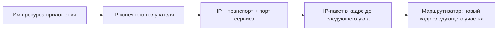

[[Архитектура вычислительных систем]]

# Сетевая адресация и соединение клиента с сервером

 > [!abstract] Суть
> Имя, IP, транспортный порт и MAC отвечают на разные вопросы. Для соединения клиента с сервером нужны две конечные точки: адрес и порт каждой стороны в выбранном транспортном протоколе.

## Адресация на разных уровнях

После [[Сетевой стек, TCP-IP и инкапсуляция]] важно различать адреса, которые читают разные части стека.

| Уровень / представление | Пример со слайда 37 | Назначение |
|---|---|---|
| Прикладные имена и службы имён | `www.ifmo.ru`; DNS, X.500, WINS перечислены в источнике | Имена, понятные приложениям; разные системы разрешения и каталогизации |
| Транспорт TCP/UDP | Порт `443` | Выбор транспортной конечной точки сервиса |
| Межсетевой IP | `192.168.0.103`; `fe80::59e1:d46b:1bb:5169` | Адресация интерфейса и доставка в IP-сети |
| Канальный MAC | `BC:EE:7B:5B:E5:E5` | Адресация интерфейса в канальном сегменте |
| Составные представления | URL; сокет как IP + порт в упрощении лекции | Объединяют несколько элементов адресации |

Уточнение: IP не обязан однозначно обозначать один компьютер навсегда; у узла может быть несколько интерфейсов и адресов. Порт не является постоянным номером процесса: связь с процессами поддерживает ОС, а один сервис способен обслуживать много соединений. TCP-порт 443 и UDP-порт 443 принадлежат разным пространствам транспортных конечных точек.

DNS, X.500 и WINS в таблице источника объединены условно: это разные механизмы именования и каталогов. URL описывает адрес ресурса, включая схему, имя/адрес узла и путь, а при необходимости порт. MAC, IP и имя не взаимозаменяемы.

Дополнительное пояснение: адрес с началом `fe80::` в примере IPv6 относится к локальному каналу; для его использования важно, через какой интерфейс обращаться. Этот пример не следует воспринимать как обычный глобально маршрутизируемый адрес.

## Порты, сокеты и соединение

Сервер заранее начинает слушать известный клиенту адрес и порт. Клиент обычно инициирует соединение, используя собственный временный порт. Слайд упрощённо называет его случайным портом выше 1024; конкретный диапазон и способ выбора зависят от ОС и конфигурации. Серверный порт также не обязан быть меньше 1024.

В модели лекции **сокет** обозначается как `IP:порт`. Дополнительное пояснение: в программировании сокет — объект ОС для обмена; запись IP и порта описывает его сетевую конечную точку. Для различения TCP-соединений используют обе пары адрес/порт в контексте TCP:

$$ (IP_{client},\ port_{client},\ IP_{server},\ port_{server}). $$

Если сравнивать обмен разных транспортов, явно учитывают также транспортный протокол. Два клиента могут подключиться к одному серверному порту: соединения различаются своими клиентскими адресами и/или портами.

## Пример веб-клиента и сервера

Исходные данные со слайдов 38–40: браузер клиента `5.12.46.198`, временный TCP-порт `29384`; веб-сервер `87.250.250.242`, TCP-порт `80`. Адреса сохраняются как значения учебной схемы; обращаться к этим узлам не требуется.

```mermaid
sequenceDiagram
 participant C as Браузер 5.12.46.198:29384
 participant N as Сеть с работающей маршрутизацией
 participant S as Веб-сервер 87.250.250.242:80
 Note over C,S: Адреса настроены; сервер слушает TCP 80
 C->>N: Источник 5.12.46.198:29384, назначение 87.250.250.242:80
 N->>S: Запрос установления TCP-соединения
 S->>N: Источник 87.250.250.242:80, назначение 5.12.46.198:29384
 N->>C: Ответ для клиентской конечной точки
 Note over C,S: После установления соединения передаются данные
```

Это чистое воспроизведение смысла исходных стрелок: у сообщения есть адреса и порты источника и назначения; в ответе они меняются местами. Схема не перечисляет все служебные TCP-сегменты и не заменяет описание полного рукопожатия.

Порядок действий источника:

1. Настроены IP-адреса; предполагается работающая маршрутизация.
2. Программа-сервер занимает и слушает заранее известный TCP-порт.
3. Клиент выбирает свою конечную точку и передаёт стеку адрес/порт сервера.
4. В передаче указываются также адрес/порт отправителя, чтобы получатель мог ответить.
5. Стороны устанавливают соединение и обмениваются прикладными данными.

Наличие IP-маршрута не гарантирует, что сервис слушает нужный порт, а открытый порт не гарантирует правильную обработку прикладного запроса. В [[Распределённая система — сеть, контейнеры и обмен данными]] это различие используется для HTTP-сервиса между узлами и контейнерами.

## Как связаны MAC, IP и порт на пути

Дополнительное пояснение к схемам стека и маршрутизатора: при отправке в удалённую сеть IP указывает конечного получателя, а адрес кадра — следующий узел текущего канального участка. Маршрутизатор извлекает IP-пакет и формирует новый кадр для следующего участка. Порты сохраняют связь с конечными точками приложений в рассматриваемой упрощённой схеме.



Таким образом, TCP/IP связывает адресацию сетевого пути с адресацией конечных точек приложений. Роли устройств подробно: [[Сетевое оборудование — адаптеры, коммутаторы и маршрутизаторы]].

## Источник

[[99 Система/Вложения/Лек 3. Слой NetWork Ч1.pptx]] — слайды 35–42. Исходный пример и его численные адреса сохранены; смысл схем воспроизведён в Mermaid, дополнительные уточнения обозначены отдельно.


Проверка уточнений: [RFC 9293 — TCP, соединение как пара сокетов](https://www.rfc-editor.org/rfc/rfc9293), [RFC 4291 — IPv6 link-local](https://www.rfc-editor.org/rfc/rfc4291).
