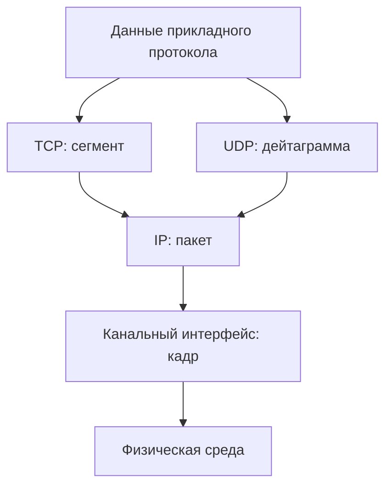

[[Архитектура вычислительных систем]]

# Сетевой стек, TCP-IP и инкапсуляция

> [!abstract] Суть
> Сетевой стек разделяет передачу данных на задачи. Прикладной протокол определяет смысл обмена, транспорт связывает конечные точки приложений, IP обеспечивает передачу между сетями, а нижние уровни — по конкретному каналу.

## Задачи сетевого слоя инфраструктуры

Networking предоставляет соединение, маршрутизацию и средства безопасности передачи данных. В этот слой входят сетевое оборудование, программные стеки протоколов и SDN — программно определяемая сеть. Место сети среди девяти слоёв инфраструктуры разобрано в [[Инфраструктура как система слоёв]].

В одном сеансе взаимодействуют разные компьютеры и ОС, приложения, типы оборудования и административные области. Нельзя требовать, чтобы весь путь состоял из устройств одного производителя. Стандартизованные интерфейсы позволяют заменять отдельные компоненты и соединять разнородные реализации. Альтернатива, обсуждаемая в лекции, — единое монолитное проприетарное решение, в котором совместимость обеспечивается внутри одного продукта.

**Сетевой стек** — упорядоченный набор взаимодействующих протоколов, обеспечивающий обмен между двумя и более системами, а также между приложениями на одном компьютере. **Уровень** объединяет протоколы, решающие определённую подзадачу. **Протокол** задаёт соглашения о формате и правилах обмена; интерфейс между соседними уровнями определяет, как пользоваться услугой нижнего уровня.

Дополнительное пояснение: отправитель проходит стек сверху вниз, получатель — снизу вверх. Логически одноимённые протоколы общаются друг с другом, но физически их данные проходят через нижние уровни.

## Локальная и составная сеть

В модели лекции локальная сеть объединяет узлы общим канальным протоколом; передача внутри одного канального сегмента не требует IP-маршрутизации. Составная сеть соединяет такие сети маршрутизаторами. Один сеанс может проходить через разные канальные технологии.

| Задача | Локальная передача | Передача через составную сеть |
|---|---|---|
| Адресация | Найти интерфейс в канальном сегменте | Указать сеть и адрес назначения |
| Совместный доступ | Разделить среду или канальные ресурсы | Разделить ресурсы на всём пути |
| Доставка | Обнаруживать ошибки и при необходимости восстанавливать передачу средствами соответствующих протоколов | Обеспечить нужные свойства сквозного обмена |
| Выбор пути | Передать кадр в сегменте | Маршрутизировать через несколько сетей |
| Дополнительные требования | Зависят от технологии | Качество обслуживания (QoS), безопасность |

Уточнение: «локальная» не означает обязательное отсутствие маршрутизаторов во всей сети организации. Здесь речь о передаче внутри конкретного канального сегмента. Надёжность также не возникает автоматически из факта локальности: её гарантии задаёт используемый протокол.

Лекция выделяет прикладные протоколы, мультиплексирование приложений, надёжность, межсетевой обмен, интерфейсы оборудования, само оборудование и каналы. Несколько таких функций могут входить в один уровень выбранной модели.

## TCP/IP и сопоставление с OSI

TCP/IP — открытое, независимое от конкретной аппаратной платформы семейство сетевых протоколов. TCP расшифровывается как Transmission Control Protocol, IP — Internet Protocol. Название семейства не означает, что каждый обмен обязательно использует TCP: в нём есть и UDP.

| Модель TCP/IP | Соответствующие уровни OSI | Назначение |
|---|---|---|
| Application — прикладной | 7. Прикладной, 6. Представления, 5. Сеансовый | Смысл сообщений и правила прикладного обмена |
| Transport — транспортный | 4. Транспортный | Обмен конечных точек приложений, мультиплексирование по портам |
| Internet — межсетевой | 3. Сетевой | IP-адресация и передача пакетов между сетями |
| Network Access — доступ к сети | 2. Канальный, 1. Физический | Кадры, интерфейсы, среда и передача сигналов |

![[99 Система/Вложения/АВС — сеть и хранение 2026/avs-network-017-image18.png|720]]

Исходная схема со слайда 17: семь уровней OSI сопоставлены четырём TCP/IP. Протоколы справа показывают примеры размещения функций, а не полный перечень допустимых сочетаний.

На рисунке над TCP находятся Telnet/SSH, FTP/SFTP/SCP, SMTP/POP3/IMAP, HTTP/HTTPS и BGP; над UDP — DNS, SNMP, Syslog, NTP, WINS, RIP/RIPv2/RIPng. У IP показаны ICMP и IGMP, на границе с доступом — ARP и исторический RARP. Среди нижних технологий перечислены Ethernet, Token Ring, Frame Relay, ATM, SONET, SDH, PDH, CDMA и GSM.

Уточнение к рисунку: это учебное сопоставление, включающее исторические технологии. DNS использует и UDP, и TCP; способ передачи конкретного приложения определяется его версией и режимом. Прямоугольники разных моделей не являются строгим доказательством одинаковых границ всех реализаций.

## Инкапсуляция и единицы передачи

![[99 Система/Вложения/АВС — сеть и хранение 2026/avs-network-018-image19.jpeg|720]]

Исходная схема со слайда 18, повторённая на слайде 36. Прикладные данные передаются TCP либо UDP, затем IP и канальному интерфейсу. Подписи «сегмент», «дейтаграмма», «пакет» и «кадр» относятся к разным уровням.

**Инкапсуляция** — помещение данных верхнего уровня в единицу передачи нижнего уровня с его служебной информацией. Для TCP это сегмент, для UDP — дейтаграмма; IP несёт их в пакете (IP-дейтаграмме), а канальная технология — в кадре, или фрейме. На получателе выполняется обратное извлечение.

Дополнительное пояснение: вложение служебной информации не означает, что каждый прикладной запрос станет ровно одним пакетом. Стек может разделять данные на несколько единиц передачи; приёмная сторона собирает нужное представление.

## Дейтаграммы и соединения

| Подход | Свойство | Протоколы из лекции |
|---|---|---|
| Дейтаграммный | Отдельные сообщения передаются без предварительного установления соединения этим протоколом | IP, UDP |
| С установлением соединения | До обмена поддерживается состояние соединения между сторонами | TCP |

Дополнительное пояснение: TCP предоставляет приложению упорядоченный поток байтов с механизмами надёжной доставки. UDP сохраняет границы дейтаграмм, но сам не обеспечивает повторную передачу и упорядочивание. Прикладной протокол может реализовать нужные механизмы поверх UDP; поэтому «UDP» не означает обязательную ненадёжность всей прикладной системы.

На слайде 19 приведено сочетание «HTTP/2 + QUIC + UDP». **Уточнение ошибки источника:** HTTP поверх QUIC стандартизован как **HTTP/3**; типичный стек — HTTP/3 → QUIC → UDP → IP. HTTP/2 в обычном применении работает поверх TLS/TCP. QUIC обеспечивает надёжные потоки поверх UDP, поэтому противопоставлять все протоколы над UDP соединениям нельзя. См. [RFC 9114 — HTTP/3](https://www.rfc-editor.org/rfc/rfc9114).

Далее: [[Сетевое оборудование — адаптеры, коммутаторы и маршрутизаторы]] и [[Сетевая адресация и соединение клиента с сервером]]. Пример использования сети приложениями — [[Распределённая система — сеть, контейнеры и обмен данными]].

## Источники

[[99 Система/Вложения/Лек 3. Слой NetWork Ч1.pptx]] — Artem Beresnev, «Лекция 3. Сетевой слой. Часть 1», слайды 1–21, 36, 42. Объяснения инкапсуляции и границ гарантий развёрнуты для понимания; уточнения источника обозначены в тексте.
