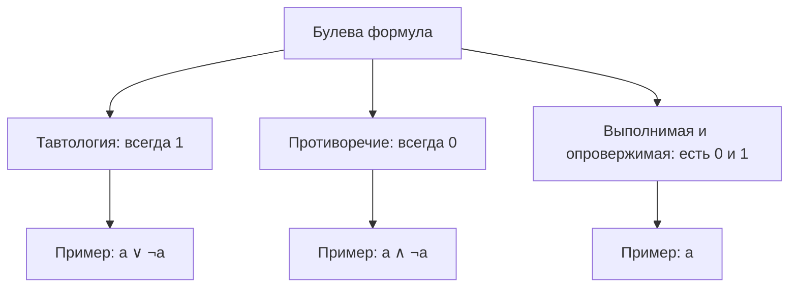

[[Дискретная математика]]

# Булевы функции и логические законы

Булева функция сопоставляет набору нулей и единиц один бит. Таблица истинности задаёт её полностью, а логические законы позволяют менять формулу без изменения функции.

## Высказывания и таблицы

Высказывание имеет одно из значений: истинно ($1$, true) или ложно ($0$, false). Простые высказывания обозначаются переменными; сложные строятся операциями.

$$f:\{0,1\}^n\to\{0,1\}.$$

Наборы располагаем лексикографически: $00\ldots0,00\ldots1,\ldots,11\ldots1$. Вектор функции — значения в этом порядке. При $n=1$ существуют четыре функции: $0,x,\overline x,1$.

**Теорема и доказательство из лекции.** Число функций от $n$ переменных равно $2^{2^n}$. В таблице $2^n$ строк; в каждой независимо выбирается одно из двух значений. При $n=2$ функций $16$, при $n=3$ — $256$.

Диаграмма Венна изображает наборы принадлежностей двух множеств: внешняя область — $00$, только первый круг — $10$, только второй — $01$, пересечение — $11$.

### Четыре унарные функции и виды формул

Таблица из IMG_4071 перечисляет все $2^{2^1}=4$ функции одного аргумента:

| $x$ | $x$ | $\neg x$ | $0$ | $1$ |
| --- | --- | --- | --- | --- |
| 0 | 0 | 1 | 0 | 1 |
| 1 | 1 | 0 | 0 | 1 |

Значения true, T и 1 обозначают истину; false, F и 0 — ложь. Буквы $a,b,c$ представляют простые высказывания, а, например, $(a\land b)\lor c$ — составное.

По значениям на **всех** наборах формулы делятся на три вида (схема IMG_4073):

Последняя ветвь в рукописи названа обычной булевой функцией; все три ветви являются булевыми функциями, различается только постоянство значения.

## Операции

| $a$ | $b$ | $a\land b$ | $a\lor b$ | $a\to b$ | $a\leftrightarrow b$ | $a\oplus b$ | $a\mid b$ | $a\downarrow b$ | $a\land\overline b$ |
| --- | --- | --- | --- | --- | --- | --- | --- | --- | --- |
| 0 | 0 | 0 | 0 | 1 | 1 | 0 | 1 | 1 | 0 |
| 0 | 1 | 0 | 1 | 1 | 0 | 1 | 1 | 0 | 0 |
| 1 | 0 | 0 | 1 | 0 | 0 | 1 | 1 | 0 | 1 |
| 1 | 1 | 1 | 1 | 1 | 1 | 0 | 0 | 0 | 0 |

$\overline a=1-a$. Конъюнкция истинна, когда истинны оба операнда; дизъюнкция — когда истинен хотя бы один. Импликация ложна только для $1\to0$, $a\to b=\overline a\lor b$. Эквивалентность означает совпадение значений. XOR, сложение по модулю 2, истинно при различных значениях: $0\oplus0=1\oplus1=0$, $0\oplus1=1\oplus0=1$.

Штрих Шеффера $a\mid b=\overline{a\land b}$, стрелка Пирса $a\downarrow b=\overline{a\lor b}$, логическая разность $a-b=\overline{a\to b}=a\land\overline b$. Формулы эквивалентны, если совпадают на каждом наборе. Не следует смешивать эквивалентность формул и бинарную операцию, хотя для последней равенство функций проверяется той же таблицей.

Приоритет в источниках: скобки, отрицание, $\land$, $\lor$, затем $\to,\leftrightarrow$. Для XOR и смешанных импликаций неоднозначность лучше устранять скобками.

### Операции на диаграммах Венна

![[99 Система/Вложения/Дискретная математика/Схемы/Булева алгебра — диаграммы Венна.png]]

Чистое воспроизведение схем IMG_4071–IMG_4072. В каждом прямоугольнике задано всё множество возможных исходов; круги $A,B$ показывают истинность $a,b$. Четыре области подписаны битами $ab$. Синие области и точки соответствуют значению 1. Конъюнкция выбирает только $11$, дизъюнкция — $10,11,01$, импликация — $00,01,11$, эквивалентность — $00,11$. Внешняя область существенна: точка вне обоих кругов означает набор $00$, а не отсутствие значения.

Из таблицы также получаем $a\oplus b=a\overline b\lor\overline a b$; разность $a-b$ — отрицание импликации и выбирает только область $10$.

## Законы

$$\overline{\overline a}=a,\qquad aa=a,\qquad a\lor a=a;$$
$$ab=ba,\quad a\lor b=b\lor a;\qquad a(bc)=(ab)c,\quad a\lor(b\lor c)=(a\lor b)\lor c;$$
$$a(b\lor c)=ab\lor ac,\qquad a\lor bc=(a\lor b)(a\lor c);$$
$$a\overline a=0,\quad a\lor\overline a=1,\quad a\lor0=a,\quad a1=a,\quad a0=0,\quad a\lor1=1;$$
$$\overline{a\lor b}=\overline a\,\overline b,\qquad\overline{ab}=\overline a\lor\overline b;$$
$$a\lor ab=a,\qquad a(a\lor b)=a;$$
$$(a\lor\overline b)(a\lor b)=a,\qquad\overline a\,b\lor ab=b.$$

**Уточнение источника.** В последней формуле склеивания в лекции справа написано $a$. Для левой части $\overline a b\lor ab$ результат $b$, поскольку $b(\overline a\lor a)=b$. Формула $a\overline b\lor ab=a$ тоже верна, но имеет другую левую часть.

Проверка двойного отрицания даёт $0\mapsto1\mapsto0$, $1\mapsto0\mapsto1$. Для первого закона де Моргана значения $\overline{a\lor b}$ и $\overline a\,\overline b$ по строкам $00,01,10,11$ равны $1,0,0,0$. Это сохранённые табличные доказательства лекции.

### Склеивание и XOR

Два доказательства склеивания из IMG_4073 используют дистрибутивность и дополнение:

$$(a\lor\overline b)(a\lor b)=a\lor(\overline b\land b)=a\lor0=a,$$
$$ab\lor a\overline b=a(b\lor\overline b)=a\cdot1=a.$$

Для XOR также верны коммутативность и ассоциативность: $a\oplus b=b\oplus a$, $(a\oplus b)\oplus c=a\oplus(b\oplus c)$. В отличие от дизъюнкции, $a\oplus a=0$, поэтому при преобразовании полиномов одинаковые слагаемые сокращаются, а не склеиваются в одно.

## Существенные и фиктивные переменные

Переменная $x_i$ фиктивна, если изменение только её значения никогда не меняет $f$; иначе существенна. Формально

$$f(x_1,\ldots,0,\ldots,x_n)=f(x_1,\ldots,1,\ldots,x_n)$$

для всех значений остальных координат. Вектор $01011010$ задаёт $x\oplus z$ как функцию $(x,y,z)$: пары строк с разными $y$ совпадают, а изменение $x$ или $z$ меняет результат.

## Подстановка функций

Пример практики:

$$f_1=(10010111),\quad f_2=(01101011),\qquad h(x,y)=f_2(y,y,f_1(x,y,x)).$$

Для $xy=00,01,10,11$ внутренние значения соответственно $f_1(000)=1$, $f_1(010)=0$, $f_1(101)=1$, $f_1(111)=1$. Внешние наборы $001,110,001,111$ все дают $f_2=1$, поэтому $h=(1111)$.

В другом разобранном выражении практики

$$f=\overline{x\to y}\land\bigl(x\lor\overline{\overline y\oplus z}\bigr)$$

получен вектор $00001100$. Первый множитель равен $x\overline y$. Когда он равен 1, имеем $x=1$, поэтому скобка тоже равна 1; в остальных случаях всё произведение равно 0. Следовательно, $f=x\overline y$. Это объясняет табличный результат без потери границ отрицаний.

### Суперпозиция с вектором 1110

На IMG_4077 задан другой пример:

$$f_1=(10011100),\quad f_2=(01101101),\quad
h(x,y)=f_1(x,y,f_2(x,y,x)).$$

Сначала вычисляется внутренняя функция; затем её результат становится третьим аргументом внешней:

| $xy$ | Вход $f_2$ | $f_2(x,y,x)$ | Вход $f_1$ | $h$ |
| --- | --- | --- | --- | --- |
| 00 | 000 | 0 | 000 | 1 |
| 01 | 010 | 1 | 011 | 1 |
| 10 | 101 | 1 | 101 | 1 |
| 11 | 111 | 1 | 111 | 0 |

Итак, $h=(1110)=\overline{xy}=x\mid y$. **Уточнение источника:** возле ответа смешаны дизъюнкция и название стрелки Пирса. Полученная таблица задаёт именно штрих Шеффера; у дизъюнкции вектор $0111$, у стрелки Пирса — $1000$.

### Пример тождественного преобразования в тавтологию

В практике рассматривается

$$((a\oplus b)\downarrow(a\oplus c))\to((a\downarrow c)\leftrightarrow(b\mid c)).$$

Левая часть импликации равна $\overline{a\oplus b}\,\overline{a\oplus c}$ и истинна ровно при $a=b=c$. Правую часть раскрываем через $P\leftrightarrow Q=PQ\lor\overline P\,\overline Q$:

$$(\overline a\overline c)(\overline b\lor\overline c)\lor(a\lor c)bc=\overline a\overline c\lor bc.$$

При $a=b=c=0$ первый член равен 1, при $a=b=c=1$ второй равен 1. На остальных наборах антецедент ложен, поэтому вся импликация также истинна. Получается константа 1. Это раскрывает завершение длинной цепочки де Моргана на скане: одинаковый символ XOR в двух частях антецедента нельзя заменять эквивалентностью.

## Источники

- [[99 Система/Вложения/Дискретная математика/БА лекции.pdf|БА лекции.pdf]]
- [[99 Система/Вложения/Дискретная математика/Дискра (комб) практика_261015_092730.pdf|Дискра (комб) практика_261015_092730.pdf]]
- [[99 Система/Вложения/Дискретная математика/IMG_3923.HEIC|IMG_3923.HEIC]]
- [[99 Система/Вложения/Дискретная математика/IMG_3924.HEIC|IMG_3924.HEIC]]
- [[99 Система/Вложения/Дискретная математика/IMG_3925.HEIC|IMG_3925.HEIC]]
- [[99 Система/Вложения/Дискретная математика/IMG_3926.HEIC|IMG_3926.HEIC]]
- [[99 Система/Вложения/Дискретная математика/IMG_3927.HEIC|IMG_3927.HEIC]]

- [[99 Система/Вложения/Дискретная математика/IMG_4071.HEIC|IMG_4071.HEIC]]
- [[99 Система/Вложения/Дискретная математика/IMG_4072.HEIC|IMG_4072.HEIC]]
- [[99 Система/Вложения/Дискретная математика/IMG_4073.HEIC|IMG_4073.HEIC]]
- [[99 Система/Вложения/Дискретная математика/IMG_4077.HEIC|IMG_4077.HEIC]]
