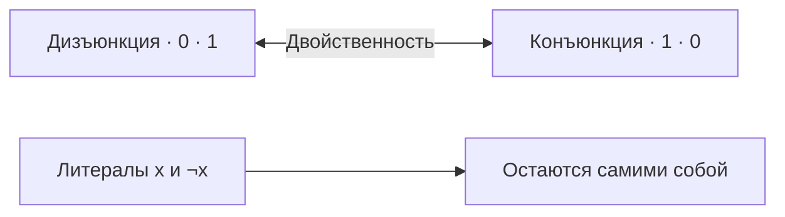
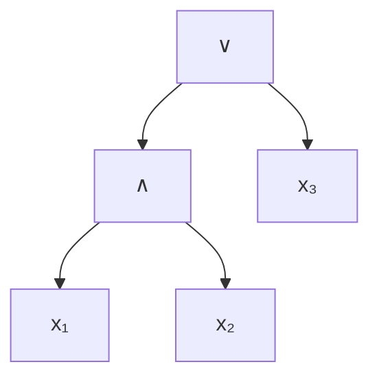

[[Дискретная математика]]

# Двойственность булевых функций

Двойственность одновременно меняет все входные биты и выход. Она переносит тождества и способы построения формул на двойственные операции.

## Определение

$$f^*(x_1,\ldots,x_n)=\overline{f(\overline{x_1},\ldots,\overline{x_n})}.$$

Повторное применение даёт $f^{**}=f$. Двойственные пары: $0^*=1$, $1^*=0$, $(x\land y)^*=x\lor y$, $(x\lor y)^*=x\land y$. Проекция $x$ и отрицание $\overline x$ самодвойственны. Например,

$$(x\lor y)^*=\overline{\overline x\lor\overline y}=xy.$$

Самодвойственная функция удовлетворяет $f=f^*$, то есть на противоположных наборах принимает противоположные значения.

### Парные тождества

Стрелка между законами поглощения на IMG_4078 означает переход к двойственному тождеству:

| Исходное тождество | Двойственное тождество |
| --- | --- |
| $a\lor ab=a$ | $a(a\lor b)=a$ |
| $a\lor0=a$ | $a\land1=a$ |
| $a\lor\overline a=1$ | $a\land\overline a=0$ |

Литералы сохраняются, а константы $0,1$ меняются местами. Это объясняет, почему для каждого исходного равенства получается равенство функций, а не просто похожая запись.

## Двойственность суперпозиции

Если $\varphi(x)=f(f_1(x),\ldots,f_k(x))$, то

$$\varphi^*(x)=f^*(f_1^*(x),\ldots,f_k^*(x)).$$

**Доказательство из лекции, с раскрытыми подстановками.**

$$\varphi^*(x)=\overline{f(f_1(\overline x),\ldots,f_k(\overline x))}.$$

По определению $f_i(\overline x)=\overline{f_i^*(x)}$. Поэтому правая часть есть

$$\overline{f(\overline{f_1^*(x)},\ldots,\overline{f_k^*(x)})}=f^*(f_1^*(x),\ldots,f_k^*(x)).$$

### Дерево формулы и суперпозиция

В записи $h(x)=f(g_1(x),\ldots,g_k(x))$ число внутренних функций совпадает с числом аргументов $f$. Пример IMG_4079: $f(u,v)=u\lor v$, $g_1=x_1x_2$, $g_2=x_3$ дают $h=(x_1x_2)\lor x_3$.

Листья — переменные; каждый внутренний узел применяет операцию к значениям дочерних узлов. Формально переменная является формулой; если $f$ — разрешённая $k$-местная операция и $\Phi_1,\ldots,\Phi_k$ — формулы, то $f(\Phi_1,\ldots,\Phi_k)$ — формула. На этом рекурсивном определении основана следующая структурная индукция (IMG_4079–IMG_4080).

## Принцип двойственности формул

Пусть $F=\{f_1,\ldots,f_m\}$ — базис разрешённых операций. Формула строится из переменных применением этих операций к уже построенным формулам. Если формула $\Phi$ над $F$ реализует $f$, заменим в ней каждую операцию $f_i$ на $f_i^*$, получая $\Phi^*$ над $F^*$. Тогда $\Phi^*$ реализует $f^*$.

**Структурная индукция из рукописи.** Для переменной утверждение верно, поскольку проекция самодвойственна; для одного применения базисной операции — по определению. Если оно доказано для подформул, то для формулы, полученной применением очередной операции, используется доказанная выше двойственность суперпозиции. Конечное дерево формулы исчерпывается таким переходом от листьев к корню.

Отсюда $\Phi_1=\Phi_2\iff\Phi_1^*=\Phi_2^*$. Обратное направление следует применением двойственности второй раз.

**Промежуточное пояснение к индукции рукописи.** Обычная индукция использует базу $P(1)$ и переход $\forall n(P(n)\Rightarrow P(n+1))$. В дереве формулы аналог базы — листья, аналог перехода — вывод свойства узла из свойства всех его непосредственных подформул. Запись без квантора перед переходом была бы неполной.

Законы де Моргана — частный случай обмена конъюнкции и дизъюнкции при отрицании; двойственность объясняет парность многих логических законов и перенос доказательства СДНФ на СКНФ.

## Источники

- [[99 Система/Вложения/Дискретная математика/БА лекции.pdf|БА лекции.pdf]]
- [[99 Система/Вложения/Дискретная математика/IMG_3928.HEIC|IMG_3928.HEIC]]
- [[99 Система/Вложения/Дискретная математика/IMG_3929.HEIC|IMG_3929.HEIC]]
- [[99 Система/Вложения/Дискретная математика/IMG_3930.HEIC|IMG_3930.HEIC]]

- [[99 Система/Вложения/Дискретная математика/IMG_4077.HEIC|IMG_4077.HEIC]]
- [[99 Система/Вложения/Дискретная математика/IMG_4078.HEIC|IMG_4078.HEIC]]
- [[99 Система/Вложения/Дискретная математика/IMG_4079.HEIC|IMG_4079.HEIC]]
- [[99 Система/Вложения/Дискретная математика/IMG_4080.HEIC|IMG_4080.HEIC]]
