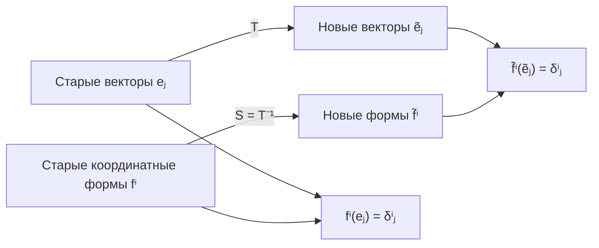

# Замена базиса и преобразование координат

[[10 Учёба/Линейная алгебра/Линейная алгебра|Линейная алгебра]]

**Меняются базис и числа в записи, а сам вектор остаётся прежним.** Если новый базисный вектор вдвое длиннее старого, то для той же стрелки нужно вдвое меньше его копий. Поэтому базис и координаты меняются в противоположных направлениях.

Сначала разберём это на числах, затем выведем формулы преподавателя и только после этого сократим суммы индексами. Нужные понятия: [[Линейные формы и сопряжённое пространство|форма и сопряжённый базис]]. Всюду $X$ — пространство размерности $n<\infty$ над полем $k$.

## Дополнительный разобранный пример

Пусть в $\mathbb R^2$ старый базис — $e_1=(1,0)$, $e_2=(0,1)$. Выберем новый:

$$\widetilde e_1=e_1+e_2=(1,1),\qquad\widetilde e_2=e_2=(0,1).$$

Вектор $x=(2,3)$ раньше записывался как $2e_1+3e_2$. В новом базисе надо найти числа $a,b$, для которых

$$a(1,1)+b(0,1)=(a,a+b)=(2,3).$$

Отсюда $a=2$, $b=1$. Получили **две записи одного вектора**:

$$x=2e_1+3e_2=2\widetilde e_1+\widetilde e_2.$$

![[Замена базиса — один вектор в двух базисах.png]]

Красная стрелка одна и та же. Слева нужны две копии $e_1$ и три $e_2$. Справа две копии наклонённого $\widetilde e_1$ уже дают $(2,2)$, поэтому остаётся добавить только одну $\widetilde e_2$. Пунктир показывает слагаемые, а не движение вектора.

Теперь сравним **одну и ту же форму** $f(x)=4x^1+5x^2$ из предыдущей темы. На новых базисных векторах она даёт

$$f(\widetilde e_1)=f(1,1)=9,\qquad f(\widetilde e_2)=f(0,1)=5.$$

Поэтому через новые координаты $a,b$ её формула — $9a+5b$. Для нашего вектора:

$$4\cdot2+5\cdot3=23=9\cdot2+5\cdot1.$$

Координаты вектора стали $(2,1)$, коэффициенты формы — $(9,5)$, но значение осталось $23$. Ниже выведем, как получать такие числа матрично.

## Матрица перехода и её обратимость

Каждый новый базисный вектор раскладывается по старым:

$$\widetilde e_j=\sum_{i=1}^n e_i\tau^i_j.$$

**Матрица перехода $T=(\tau^i_j)$ составлена из этих столбцов.** Индекс $j$ выбирает новый вектор, индекс $i$ — его координату в старом базисе. То есть $\tau^i_j$ стоит в строке $i$, столбце $j$.

В нашем примере первый столбец — $(1,1)^T$, второй — $(0,1)^T$:

$$T=\begin{pmatrix}1&0\\1&1\end{pmatrix}.$$

Обозначим ряд базисных векторов $E=(e_1,\ldots,e_n)$, новый ряд — $\widetilde E$. Тогда все разложения объединяются в одну запись:

$$\boxed{\widetilde E=ET.}$$

$E$ здесь — ряд **векторов**, а не обозначение единичной числовой матрицы. Произведение означает линейные комбинации этих векторов. В соглашении преподавателя $T$ называется переходом **от старого базиса к новому**, потому что выражает новые базисные векторы через старые. Координаты произвольного вектора она преобразует в обратную сторону — это сейчас будет выведено.

**Лемма 7.1.** $T$ обратима, то есть $\det T\ne0$.

**Доказательство с промежуточными шагами.** Пусть $Tc=0$. Тогда

$$\widetilde E c=ETc=0.$$

Левая часть — комбинация **новых** базисных векторов с коэффициентами столбца $c$. Они независимы, поэтому $c=0$. Таким образом, ядро квадратной $T$ нулевое, её столбцы независимы, ранг равен $n$, а матрица обратима. В краткой строке PDF упомянута лишь независимость старого базиса; для этого вывода существенна независимость нового.

Введём обозначение обратной матрицы:

$$S=T^{-1}=(\sigma^i_j),\qquad TS=ST=I.$$

Умножение $\widetilde E=ET$ справа на $S$ даёт $E=\widetilde ES$. Это обратный переход; обратная матрица единственна. В числовом примере

$$S=\begin{pmatrix}1&0\\-1&1\end{pmatrix}.$$

### Проверка через взаимно сопряжённые базисы

Рукопись проверяет тот же результат через формы. Пусть $f^i$ сопряжены старым $e_j$, а $\widetilde f^{\,l}$ — новым $\widetilde e_k$. Запишем пока неизвестные коэффициенты новых форм:

$$\widetilde f^{\,l}=\sum_i a^l_i f^i.$$

По определению сопряжённости $\widetilde f^{\,l}(\widetilde e_k)=\delta^l_k$. Подставляя оба разложения, получаем

$$\delta^l_k=\sum_i\sum_j a^l_i\tau^j_k f^i(e_j)
=\sum_i\sum_j a^l_i\tau^j_k\delta^i_j
=\sum_i a^l_i\tau^i_k.$$

Для $A=(a^l_i)$ это $AT=I$. Поэтому $\det A\det T=1$, откуда $\det T\ne0$ и $A=S$. Используется известное $\det(AB)=\det A\det B$ для квадратных матриц одного порядка; подробнее — [[Определители и разложения по минорам]].

### Схема согласования двух базисов

Дополнительная схема передаёт смысл рукописи: новые формы должны различать новые векторы так же, как старые формы различали старые. Именно требование сопряжённости приводит к обратной матрице. На фотографии встречается $TS=I$; в наших строках и столбцах сначала получилось $AT=I$. После установления обратимости верны оба порядка произведения.

## Преобразование координат вектора

Обозначим старый координатный столбец через $\xi$, новый — через $\widetilde\xi$. Сам вектор имеет два разложения:

$$x=E\xi=\widetilde E\widetilde\xi=ET\widetilde\xi.$$

Единственность координат в старом базисе даёт $\xi=T\widetilde\xi$. Решаем это равенство относительно новых координат:

$$\boxed{\widetilde\xi=S\xi=T^{-1}\xi.}$$

Это **теорема 7.2**. Обратная матрица возникла потому, что мы решали уравнение $T\widetilde\xi=\xi$, а не потому, что координаты обязаны запоминаться по отдельному правилу.

В примере

$$\widetilde\xi=\begin{pmatrix}1&0\\-1&1\end{pmatrix}\binom23=\binom21.$$

### Один объект и две координатные записи

Это дополнительная схема. Она показывает, что координатный столбец и вектор — разные объекты. Сравнивать $\xi$ и $\widetilde\xi$ можно лишь с учётом базисов, в которых они записаны.

## Преобразование сопряжённого базиса

Новая форма $\widetilde f^{\,l}$ должна извлекать $l$-ю **новую** координату. Раз $\widetilde\xi=S\xi$, эта форма складывает старые координаты с коэффициентами строки $l$ матрицы $S$.

**Теорема 7.1:**

$$\boxed{\widetilde f^{\,l}=\sum_i\sigma^l_i f^i.}$$

**Доказательство преподавателя, раскрытое по действиям.** В разложении $\widetilde f^{\,l}=\sum_i\alpha^l_i f^i$ коэффициенты пока неизвестны. Подставим новый базисный вектор:

$$\begin{aligned}
\delta^l_k&=\widetilde f^{\,l}(\widetilde e_k)\\
&=\left(\sum_i\alpha^l_i f^i\right)\left(\sum_j e_j\tau^j_k\right)\\
&=\sum_i\sum_j\alpha^l_i\tau^j_k f^i(e_j)\\
&=\sum_i\sum_j\alpha^l_i\tau^j_k\delta^i_j
=\sum_i\alpha^l_i\tau^i_k.
\end{aligned}$$

Последняя сумма — элемент $(l,k)$ произведения $AT$. Поэтому $AT=I$, $A=S$ и $\alpha^l_i=\sigma^l_i$, что и требовалось.

Если формы собраны **столбцом** $F=(f^1,\ldots,f^n)^T$, получаем $\widetilde F=SF$. Например,

$$\widetilde f^{\,1}=f^1,\qquad\widetilde f^{\,2}=-f^1+f^2.$$

Первая новая координата нашего вектора — старая первая, вторая — старая вторая минус старая первая. Проверка на новых векторах даёт таблицу $\widetilde f^{\,i}(\widetilde e_j)=\delta^i_j$.

**Доказательство теоремы 7.2 через формы из лекции.** Оно даёт ту же формулу координат другим способом:

$$\begin{aligned}
\widetilde\xi^k&=\widetilde f^{\,k}(x)
=\left(\sum_i\sigma^k_i f^i\right)\left(\sum_j e_j\xi^j\right)\\
&=\sum_i\sum_j\sigma^k_i\xi^j f^i(e_j)
=\sum_i\sum_j\sigma^k_i\xi^j\delta^i_j
=\sum_j\sigma^k_j\xi^j.
\end{aligned}$$

## Преобразование координат формы

Пусть сама форма обозначена $y\in X^*$. Её старые коэффициенты — $\eta_i=y(e_i)$, новые — $\widetilde\eta_j=y(\widetilde e_j)$. Запишем их **строками** $\eta,\widetilde\eta$.

Нужно просто вычислить ту же форму на новых базисных векторах:

$$\widetilde\eta_j=y\left(\sum_i e_i\tau^i_j\right)
=\sum_i y(e_i)\tau^i_j=\sum_i\eta_i\tau^i_j.$$

Получили **теорему 7.3**:

$$\boxed{\widetilde\eta=\eta T.}$$

**Полная подстановка через сопряжённый базис, как в доказательстве преподавателя.** Из $y=\sum_i\eta_i f^i$:

$$\widetilde\eta_l=\left(\sum_i\eta_i f^i\right)\left(\sum_j e_j\tau^j_l\right)
=\sum_i\sum_j\eta_i\tau^j_l f^i(e_j)
=\sum_i\sum_j\eta_i\tau^j_l\delta^i_j
=\sum_i\eta_i\tau^i_l.$$

Наш пример: $\widetilde\eta=(4,5)T=(9,5)$. Если коэффициенты формы собрать столбцом, то при транспонировании равенства получится $\widetilde\eta_{\mathrm{col}}=T^T\eta_{\mathrm{col}}$. Это другая ориентация записи тех же чисел.

### Строка коэффициентов и ряд сопряжённых форм

В рукописи координатные формы обозначены $e^i$, а не $f^i$. Смысл одинаков: $e^i(e_j)=\delta^i_j$. У формы $f=f_i e^i$ числа $f_i$ — коэффициенты, а функции $e^i$ — базис. Здесь и далее повторение индекса означает сумму, как объясняется ниже.

Из разложения вектора следует

$$f(v)=f\left(\sum_k v^ke_k\right)=\sum_k v^k f(e_k)=\sum_k v^kf_k
=\sum_j\widetilde v^{\,j}\widetilde f_j.$$

**Уточнение рукописи:** скаляр $v^k$ выносится из формы множителем. Запись $f(v^k)f(e_k)$ некорректна: $v^k\in k$, а аргументом формы должен быть вектор из $X$.

Если $\widetilde e^{\,i}=\sum_k L^i_k e^k$, то

$$\delta^i_j=\widetilde e^{\,i}(\widetilde e_j)=\sum_k\sum_m L^i_k\tau^m_j e^k(e_m)=\sum_k L^i_k\tau^k_j.$$

Отсюда $LT=I$, то есть $L=S$, как и для $f^i$ выше.

Осталось различить **ряд форм** и **строку их коэффициентов**. Для ряда $R=(e^1,\ldots,e^n)$ транспонирование $\widetilde F=SF$ даёт

$$\widetilde R=RS^T=RT^{-\mathsf T},\qquad T^{-\mathsf T}=(T^{-1})^T.$$

Для столбца коэффициентов формы, напротив, $\widetilde f_{\mathrm{col}}=T^T f_{\mathrm{col}}$. Здесь транспонирование связано только с расположением объектов в ряд или столбец.

**Промежуточное пояснение матричной схемы рукописи.** Таблица применений форм к базисным векторам — единичная:

$$\left(e^i(e_j)\right)_{i,j}=I.$$

Поэтому изображённую на листе цепочку можно читать как

$$f(v)=(f_1,\ldots,f_n)\underbrace{\left(e^i(e_j)\right)_{i,j}}_{I}
\begin{pmatrix}v^1\\\vdots\\v^n\end{pmatrix}
=\sum_i f_iv^i.$$

Условное произведение «столбец форм × ряд векторов» здесь означает именно таблицу их попарных применений, а не обычное числовое умножение векторов.

### Суммирование по повторяющимся индексам

До этого суммы были выписаны явно. В рукописи их сокращают **соглашением Эйнштейна**: если индекс повторён один раз сверху и один раз снизу, по нему суммируют от $1$ до $n$:

$$\alpha^i\beta_i=\sum_{i=1}^n\alpha^i\beta_i.$$

Например, $\widetilde\xi^i=\sigma^i_j\xi^j$ при $n=2$ — это два уравнения:

$$\widetilde\xi^1=\sigma^1_1\xi^1+\sigma^1_2\xi^2,\qquad
\widetilde\xi^2=\sigma^2_1\xi^1+\sigma^2_2\xi^2.$$

$j$ — индекс суммирования: он перебегает все значения и исчезает после суммы. $i$ — свободный индекс: выбирает, какую новую координату мы считаем. Индекс суммирования можно переименовать; свободные индексы обязаны совпадать по обе стороны равенства. Индексы не являются степенями.

Сохранённый индексный вывод рукописи теперь читается так:

$$\widetilde e_j=\tau^k_j e_k,\quad
v=\widetilde v^{\,j}\widetilde e_j=\widetilde v^{\,j}\tau^k_j e_k=v^ke_k.$$

Из единственности разложения $v^k=\tau^k_j\widetilde v^{\,j}$. Умножаем на обратную матрицу:

$$\sigma^i_kv^k=\sigma^i_k\tau^k_j\widetilde v^{\,j}=\delta^i_j\widetilde v^{\,j}=\widetilde v^{\,i}.$$

Это снова $\widetilde v=Sv$ для **столбцов координат**. Буква $v$ без индексов здесь в матричной формуле обозначает координатный столбец, а не сменившийся геометрический вектор.

## Ковариантность, контравариантность и значение формы

Мы получили три связанных правила:

$$\widetilde E=ET,\qquad\widetilde\xi=T^{-1}\xi,\qquad\widetilde\eta=\eta T.$$

В терминологии лекции коэффициенты формы, преобразующиеся с $T$, называют **ковариантными** и пишут с нижним индексом. Координаты вектора, преобразующиеся с $S=T^{-1}$, называют **контравариантными** и пишут с верхним индексом.

Главное — совместность правил. **Дополнительная проверка** показывает, что измерение сохраняется:

$$\widetilde\eta\widetilde\xi=(\eta T)(S\xi)=\eta(TS)\xi=\eta\xi=y(x).$$

### Что означает памятка об индексах

| Объект | Что представляет | Закон преобразования |
| --- | --- | --- |
| Ряд базисных векторов $E$ | Новые направления через старые | $\widetilde E=ET$ |
| Столбец координат $\xi$ | Сколько базисных векторов нужно для $x$ | $\widetilde\xi=S\xi$ |
| Столбец базисных форм $F$ | Правила извлечения координат | $\widetilde F=SF$ |
| Строка коэффициентов $\eta$ | Значения одной формы на базисе | $\widetilde\eta=\eta T$ |

Дополнительное пояснение: памятка «сверху — обратная, снизу — прямая» относится к **компонентам**. Сам $e_i$ — вектор, а $\xi^i$ — число; $f^i$ — форма, а $\eta_i$ — число. Нельзя выбирать матричную формулу только по положению индекса у названия базисного объекта. Сначала установите, что именно записано и строка это или столбец.

Вступительная фраза PDF о «двух возможностях» относится к этим законам для координат векторов и форм. Более сложные объекты сочетают оба закона: следующий шаг — [[Тензоры и закон преобразования компонент]].

## Источники

- [[lecture_7_Basis_transformation.pdf|Преобразование базиса]]

Рукописный источник: [[IMG_4034.HEIC]] — матрица перехода, её невырожденность, преобразование сопряжённых базисов и памятка об индексах. Обозначения согласованы с основной лекцией преподавателя.

- [[photo_2026-11-17 21.54.34.jpeg]], [[photo_2026-11-17 21.54.35.jpeg]] — индексный вывод преобразования координат, соглашение о суммировании, преобразование сопряжённого базиса и коэффициентов формы.
