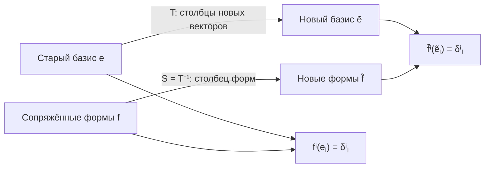

# Замена базиса и преобразование координат

[[10 Учёба/Линейная алгебра/Линейная алгебра|Линейная алгебра]]

При смене базиса вектор сохраняется, а его координаты меняются по обратной матрице. Коэффициенты линейной формы меняются так, чтобы её значение на векторе оставалось тем же. Используются обозначения $T$, $S$, верхние и нижние индексы лекции преподавателя.

## Матрица перехода и её обратимость

Пусть $e_1,\ldots,e_n$ — старый базис $X(k)$, $\widetilde e_1,\ldots,\widetilde e_n$ — новый. Для каждого нового вектора единственным образом
$$\widetilde e_k=\sum_{j=1}^ne_j\tau^j_k.$$
Матрица $T=(\tau^j_k)$ называется матрицей перехода **от старого базиса к новому**. Её столбец $k$ — координаты $\widetilde e_k$ в старом базисе. Для формальных рядов базисных векторов $E=[e_1,\ldots,e_n]$, $\widetilde E=[\widetilde e_1,\ldots,\widetilde e_n]$:
$$\widetilde E=ET.$$
Символ $E$ здесь ряд векторов, а не обязательно числовая единичная матрица.

**Лемма 7.1:** $\det T\ne0$. **Промежуточные шаги к краткому доказательству:** если $Tc=0$, то $\widetilde E c=ETc=0$. Независимость **нового** базиса даёт $c=0$. Значит, столбцы $T$ независимы; квадратная матрица имеет полный ранг, после Гаусса её можно привести к единичной, поэтому она обратима и $\det T\ne0$. В PDF в этой строке упомянут только старый базис; одной его независимости без независимости нового недостаточно.

Обозначим
$$S=T^{-1}=(\sigma^l_i).$$
Тогда $\widetilde ES=E$, то есть $E=\widetilde ES$. Матрица обратного перехода единственна.

### Проверка через взаимно сопряжённые базисы

Рукописный вывод рассматривает одновременно $e_i,\widetilde e_i$ и сопряжённые им формы $f^i,\widetilde f^{,i}$. В принятой выше записи

$$\widetilde e_k=\sum_i e_i\tau^i_k,\qquad
\widetilde f^{,l}=\sum_i a^l_i f^i.$$

Коэффициенты $a^l_i$ пока неизвестны; их существование следует из того, что $f^i$ — базис $X^*$. Применим новую форму к новому базисному вектору:

$$\delta^l_k=\widetilde f^{,l}(\widetilde e_k)
=\sum_i\sum_j a^l_i\tau^j_k f^i(e_j)
=\sum_i a^l_i\tau^i_k.$$

При $A=(a^l_i)$ получено $AT=I$. Значит, $\det A\det T=1$ и $\det T\ne0$, после чего $A=T^{-1}=S$. Это позволяет одновременно проверить невырожденность матрицы перехода и найти коэффициенты новых сопряжённых форм. Полное доказательство основной теоремы ниже сохраняет тот же вывод; здесь раскрыта связь с проверкой на фото.

**Пояснение к порядку индексов.** Коэффициент $\tau^j_i$ относится к новому вектору $\widetilde e_i$ и старому вектору $e_j$: $\widetilde e_i=\sum_j e_j\tau^j_i$. Поэтому в соглашении $\widetilde E=ET$ это элемент строки $j$, столбца $i$. Для коэффициента новой формы $\sigma^j_i$ индекс $j$ выбирает новую форму, а $i$ — старую. Перед чтением матричного произведения нужно зафиксировать расположение коэффициентов, а не угадывать его по положению символов на листе. На фотографии записано $TS=I$; для обратных квадратных матриц верны оба тождества $TS=ST=I$.

### Схема согласования двух базисов

**Дополнительная схема, передающая смысл подстановок из рукописи.**

После замены базиса новая $i$-я координатная форма должна по-прежнему давать единицу на своём новом векторе и нуль на остальных. Подстановка двух разложений в это требование даёт $AT=I$; отсюда определяется $A=S$. Поэтому обратная матрица возникает из условия взаимной сопряжённости, а не из формального правила «перевернуть индексы».

Фотография использует своё расположение коэффициентов и запись $TS=I$. Для сравнения с PDF нужно сначала закрепить строки и столбцы; в принятых здесь обозначениях вывод выше даёт $AT=I$, а после установления обратимости верны оба порядка произведения. Нижние и верхние индексы обозначают роли коэффициентов, а не степени.

### Суммирование по повторяющимся индексам

Рукопись [[photo_2026-11-17 21.54.34.jpeg]] вводит сокращённую запись: повторение одного индекса сверху и снизу означает суммирование от $1$ до $n$. Например,
$$\alpha^i\beta_i:=\sum_{i=1}^n\alpha^i\beta_i.$$
Это соглашение Эйнштейна. Индекс суммирования можно переименовать; свободные индексы остаются одинаковыми по обе стороны равенства. Далее в индексных формулах используется это соглашение.

При $T=(\tau^k_j)$, $S=T^{-1}=(\sigma^j_k)$:
$$\widetilde e_j=\tau^k_j e_k,\qquad
v=\widetilde v^{\,j}\widetilde e_j=v^ke_k.$$
Подстановка даёт
$$v=\widetilde v^{\,j}\tau^k_j e_k.$$
По единственности разложения по старому базису
$$v^k=\tau^k_j\widetilde v^{\,j}.$$
Умножаем на $\sigma^i_k$ и используем $\sigma^i_k\tau^k_j=\delta^i_j$:
$$\sigma^i_kv^k=\delta^i_j\widetilde v^{\,j}=\widetilde v^{\,i}.$$
Итак, $v=T\widetilde v$ для столбцов координат, а $\widetilde v=Sv$. В последней формуле буква $v$ обозначает координатный столбец; сам вектор остаётся прежним. Этот индексный вывод дополняет доказательство через сопряжённые формы ниже.

На полях записано $\det(AB)=\det A\det B$ для квадратных матриц одного порядка; результат разобран в [[Определители и разложения по минорам]].

## Преобразование сопряжённого базиса

Пусть $f^i$ и $\widetilde f^{,l}$ — базисы $X^*$, сопряжённые соответственно $e_j$ и $\widetilde e_k$: $(f^i,e_j)=\delta^i_j$, $(\widetilde f^{,l},\widetilde e_k)=\delta^l_k$.

**Теорема 7.1:**
$$\widetilde f^{,l}=\sum_{i=1}^n\sigma^l_i f^i.$$

**Доказательство преподавателя.** Разложим $\widetilde f^{,l}=\sum_i\alpha^l_i f^i$. Подставим новый базис:
$$\begin{aligned}
\delta^l_k&=(\widetilde f^{,l},\widetilde e_k)
=\left(\sum_i\alpha^l_if^i,\sum_je_j\tau^j_k\right)\\
&=\sum_i\sum_j\alpha^l_i(f^i,e_j)\tau^j_k
=\sum_i\sum_j\alpha^l_i\delta^i_j\tau^j_k
=\sum_i\alpha^l_i\tau^i_k.
\end{aligned}$$
Для матрицы $A=(\alpha^l_i)$ это $AT=I$, значит $A=T^{-1}=S$. Получили заявленную формулу. Если $F=(f^1,\ldots,f^n)^T$ и $\widetilde F=(\widetilde f^{,1},\ldots,\widetilde f^{,n})^T$, то
$$\widetilde F=SF.$$
Это запись столбцом форм; при использовании ряда форм возникло бы транспонирование, поэтому ориентацию записи нужно сохранять.

## Преобразование координат вектора

Пусть
$$x=\sum_je_j\xi^j=\sum_k\widetilde e_k\widetilde\xi^{,k}.$$
**Теорема 7.2:**
$$\widetilde\xi^{,k}=\sum_{j=1}^n\sigma^k_j\xi^j,\qquad
\widetilde\xi=S\xi=T^{-1}\xi.$$

**Доказательство преподавателя через сопряжённые формы.** Координата в новом базисе равна значению новой координатной формы:
$$\begin{aligned}
\widetilde\xi^{,k}&=(\widetilde f^{,k},x)
=\left(\sum_i\sigma^k_if^i,\sum_je_j\xi^j\right)\\
&=\sum_i\sum_j\sigma^k_i(f^i,e_j)\xi^j
=\sum_i\sum_j\sigma^k_i\delta^i_j\xi^j
=\sum_j\sigma^k_j\xi^j.
\end{aligned}$$

**Дополнительное пояснение через сам вектор:** $x=E\xi=\widetilde E\widetilde\xi=ET\widetilde\xi$. По единственности старых координат $\xi=T\widetilde\xi$, откуда та же обратная формула. Матрица, переводящая старые координаты в новые, — $S$, хотя матрицей перехода «от старого базиса к новому» по соглашению преподавателя названа $T$.

## Преобразование координат формы

Пусть форма $y\in X^*$ записана
$$y=\sum_i\eta_i f^i=\sum_l\widetilde\eta_l\widetilde f^{,l}.$$
Её коэффициенты $\eta_i=(y,e_i)$, новые $\widetilde\eta_l=(y,\widetilde e_l)$.

**Теорема 7.3:**
$$\widetilde\eta_l=\sum_{i=1}^n\eta_i\tau^i_l,\qquad
\widetilde\eta=\eta T,$$
где $\eta=(\eta_1,\ldots,\eta_n)$ и $\widetilde\eta$ записаны строками.

**Доказательство преподавателя:**
$$\begin{aligned}
\widetilde\eta_l&=(y,\widetilde e_l)
=\left(\sum_i\eta_if^i,\sum_je_j\tau^j_l\right)\\
&=\sum_i\sum_j\eta_i(f^i,e_j)\tau^j_l
=\sum_i\sum_j\eta_i\delta^i_j\tau^j_l
=\sum_i\eta_i\tau^i_l.
\end{aligned}$$
Если коэффициенты формы писать столбцом, эквивалентная формула — $\widetilde\eta_{\mathrm{col}}=T^T\eta_{\mathrm{col}}$. Это дополнительная смена способа записи, а не новая матрица перехода.

### Строка коэффициентов и ряд сопряжённых форм

В [[photo_2026-11-17 21.54.35.jpeg]] сопряжённые базисные формы обозначены $e^i$, $\widetilde e^{\,i}$; это те же объекты, что $f^i$, $\widetilde f^{,i}$ выше. Они удовлетворяют $e^i(e_j)=\delta^i_j$. Если
$$f=f_i e^i=\widetilde f_j\widetilde e^{\,j},$$
то по линейности
$$f(v)=v^kf(e_k)=v^kf_k
=\widetilde v^{\,j}f(\widetilde e_j)
=\widetilde v^{\,j}\widetilde f_j.$$
**Уточнение записи рукописи:** скаляр $v^k$ выносится из формы как множитель; выражение $f(v^k)f(e_k)$ некорректно для формы на произвольном $X$, поскольку $v^k\in K$, а аргумент $f$ должен принадлежать $X$.

Положим $\widetilde e^{\,i}=L^i_k e^k$. Из сопряжённости:
$$\delta^i_j=\widetilde e^{\,i}(\widetilde e_j)
=L^i_k\tau^m_j e^k(e_m)=L^i_k\tau^k_j.$$
Поэтому $LT=I$, $L=S$, то есть $\widetilde e^{\,i}=\sigma^i_k e^k$.

В рукописи используется и **ряд** форм. Если $R=(e^1,\ldots,e^n)$, то
$$\widetilde R=R S^{\mathsf T}=R T^{-\mathsf T},\qquad
\widetilde f_{\mathrm{col}}=T^{\mathsf T}f_{\mathrm{col}},$$
где $T^{-\mathsf T}:=(T^{-1})^{\mathsf T}$. Для столбца базисных форм верна прежняя формула $\widetilde F=SF$. Следовательно, транспонирование здесь связано с тем, записываем ли формы рядом или столбцом.

**Промежуточное раскрытие матричной записи рукописи:**
$$f(v)=(f_1,\ldots,f_n)
\begin{pmatrix}e^1\\ \vdots\\ e^n\end{pmatrix}
(e_1,\ldots,e_n)
\begin{pmatrix}v^1\\ \vdots\\ v^n\end{pmatrix}
=(f_1,\ldots,f_n)I\begin{pmatrix}v^1\\ \vdots\\ v^n\end{pmatrix}.$$
Произведение столбца форм на ряд векторов означает попарное применение форм: его элемент $(i,j)$ равен $e^i(e_j)=\delta^i_j$. Это объясняет отмеченную на листе единичную матрицу.

## Ковариантность, контравариантность и значение формы

По терминологии лекции величины, преобразующиеся с $T$ так же, как базис, называются **ковариантными**, их координатные индексы нижние: $\eta_i$. Преобразующиеся по обратному закону с $S=T^{-1}$ — **контравариантными**, индексы верхние: $\xi^i$. Верхний индекс координаты означает номер, а не степень.

**Дополнительная проверка согласованности:**
$$(y,x)=\eta\xi=\widetilde\eta\widetilde\xi=(\eta T)(S\xi)=\eta(TS)\xi=\eta\xi.$$
Значение формы на векторе не меняется. Три формулы, которые нужно читать вместе:
$$\widetilde E=ET,\qquad\widetilde\xi=T^{-1}\xi,\qquad\widetilde\eta=\eta T.$$
Тезис вступления PDF о «двух возможностях» относится к рассматриваемым здесь векторным координатам и формам, а не классифицирует все возможные преобразования любых математических объектов.

### Что означает памятка об индексах

Фраза в рукописи «индекс снизу — прямая матрица, индекс сверху — обратная» относится к обсуждаемым **координатным величинам**:

| Объект | Определение | Преобразование |
|---|---|---|
| Координаты вектора, верхний индекс | $x=\sum_i e_i\xi^i$ | $\widetilde\xi=S\xi$ |
| Коэффициенты формы, нижний индекс | $\eta_i=y(e_i)$ | $\widetilde\eta=\eta T$, строкой |
| Базисные векторы | $E=[e_1,\ldots,e_n]$ | $\widetilde E=ET$ |
| Сопряжённые базисные формы | $F=(f^1,\ldots,f^n)^T$ | $\widetilde F=SF$ |

**Дополнительное пояснение:** координаты вектора и сами базисные векторы — разные объекты; аналогично различаются коэффициенты формы и базисные формы. Их законы взаимно компенсируются, чтобы вектор $x$ и скаляр $y(x)$ не менялись. Нижний индекс у базисного вектора не следует смешивать с нижним индексом коэффициента произвольной формы. Числовая проверка всех четырёх строк таблицы приведена в следующем примере.

### Один объект и две координатные записи

**Дополнительная схема для понимания.**

Меняется способ разложения вектора, а не сам вектор. Форма тоже остаётся тем же правилом измерения, но её коэффициенты меняются в противоположном направлении: $\widetilde\eta=\eta T$. Произведение «строка формы × столбец координат» сохраняет значение, потому что $T$ и $S$ взаимно сокращаются. Следующий пример проверяет это числами.

## Дополнительный разобранный пример

В $\mathbb R^2$ зададим $\widetilde e_1=e_1+e_2$, $\widetilde e_2=e_2$. Тогда
$$T=\begin{pmatrix}1&0\\1&1\end{pmatrix},\qquad S=\begin{pmatrix}1&0\\-1&1\end{pmatrix}.$$
Для $x=2e_1+3e_2$ имеем $\widetilde\xi=S(2,3)^T=(2,1)^T$. Проверка: $2\widetilde e_1+\widetilde e_2=2e_1+3e_2$.

![[Замена базиса — один вектор в двух базисах.png]]

**Как читать дополнительный рисунок.** Красная стрелка в обеих панелях — один и тот же вектор. Слева он собирается из двух старых первых и трёх старых вторых базисных векторов. Справа новый первый вектор наклонён: две его копии дают $(2,2)$, после чего одна копия нового второго доводит сумму до $(2,3)$. Поэтому новые координаты — $(2,1)$, хотя положение конца красной стрелки не изменилось. Пунктир показывает слагаемые разложения, а не траекторию движения.

Форма $y$ со старыми коэффициентами $\eta=(4,5)$ имеет новые $\widetilde\eta=(4,5)T=(9,5)$. В старых координатах $(y,x)=4\cdot2+5\cdot3=23$, в новых — $9\cdot2+5\cdot1=23$. Сопряжённые формы меняются как $\widetilde f^{,1}=f^1$, $\widetilde f^{,2}=-f^1+f^2$; подстановка в новые векторы даёт $\delta^i_j$.

## Источники

- [[lecture_7_Basis_transformation.pdf|Преобразование базиса]]

Рукописный источник: [[IMG_4034.HEIC]] — матрица перехода, её невырожденность, преобразование сопряжённых базисов и памятка об индексах. Обозначения согласованы с основной лекцией преподавателя.

- [[photo_2026-11-17 21.54.34.jpeg]], [[photo_2026-11-17 21.54.35.jpeg]] — индексный вывод преобразования координат, соглашение о суммировании, преобразование сопряжённого базиса и коэффициентов формы.
