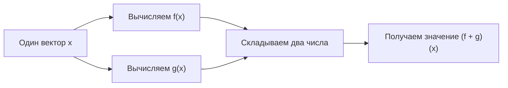
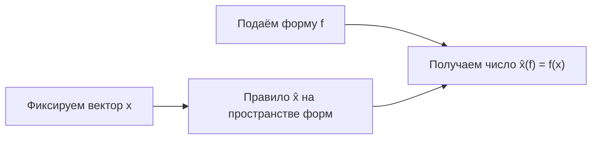

# Линейные формы и сопряжённое пространство

[[10 Учёба/Линейная алгебра/Линейная алгебра|Линейная алгебра]]

Вектор можно описать несколькими координатами. **Линейная форма берёт вектор и выдаёт одно число**, линейно зависящее от этих координат. Например, правило $f(x^1,x^2)=4x^1+5x^2$ превращает вектор $(2,3)$ в число $23$.

Дальше нам нужны три шага: понять такое правило, научиться описывать все подобные правила и разобраться, почему сами они образуют пространство. Это подготовит [[Замена базиса и преобразование координат|замену базиса]].

Во всей заметке $k$ — поле, $X$ — пространство над ним. Начиная с коэффициентов и сопряжённого базиса предполагаем $\dim_kX=n<\infty$. Дополнительные числовые примеры и пояснения ниже служат пониманию; обозначения и нумерация результатов сохранены по лекции преподавателя.

## Линейная форма и примеры

**Определение.** Линейная форма — функция $f:X\to k$, для которой

$$f(x+y)=f(x)+f(y),\qquad f(\alpha x)=\alpha f(x).$$

Первое условие разрешает сначала сложить векторы, а потом вычислить значение — или сначала вычислить два значения и сложить их. Второе разрешает выносить скаляр из аргумента. Вместе они дают $f(\alpha x+\beta y)=\alpha f(x)+\beta f(y)$.

**Дополнительный пример.** Для $f(x^1,x^2)=4x^1+5x^2$:

$$f((x^1,x^2)+(y^1,y^2))=4(x^1+y^1)+5(x^2+y^2)=f(x)+f(y).$$

Аналогично $f(\alpha x)=4\alpha x^1+5\alpha x^2=\alpha f(x)$. Прибавление постоянного ненулевого числа нарушило бы линейность: форма обязательно имеет $f(0)=0$.

В лекции $(f,x)$ означает то же, что $f(x)$. Это **применение функции**, а не обязательно скалярное произведение. Опечатка во второй аксиоме PDF: вместо $f(x)\alpha=f(x)\alpha$ следует читать $f(x\alpha)=f(x)\alpha$.

**Примеры 6.1 из лекции.**

- В $E_3$ — скалярная ортогональная проекция на фиксированное ориентированное направление. Дополнительная запись: при единичном направляющем векторе $u$ это $f(x)=\langle u,x\rangle$. Ответ — число со знаком; векторная проекция $\langle u,x\rangle u$ сама по себе формой со значениями в поле не является.
- В $\mathbb R^n$ — извлечение одной координаты: если $x=\sum_i e_i\xi^i$, то $f^j(x)=\xi^j$. Здесь $j$ фиксировано, а верхний индекс — номер, не степень.

![[Screenshot 2026-11-18 at 10.59.23.png]]

- На вещественном пространстве многочленов $P_n$ — $f(x)=\int_a^b w(t)x(t)\,dt$, где пределы $a,b$ и весовой многочлен $w$ фиксированы. Переменный аргумент формы — многочлен $x(t)$. Линейность интеграла даёт $f(\alpha x+\beta y)=\alpha f(x)+\beta f(y)$. В PDF вес и форма обозначены одной буквой; здесь они разделены.

![[Screenshot 2026-11-16 at 21.55.51.png]]

- На квадратных вещественных матрицах — след: $f(A)=\operatorname{tr}A=\sum_i a_{ii}$. Диагональные элементы складываются и умножаются на скаляр покомпонентно, поэтому $\operatorname{tr}(\alpha A+\beta B)=\alpha\operatorname{tr}A+\beta\operatorname{tr}B$.

![[Screenshot 2026-11-16 at 21.56.30.png]]

## Ядро формы и уравнение уровня

Ядро — все векторы, на которых форма даёт нуль:

$$\ker f=\{x\in X:f(x)=0\}.$$

Его смысл: **добавление вектора из ядра не меняет показания формы**. Если $h\in\ker f$, то $f(a+h)=f(a)+f(h)=f(a)$.

**Лемма 6.1.** Ядро является подпространством.

**Доказательство по шагам.** Из $f(0)=f(0)+f(0)$ получаем $f(0)=0$, так что ядро непусто. Если $x,y$ в ядре, то $f(x+y)=0+0=0$: сумма тоже в ядре. Для любого $\alpha\in k$ имеем $f(\alpha x)=\alpha\cdot0=0$: скалярное кратное тоже в ядре. Это и есть нужная замкнутость.

Теперь рассмотрим уравнение $f(x)=a$. Если известен хотя бы один его ответ $x_0$, то

$$f(x)=a\iff f(x)-f(x_0)=0\iff x-x_0\in\ker f.$$

Поэтому **все решения** равны $x_0+\ker f$. Это линейное многообразие с несущим подпространством $\ker f$.

Условие существования $x_0$ важно: при $f=0,a\ne0$ решений нет; при $f=0,a=0$ решения — всё $X$.

### Почему ядро ненулевой формы имеет коразмерность 1

В лекции утверждение $\operatorname{codim}\ker f\le1$ оставлено до дальнейшего доказательства. Ниже — **дополнительное доказательство**.

Если $f=0$, то $\ker f=X$ и коразмерность равна 0. Пусть $f\ne0$. Тогда найдётся $v$ с $f(v)\ne0$. Нормируем его: $u=v/f(v)$, откуда $f(u)=1$.

Любой вектор можно разложить:

$$x=\underbrace{x-f(x)u}_{\text{в ядре}}+\underbrace{f(x)u}_{\text{кратен }u}.$$

Первая часть действительно в ядре, поскольку $f(x-f(x)u)=f(x)-f(x)\cdot1=0$. Общих ненулевых векторов у ядра и прямой $\langle u\rangle$ нет: если $tu\in\ker f$, то $0=f(tu)=t$.

Итак, $X=\ker f\oplus\langle u\rangle$. За пределами ядра нужно ровно одно независимое направление, поэтому коразмерность равна 1. Кроме того, любое число $a$ достигается: $f(au)=a$. В конечномерном случае $\dim\ker f=n-1$; непустые уровни ненулевой формы — гиперплоскости, причём уровень 0 является самим ядром.

![[Screenshot 2026-11-16 at 22.04.05.png]]

### Геометрический смысл ядра и уровней

**Дополнительный разобранный пример.** В $\mathbb R^2$ возьмём $f(x)=x^1+2x^2$.

![[Линейная форма — ядро и уровни.png]]

Синяя прямая $x^1+2x^2=0$ — ядро. Прямые $x^1+2x^2=c$ при других $c$ параллельны ей: каждая состоит из векторов с одним показанием формы.

Для $a=(2,0)$ и $h=(-2,1)$ имеем $f(h)=-2+2=0$. Поэтому

$$f(a+h)=f(0,1)=2=f(2,0)=f(a).$$

Стрелка вдоль зелёной прямой изображает добавление $h$. Ядро проходит через нуль; уровень с $c\ne0$ через нуль не проходит.

### Как система уравнений записывается через формы

В системе с $m$ неизвестными каждая строка задаёт одну форму:

$$a_{i1}x^1+\cdots+a_{im}x^m=b_i
\quad\Longleftrightarrow\quad f_i(x)=b_i,\qquad i=1,\ldots,r.$$

Здесь $X=k^m$, $f_i(x)=\sum_j a_{ij}x^j$. Система требует попасть одновременно на уровни всех $r$ форм.

![[Screenshot 2026-11-16 at 22.17.00.png]]

Если $x_0$ — одно общее решение, то

$$\{x:f_i(x)=b_i\ \forall i\}=x_0+\bigcap_{i=1}^r\ker f_i.$$

![[Screenshot 2026-11-16 at 22.16.39.png]]

**Промежуточный шаг:** каждое равенство $f_i(x)=f_i(x_0)$ означает $x-x_0\in\ker f_i$. Одновременное выполнение означает принадлежность пересечению ядер. При несовместности системы исходного $x_0$ нет, и множество решений пусто.

Запись рукописи $f(a+H)=f(a)$ при $H=\ker f$ сокращает утверждение $f(a+h)=f(a)$ для каждого $h\in H$. Строго образ множества $a+H$ равен одноточечному множеству $\{f(a)\}$; $H$ здесь не является отдельным вектором-аргументом.

![[Screenshot 2026-11-16 at 22.16.26.png]]

Связь с решением систем: [[СЛАУ, метод Гаусса и пространство решений]].

## Пространство линейных форм

Теперь рассматриваем сами правила вычисления как объекты. Например, $f(x)=4x^1+5x^2$ и $g(x)=x^1-x^2$ можно сложить: новое правило выдаёт $5x^1+4x^2$.

Две формы равны, если их значения совпадают **на всех** векторах. Нулевая форма $\theta$ — правило $\theta(x)=0$ для каждого $x$, а не один вектор из $X$.

Операции определяются через значения:

$$(f+g)(x)=f(x)+g(x),\qquad(\alpha f)(x)=\alpha f(x).$$

### Что складывается: формы или их значения

Это дополнительная схема поточечного сложения. Для одного аргумента складываются два числа; повторяя правило для всех аргументов, получаем новую функцию $f+g$.

**Лемма 6.2. Сумма форм — форма.** Пусть $h=f+g$. Тогда

$$\begin{aligned}
h(x+y)&=f(x+y)+g(x+y)\\
&=f(x)+f(y)+g(x)+g(y)=h(x)+h(y),\\
h(\beta x)&=\beta f(x)+\beta g(x)=\beta h(x).
\end{aligned}$$

**Лемма 6.3. Скалярное кратное формы — форма.** Для $v=\alpha f$:

$$v(x+y)=\alpha f(x)+\alpha f(y)=v(x)+v(y),$$
$$v(\beta x)=\alpha\beta f(x)=\beta\alpha f(x)=\beta v(x).$$

В последнем переходе использована коммутативность скаляров поля $k$.

**Теорема 6.1.** Все линейные формы на $X$ с этими операциями образуют пространство $X^*$, называемое **сопряжённым**, или дуальным.

**Полная проверка аксиом, раскрывающая краткую проверку в PDF.** Замкнутость уже доказана. Остальные равенства проверяем на каждом $x$:

$$\begin{aligned}
((f+g)+h)(x)&=f(x)+g(x)+h(x)=(f+(g+h))(x),\\
(f+g)(x)&=g(x)+f(x)=(g+f)(x),\\
(f+\theta)(x)&=f(x),\qquad (f+(-f))(x)=0,\\
((\alpha+\beta)f)(x)&=\alpha f(x)+\beta f(x),\\
(\alpha(f+g))(x)&=\alpha f(x)+\alpha g(x),\\
(\alpha(\beta f))(x)&=(\alpha\beta)f(x),\qquad(1f)(x)=f(x).
\end{aligned}$$

Здесь $(-f)(x)=-f(x)$. Поскольку равенства верны для каждого аргумента, это равенства самих форм. Получены ассоциативность, коммутативность, нуль, противоположный элемент, обе дистрибутивности и правила действия скаляров.

![[Screenshot 2026-11-16 at 22.23.22.png]]

![[Screenshot 2026-11-16 at 22.24.04.png]]

## Коэффициенты формы в базисе

Зафиксируем базис $e_1,\ldots,e_n$. Любой вектор имеет единственное разложение $x=\sum_j e_j\xi^j$. Линейность позволяет вычислить форму по частям:

$$f(x)=f\left(\sum_j e_j\xi^j\right)=\sum_j \xi^j f(e_j).$$

Значит, достаточно знать $n$ чисел $\varphi_j=f(e_j)$. Они и называются **коэффициентами формы в этом базисе**:

$$f(x)=\sum_{j=1}^n\varphi_j\xi^j.$$

**Дополнительное пояснение на нашем примере.** В стандартном базисе $\mathbb R^2$ форма $4x^1+5x^2$ даёт $f(e_1)=4,f(e_2)=5$. Поэтому её коэффициенты — $(4,5)$, тогда как координаты аргумента $(2,3)$ — другой набор чисел. Их произведение «строка на столбец» даёт $4\cdot2+5\cdot3=23$.

**Теорема 6.2.** Любой набор чисел $(\varphi_1,\ldots,\varphi_n)$ задаёт ровно одну форму с $f(e_j)=\varphi_j$.

**Доказательство.** По заданным числам определим $f(x)=\sum_j\varphi_j\xi^j$. Координаты вектора единственны, поэтому правило однозначно. Координаты $\alpha x+\beta y$ равны $\alpha\xi^j+\beta\eta^j$; подстановка даёт $f(\alpha x+\beta y)=\alpha f(x)+\beta f(y)$. На $e_j$ только $j$-я координата равна 1, следовательно, $f(e_j)=\varphi_j$. Наконец, любая другая форма с такими значениями по линейности обязана вычисляться той же суммой. Это доказывает и существование, и единственность.

![[Screenshot 2026-11-16 at 22.29.07.png]]

### Линейность соответствия между формами и коэффициентами

Соответствие $C_e:X^*\to k^n$, $C_e(f)=(f(e_1),\ldots,f(e_n))$, не только биективно, но и линейно. Действительно,

$$(\lambda f+g)(e_j)=\lambda f(e_j)+g(e_j).$$

Если коэффициенты $f$ — $\varphi_j$, а $g$ — $\psi_j$, то коэффициенты $\lambda f+g$ — $\lambda\varphi_j+\psi_j$. Поэтому $C_e$ — изоморфизм. Он зависит от базиса $e$: форма остаётся тем же правилом, но её коэффициенты в другом базисе могут быть другими.

## Сопряжённый базис

Извлечение каждой отдельной координаты — тоже форма. Обозначим их $f^1,\ldots,f^n$:

$$f^j(x)=\xi^j\quad\text{при }x=\sum_i e_i\xi^i.$$

Например, в стандартном базисе $\mathbb R^2$ это $f^1(x^1,x^2)=x^1$ и $f^2(x^1,x^2)=x^2$. Любая форма $4x^1+5x^2$ тогда записывается как $4f^1+5f^2$.

На базисных векторах координатные формы дают

$$f^i(e_j)=\delta^i_j=\begin{cases}1,&i=j,\\0,&i\ne j.\end{cases}$$

Символ $\delta^i_j$ — просто короткая запись этой таблицы из нулей и единиц. Базисы с таким свойством называют **сопряжёнными**.

**Теорема 6.3.** Формы $f^1,\ldots,f^n$ образуют базис $X^*$.

**Доказательство полноты.** Для любой формы $f$ и каждого $x$:

$$f(x)=\sum_j\varphi_j\xi^j=\sum_j\varphi_jf^j(x).$$

Равенство на всех $x$ означает $f=\sum_j\varphi_jf^j$. Следовательно, координатные формы порождают всё $X^*$.

**Доказательство независимости.** Пусть $\sum_j\alpha_j f^j=\theta$. Применим равенство к $e_k$:

$$0=\sum_j\alpha_jf^j(e_k)=\sum_j\alpha_j\delta^j_k=\alpha_k.$$

Это верно для каждого $k$. Поэтому все коэффициенты нулевые и набор независим. В частности, $\dim_kX^*=n=\dim_kX$.

![[Screenshot 2026-11-18 at 11.17.11.png]]

**Лемма 6.4.** Каждому базису $X$ соответствует единственный сопряжённый базис $X^*$, и наоборот.

Прямое направление уже доказано: форма $f^i$ однозначно задаётся значениями $f^i(e_j)=\delta^i_j$ по теореме 6.2.

**Дополнительное доказательство обратного направления.** Пусть даны любые базисные формы $g^1,\ldots,g^n$. Нужно найти векторы $e_j$, для которых $g^i(e_j)=\delta^i_j$. Соберём все показания в одно отображение

$$H:X\to k^n,\qquad H(x)=(g^1(x),\ldots,g^n(x))^T.$$

Оно линейно. Если $H(x)=0$, все $g^i$ дают на $x$ нуль. Тогда нуль даёт любая форма, поскольку $g^i$ образуют базис $X^*$. В частности, все координатные формы для вспомогательного базиса $X$ равны нулю на $x$; значит, $x=0$. Получена инъективность $H$.

Пространства $X$ и $k^n$ имеют одинаковую конечную размерность, поэтому $H$ биективно: образы $n$ базисных векторов независимы и образуют базис $k^n$. Пусть $u_j$ — стандартные столбцы в $k^n$. Положим $e_j=H^{-1}(u_j)$. Тогда $g^i(e_j)=\delta^i_j$, а прообразы базиса при изоморфизме образуют базис. Единственность каждого $e_j$ следует из инъективности $H$.

### Два разложения, которые нельзя смешивать

| Что раскладываем | По какому базису | Как узнаём коэффициент |
| --- | --- | --- |
| Вектор $x=\sum_j e_j\xi^j$ | По векторам $e_j$ | $\xi^j=f^j(x)$ |
| Форму $f=\sum_j\varphi_j f^j$ | По формам $f^j$ | $\varphi_j=f(e_j)$ |

Дополнительное пояснение: $f^j$ — функция-измеритель, $\xi^j$ — её числовой ответ на конкретном векторе. Число $\varphi_j$ показывает, с каким весом произвольная форма использует этот измеритель. Индекс в $f^j$ нумерует функции; он не возводит $f$ в степень.

## Второе сопряжённое и естественный изоморфизм

$X^*$ состоит из форм на $X$. Теперь можно взять формы уже **на пространстве $X^*$**. Они образуют $X^{**}=(X^*)^*$.

Чтобы построить один такой объект, зафиксируем вектор $x$. На вход будем подавать разные формы $f$ и возвращать число $f(x)$. Получится правило

$$\widehat x:X^*\to k,\qquad\widehat x(f)=f(x).$$

**Дополнительный пример.** Зафиксируем $x=(2,3)$. Правило $\widehat x$ возвращает 2 на форме $f^1$, 3 на форме $f^2$ и 23 на форме $4f^1+5f^2$. Входами здесь служат функции, а ответами — числа.

### Как читать два сопряжения на рукописной странице

Это дополнительная схема к рукописи. У $f\in X^*$ аргумент — вектор. У $\widehat x\in X^{**}$ аргумент — форма. Число в итоге одно и то же, но функции имеют разные области определения.

**Лемма 6.5.** Для конечномерного $X$ отображение $J:X\to X^{**}$, $J(x)=\widehat x$, является естественным изоморфизмом.

В терминологии лекции «естественный» означает, что правило задаётся без выбора базиса. Развернём доказательство.

1. **$\widehat x$ действительно линейная форма на $X^*$.** По определению операций на формах:
   $$\widehat x(f+g)=f(x)+g(x),\qquad\widehat x(\alpha f)=\alpha f(x).$$
2. **Само $J$ линейно.** Для любой формы $f$:
   $$J(x+y)(f)=f(x+y)=f(x)+f(y)=(J(x)+J(y))(f),$$
   $$J(\alpha x)(f)=f(\alpha x)=\alpha f(x)=(\alpha J(x))(f).$$
   Значения равны на всех $f$, значит, равны элементы $X^{**}$.
3. **$J$ инъективно.** Если $J(x)=0$, то $f(x)=0$ для всех форм. В частности, координатные формы дают все координаты $x$ равными нулю. Поэтому $x=0$.
4. **$J$ сюръективно.** Уже доказано $\dim X^*=n$, а потому $\dim X^{**}=n$. Инъективное отображение между пространствами одной конечной размерности биективно.
5. **Выбор базиса не входит в правило $J(x)(f)=f(x)$.** Базис понадобился для проверки, но не для определения соответствия. В этом смысле изоморфизм естественный.

Операции в $X^{**}$ тоже поточечны: $(\widehat x+\widehat y)(f)=\widehat x(f)+\widehat y(f)$ и $(\alpha\widehat x)(f)=\alpha\widehat x(f)$. При бесконечной размерности приведённое доказательство сюръективности неприменимо.

![[Screenshot 2026-11-16 at 22.40.12.png]]

Равенство размерностей даёт также $X\simeq X^*$, но выбор соответствия между их базисами зависит от выбора. В отличие от него, соответствие $X\simeq X^{**}$ выше задано непосредственно вычислением $f(x)$.

Дальше: [[Замена базиса и преобразование координат]]. Там сам вектор и сама форма останутся прежними, а их числовые записи изменятся.

![[Screenshot 2026-11-18 at 13.46.31.png]]

## Источники

- [[lecture_6_Linear_algebraic_forms.pdf|Линейные формы]]

Рукописные источники: [[IMG_4031.HEIC]], [[IMG_4032.HEIC]], [[IMG_4033.HEIC]]. Определения и доказательства сверены с основной лекцией преподавателя; дополнительные разъяснения отмечены в тексте.
