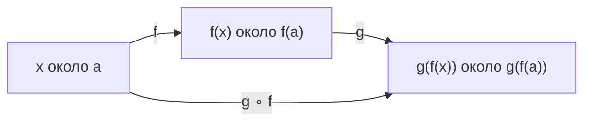
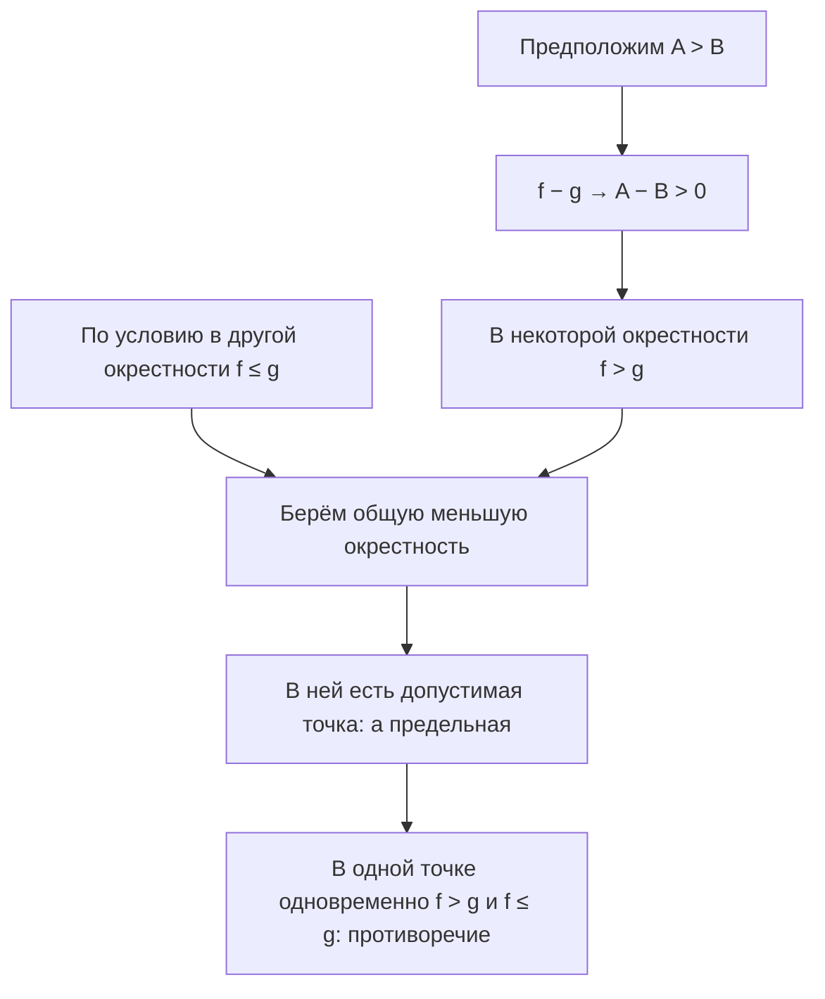

[[Матанализ]]

# Непрерывность функций

> [!abstract] Суть
> При непрерывности близкие аргументы дают близкие значения, причём предел совпадает со значением в точке. Поэтому здесь, в отличие от предела, саму точку не исключают.

## Определение непрерывности через предел

Пусть $f:D\subseteq\mathbb R\to\mathbb R$, $a\in D$, и $a$ — предельная точка $D$. **Функция непрерывна в точке $a$, если существует конечный предел при $x\to a$ по области определения и он равен значению функции в этой точке:**

$$\boxed{\lim_{\substack{x\to a\\x\in D\setminus\{a\}}}f(x)=f(a).}$$

В этой записи нужны одновременно три условия: $f(a)$ определено; предел существует; предел совпадает с $f(a)$. Само существование предела непрерывности не гарантирует, что и показывает рисунок ниже. В метрических пространствах определение через предел такое же: заменяются только расстояния.

Если $a$ изолирована в $D$, непрерывность определяется по Коши и выполняется автоматически; требовать отдельного предела по пустой проколотой окрестности не нужно. В рукописной формулировке через предел точка заранее предполагается предельной.

## Определение в метрических пространствах

![[Непрерывность — значение и предел.png]]

**Смысл рисунка.** На левом графике закрашенная точка принадлежит той же высоте, к которой подходят соседние значения. На правом предел A существует, но само f(a) перенесено выше; пустой кружок показывает исключённое прежнее значение. Поэтому справа функция не непрерывна. Различие предела и непрерывности состоит здесь в значении одной точки.

### Определение непрерывности по Коши

Пусть $f:D\subseteq(X,\rho)\to(Y,\mu)$ и $a\in D$. Функция непрерывна в $a$, если

$$\forall\varepsilon>0\ \exists\delta>0\ \forall x\in D:
\rho(x,a)<\delta\Rightarrow\mu(f(x),f(a))<\varepsilon.$$

Иначе говоря, $f(D\cap U_\delta(a))\subset U_\varepsilon(f(a))$. Если $a$ предельная для $D$, это равносильно $\lim_{x\to a}f(x)=f(a)$. Если $a$ изолированная, найдётся $r>0$ с $D\cap U_r(a)=\{a\}$; при $\delta=r$ расстояние образов равно нулю. Поэтому любая функция непрерывна в изолированной точке своей области, хотя отдельный предел по проколотой области там не определяют.

Для $f:D\subseteq\mathbb R\to\mathbb R$ определение Коши полностью записывается так:

$$\boxed{\forall\varepsilon>0\ \exists\delta=\delta(\varepsilon,a)>0\ \forall x\in D:
|x-a|<\delta\Rightarrow|f(x)-f(a)|<\varepsilon.}$$

Его окрестностная форма: для любой окрестности $V$ точки $f(a)$ найдётся окрестность $U$ точки $a$ такая, что $f(D\cap U)\subseteq V$. Обратное следует применением этого условия к шарам. Точка $x=a$ допускается: для неё разность значений равна нулю. Запись с $0<|x-a|<\delta$ также равносильна при уже заданном $f(a)$, поскольку недостающий случай $x=a$ выполняется автоматически.

### Непрерывность через приращение

![[Непрерывность — приращение аргумента и функции.png]]

**Смысл рисунка.** Горизонтальный отрезок — h, изменение аргумента от a до a+h. Вертикальный — Δf=f(a+h)−f(a). Непрерывность утверждает: при допустимых h→0 вертикальное изменение тоже стремится к нулю. Наклон касательной и существование производной для такого утверждения не требуются.

Для числовой функции условие принимает вид $|x-a|<\delta\Rightarrow|f(x)-f(a)|<\varepsilon$, $x\in D$. Приращение аргумента $h=x-a$ даёт равносильную форму

$$f(a+h)-f(a)\to0\quad(h\to0,\ a+h\in D).$$

## Последовательностный и односторонние критерии

### Определение непрерывности по Гейне

Пусть $f:D\subseteq(X,\rho)\to(Y,\mu)$, $a\in D$. **Функция непрерывна в $a$ по Гейне, если для любой последовательности аргументов из области, сходящейся к $a$, последовательность образов сходится к $f(a)$:**

$$\boxed{\forall(x_n)_{n\ge1}\subseteq D:
\rho(x_n,a)\to0\Rightarrow\mu(f(x_n),f(a))\to0.}$$

Для числовой функции это

$$\boxed{x_n\in D,\quad x_n\to a\quad\Longrightarrow\quad f(x_n)\to f(a)
\quad\text{для каждой такой последовательности}.}$$

Члены $x_n=a$ разрешены. Это отличается от критерия предела в проколотой области, где требовали $x_n\ne a$. Проверки одной удобной последовательности недостаточно: квантор «для любой» обязателен.

### Равносильность определений Коши и Гейне

Непрерывность в $a$ равносильна тому, что для каждой последовательности $x_n\in D$, $x_n\to a$, выполнено $f(x_n)\to f(a)$. Здесь допустимы члены $x_n=a$.

**Доказательство.** В прямую сторону для заданной точности выбираем $\delta$ и хвост, в котором $\rho(x_n,a)<\delta$. Обратно, отрицание непрерывности даёт $\varepsilon_0>0$ и для каждого $n$ точку $x_n\in D$ с $\rho(x_n,a)<1/n$, но $\mu(f(x_n),f(a))\ge\varepsilon_0$. Это противоречит последовательностному условию.

**Промежуточные шаги обратного доказательства.** Отрицание определения Коши имеет вид

$$\exists\varepsilon_0>0\ \forall\delta>0\ \exists x\in D:
\rho(x,a)<\delta,\qquad\mu(f(x),f(a))\ge\varepsilon_0.$$

Подставляя $\delta=1/n$, выбираем $x_n$ с $\rho(x_n,a)<1/n$. Так $x_n\to a$, но расстояние образов от $f(a)$ ни разу не становится меньше $\varepsilon_0$ — предел по Гейне нарушен. Отдельно выбирать $x_n\ne a$ не требуется: $x_n=a$ само невозможно при положительной ошибке $\varepsilon_0$.

Определение через предел равносильно Коши в предельной точке: условие Коши ограничиваем на $x\ne a$, а при обратном переходе добавляем случай $x=a$, где ошибка равна нулю. Тем самым все три определения согласованы при указанных условиях.

### Непрерывность слева и справа

При $a\in D\subseteq\mathbb R$ полные условия Коши для числовых значений:

$$\begin{aligned}
\text{справа: }&\forall\varepsilon>0\ \exists\delta>0\ \forall x\in D:
0\le x-a<\delta\Rightarrow|f(x)-f(a)|<\varepsilon;\\
\text{слева: }&\forall\varepsilon>0\ \exists\delta>0\ \forall x\in D:
0\le a-x<\delta\Rightarrow|f(x)-f(a)|<\varepsilon.
\end{aligned}$$

Для вещественного аргумента непрерывность справа означает $\lim_{x\to a+0}f(x)=f(a)$, слева — $\lim_{x\to a-0}f(x)=f(a)$, когда соответствующая сторона накапливается к $a$. Если доступны обе стороны, непрерывность равносильна обоим равенствам. На конце промежутка достаточно условия со стороны области определения.

### Непрерывность на области и сводка формулировок

Функция непрерывна на $D$, если непрерывна в каждой точке $a\in D$. Условие в одной точке не утверждает непрерывности на всей области.

| Формулировка | Что проверяем |
|---|---|
| Через $\lim$ | В предельной точке области: предел существует и равен $f(a)$ |
| Коши | Одна $\delta$ для каждого $\varepsilon$ контролирует все близкие допустимые аргументы |
| Гейне | Для каждой $x_n\to a$ по области имеем $f(x_n)\to f(a)$ |
| Через приращения | Для каждого допустимого $h\to0$ имеем $\Delta f=f(a+h)-f(a)\to0$ |
| С двух сторон | При доступности обеих сторон: оба односторонних предела равны $f(a)$ |

## Непрерывность композиции

**Дополнительная схема по рисунку из рукописи.**

Чтобы обеспечить точность ε на последнем шаге, сначала по непрерывности g выбирают допустимую близость η в промежуточном пространстве. Затем по непрерывности f выбирают δ по аргументу. Схема объясняет порядок выбора ε → η → δ в доказательстве, хотя сами функции действуют слева направо.

Пусть $f:D\subseteq X\to Y$ непрерывна в $a$, $g:E\subseteq Y\to Z$ непрерывна в $f(a)$ и $f(D)\subseteq E$. Тогда $g\circ f$ непрерывна в $a$.

**Дополнительное развёрнутое доказательство утверждения из записи.** Для заданного $\varepsilon>0$ непрерывность $g$ даёт $\eta>0$: близость $y$ к $f(a)$ на расстояние меньше $\eta$ обеспечивает близость $g(y)$ к $g(f(a))$ на расстояние меньше $\varepsilon$. Непрерывность $f$ даёт $\delta>0$: при $\rho(x,a)<\delta$ имеем $\mu(f(x),f(a))<\eta$. Подставляя $y=f(x)$, получаем нужную оценку для композиции. На фото примерами служат $f(x)=\sin x$, $g(y)=e^y$; при известных непрерывностях этих функций композиция $e^{\sin x}$ также непрерывна.

## Сохранение знака предела

![[Сохранение знака — положительная полоса.png]]

**Смысл рисунка.** При положительном A выбирается ε=A/2. Вся полоса от A/2 до 3A/2 лежит выше горизонтальной оси. Определение предела помещает в неё все значения при достаточно близких аргументах. Поэтому они положительны. Решающее свойство — отделённость полосы от нуля; одного рисунка возрастающей функции для доказательства было бы недостаточно.

Пусть вещественная функция $f$ имеет конечный предел $A>0$ в предельной точке $a$. Тогда $f(x)>0$ в некоторой проколотой окрестности $a$ на своей области.

**Доказательство из рукописи.** Возьмём $\varepsilon=A/2$. Для достаточно близких допустимых $x$ имеем $|f(x)-A|<A/2$, следовательно,

$$0<A/2<f(x)<3A/2.$$

При $A<0$ аналогично берут $\varepsilon=|A|/2$ и получают $f(x)<0$. В случае непрерывности и $f(a)\ne0$ знак сохраняется и в самой точке.

## Предельный переход в неравенствах

**Схема противоречия, показанного на последнем листе.**

На фотографии это отмечено пересечением двух областей. Существенна не форма нарисованных областей, а общий допустимый аргумент, для которого должны выполняться оба условия. Так рисунок завершает логический шаг доказательства.

Если $f(x)\le g(x)$ в некоторой проколотой окрестности предельной точки $a$ и существуют конечные пределы $f(x)\to A$, $g(x)\to B$, то $A\le B$.

**Доказательство.** Предположим $A>B$. Тогда $f-g\to A-B>0$ по арифметике пределов. По лемме о сохранении знака найдётся окрестность, в которой $f-g>0$. Пересечём её с окрестностью из условия. В пересечении есть точка области, поскольку $a$ предельная; в ней одновременно $f>g$ и $f\le g$, противоречие.

Строгость при переходе к пределу может пропасть: при $x\to+\infty$ имеем $1+1/x>1$, но обе стороны стремятся к 1. Это пример из записи, объясняющий необходимость нестрогого заключения.

## Источники

[[IMG_4024.HEIC]], [[IMG_4025.HEIC]], [[IMG_4026.HEIC]] — определения непрерывности, её критерии, композиция, сохранение знака и переход в неравенствах. Условия на области определения и пропущенные промежуточные шаги раскрыты явно; развёрнутое доказательство композиции добавлено для понимания.
