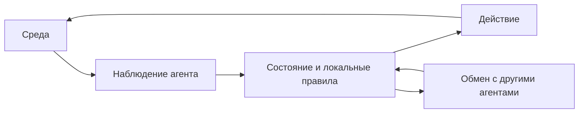

[[Тренды ИИ]]

# ИИ — агенты, взаимодействия и сложные системы

> [!abstract] Суть
> Агент получает информацию из среды, поддерживает собственное состояние и действует по правилам и целям. Свойства множества агентов зависят от взаимодействий и топологии, поэтому их нельзя вывести простым сложением индивидуальных свойств.

Когда несколько участников действуют в общей среде, одного описания каждого участника недостаточно. Нужно задать правила обмена, связи и изменение состояний во времени. Здесь вводится общий язык агентных систем; в следующей теме на этом языке будет разобрана конкретная организация LLM-агентов и их коллективных ошибок.

## От общей модели к взаимодействующим частям

Лекция противопоставляет описание через общие усреднённые закономерности и построение целого из разных локальных элементов. Название «дедуктивное обобщение частностей» на слайде нестрого: обобщение и дедукция — разные логические операции. Содержательная идея — сравнение макроописания и порождения динамики через взаимодействия.

Метафора определения веса животного различает расчёт по объёму и плотности, усреднение независимых экспертных оценок и обмен аргументами между экспертами. Обсуждение может выявить сведения, но не гарантирует устранения общей ошибки. Разделение объекта на взвешиваемые части — другая декомпозиция, не определение агентного моделирования.

Сложность имеет разные смыслы: вычислительные ресурсы, длина минимального описания по Колмогорову, богатство структуры сети, разнообразие динамических паттернов, последовательностей в биоинформатике и ёмкость класса моделей, например VC-размерность. Эти меры нельзя подменять одной универсальной шкалой.

## Состав агента и системы

Агент в рабочем определении автора — идентифицируемая автономная цифровая сущность, решающая делегированную задачу в среде. Сенсоры дают наблюдения, актуаторы/эффекторы реализуют воздействие. Внутри — атрибуты, правила, память, ресурсы, механизм решения и, при наличии обучения, правила изменения поведения. Автономность не означает отсутствия ограничений или обязательно человеческой цели у любого моделируемого агента.

Мультиагентная система (МАС) объединяет нескольких агентов, среду и связи. Большое число частей, нелинейность и динамическая нерегулярная топология характерны для рассмотренных сложных систем, но не обязательны для определения любой МАС. Взаимодействие «каждый с каждым» означает возможность сетевых эффектов, а не требование полного графа.

Бухановский вводит МАС как семейство автономных агентов, совместно решающих задачу пользователя на основе разделения труда — «цифровая артель». На схеме каждому агенту соответствуют свой экземпляр фундаментальной модели, специальные знания, умение решать специальные компьютерные задачи и инструменты воздействия на мир. Постановка общей задачи проходит через сеть участников к результату; роли и связи определяют, какие локальные действия складываются в общую работу.

![[ИИ — разделение труда в МАС (2026).png]]

Это пример организации **LLM-агентов**, а не требование, чтобы любая агентная модель содержала языковую модель. Разные роли не гарантируют независимых знаний и ошибок. Программный цикл отдельного участника, внешняя память и контроль действий раскрыты в [[ИИ — LLM-агенты, композитный ИИ и коллективные эффекты]].

Регулярные решётки изображений и последовательности противопоставлены графам социальных взаимодействий с меняющимися дальними связями. Классические модели тоже могут быть распределёнными, а МАС — иерархическими: жёсткое противопоставление «всё централизовано / всё децентрализовано» в таблице источника — учебная идеализация.

## Построение и виды взаимодействия

**Дополнительная схема для понимания.**

Внутренний цикл относится к одному участнику, обмен связывает его с остальными. Изменение правила сообщения или структуры связей может изменить результат системы, даже если индивидуальный механизм решения прежний.

Общая процедура: определить среду → общую цель → свойства и локальные правила агентов → начальное состояние → запустить изменения во времени → наблюдать достижение цели или прекращение жизнеспособности. Общая цель исследователя может отличаться от локальных целей участников.

Кооперация объединяет усилия, конкуренция разделяет ограниченные ресурсы, смешанный режим Co-Co сочетает оба. Агенты-лидеры или секретари могут связывать локальные предложения в библиотеку планов. В примере эвакуации только конкуренция ухудшает результат, а обмен локальной информацией помогает без полного знания всей среды; это вывод конкретного моделирования, не закон для всех задач.

## Топология и макродинамика

Комплексная сеть в лекции — граф с меняющимися состояниями узлов и рёбер, вероятностными правилами и связью микро- и макрохарактеристик. Внешнее воздействие, приток, отток и смена локальных связей влияют на всю систему. Если структура известна, иногда возможно макроописание; если нет, её воспроизводят на уровне взаимодействий. Переход к уравнениям требует дополнительных предположений и не следует из одного знания графа.

![[МАС — топология и макроописание.png]]

Простой пешеходный агент притягивается к цели и отталкивается от близких объектов в модели социальных сил. Контактные сети «на улице» и «в толпе» иллюстрируют различия локальной геометрии. В PDF часть этих демонстраций представлена заставкой или чёрным полем: динамические детали из них не восстанавливаются.

## Уровни поведения

| Класс | Основа решения |
|---|---|
| Простой рефлекторный | Текущее наблюдение и правило реакции |
| С внутренней моделью | Оценка ненаблюдаемой части среды по памяти и переходам |
| Целевой | Сопоставление с желаемыми состояниями |
| На полезности | Ранжирование состояний по ценности |
| Обучающийся | Изменение правил или параметров по опыту |
| Нормативный | Учет норм и ограничений взаимодействия |

Отдельная ось — реактивность, проактивность и социальная активность. Делиберативный агент использует внутреннюю модель и планирует; это не утверждение о наличии сознания. Дискретные состояния позволяют описывать процессы вроде SEIR(D): восприимчивость, скрытое состояние, активное распространение, выход из него и дополнительные исходы выбранной модели.

Пример контактных сетей эпидемии относится к моделированию на данных США 1990–2000-х. Его технический смысл — зависимость распространения от структуры и смены связей. Из него нельзя выводить моральные свойства людей или универсальное объяснение различий популяций; оценочные и правовые отступления источника не переносятся в теорию.

В другом примере состояние и правила используются для железнодорожного управления. Динамический баланс внутренних целей и внешних воздействий показан также на регулярном и нерегулярном волнении: одинаковое управление в разных средах не даёт одинакового поведения.

## BDI и когнитивные архитектуры

Модель Belief–Desire–Intention разделяет представления о мире, желания и принятые намерения. В варианте BDIAR источника добавлены Action и Result: результат действия обновляет цель, запускает новую цепочку или меняет контекст. Агент в интернете воспринимает сообщения, фильтрует их, обновляет память, формирует и отправляет сообщения; свойства профиля влияют на выбор действий. Средой могут быть стена сообщества, личные сообщения и новостная лента.

![[МАС — контекст, намерения и сообщения.png]]

Пример «Барби»-сервиса различает исходного пользователя, просмотр фото друга, создание своего изображения, публикацию, дальнейшие пересылки и уход. В модели рост сменяется оттоком, недоступностью сервиса, негативными отзывами и частичным восстановлением. Передача информации и её оптимизация — процессы на сети, а не автоматическое появление интеллекта.

Когнитивные архитектуры реализуют процессы восприятия, обучения, рассуждения и действия. На слайдах BICA/ConScale описаны ступени от рефлекса через реактивность, целевое поведение и рефлексию к метакогнитивности. Таксономия включает символьные, возникающие из низкоуровневых взаимодействий и гибридные архитектуры. Эти шкалы — исследовательские модели способностей, не универсальный сертификат разумности.

**Переход к следующей теме.** На этом общем языке теперь можно разобрать LLM-агента, оболочку его исполнения и координацию нескольких агентов. [[ИИ — LLM-агенты, композитный ИИ и коллективные эффекты|Читать дальше →]].

Связи: [[ИИ — LLM-агенты, композитный ИИ и коллективные эффекты]], [[ИИ — интеллектуальные системы поддержки решений]].

## Источники

[[Тренды-ИИ-(занятие 1)-2026.pdf]] — актуальное вводное определение агента и схема разделения труда в МАС.

[[Тренды-ИИ-(занятие 6).pdf]] — агентное моделирование и когнитивные архитектуры. Прежние схемы топологии и BDI извлечены из этого источника, новая схема разделения труда — из актуального занятия 1. Непроигрываемые демонстрации не заменены вымышленными описаниями.
