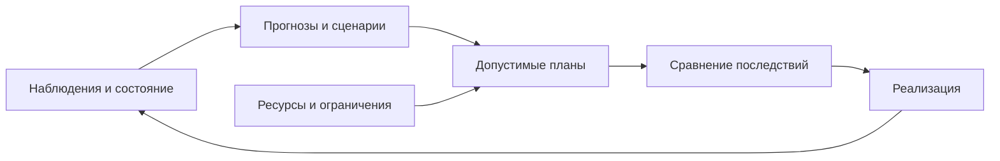

[[Тренды ИИ]]

# ИИ — промышленное планирование и кадровые модели

> [!abstract] Суть
> Эффект промышленного ИИ зависит от того, какую часть производственного процесса он меняет. Важны не только прогноз или распознавание, но и связь с действиями, ограничениями и ответственностью.

В производстве прогноз должен превратиться в выполнимый план: с оборудованием, ресурсами, людьми и ограничениями. Эта тема связывает модели с последовательностью действий во времени. Промышленные и кадровые примеры различаются объектами, но требуют одного перехода — от вероятного будущего к допустимому управленческому решению.

## Автоматизация и трансформация

Автоматизация уменьшает трудоёмкость отдельных операций. Цифровая трансформация меняет устройство процесса, культуру работы, продукты, услуги и рынок труда. Замена таблицы расчётной формулой сама по себе не создаёт нового бизнеса.

В сравнении лекции измерение активности птицы создаёт ранее отсутствовавшие данные и возможность превентивного реагирования, а оптимизация сжигания отходов без изменения процесса может остаться локальным улучшением расчёта. Это оценка двух примеров, а не доказательство ненужности расчётной автоматизации.

Рутинные применения: контроль СИЗ и последовательности операций, роботизация, техническое обслуживание и ремонт. Поддержка инженера может давать больший системный эффект через быстрые вычисления, генерацию многоэтапных сценариев, проверку результатов и поиск нетривиальных вариантов.

## Планирование и неопределённость

**Дополнительная схема для понимания.**

Прогноз описывает возможное будущее, план — действия с ресурсными ограничениями. После исполнения нужны новые наблюдения: прежний сценарий мог не реализоваться. Статичная область демонстрации на слайде не используется как свидетельство динамики.

Пример обустройства нефтегазового месторождения объединяет накопление предметной информации, генерацию возможных объектов, расписаний и оценку рисков. Различают получение знаний о текущем состоянии, построение допустимых вариантов, календарное планирование и выбор с учётом вероятности срыва.

![[ИИ — интегрированное планирование месторождения.png]]

На графиках плана показаны интервалы и уровни риска 50% и 90%; они относятся к сценарию моделирования. Отдельные слайды динамической демонстрации не содержат читаемых кадров, поэтому детали работы интерфейса по ним не выводятся.

Пример поиска места для нового бизнеса — географический интерфейс с пространственными данными. Связь с кадровым планированием состоит в использовании отраслевых ролей, ограничений и прогнозов ресурсов; это разные предметные задачи, не один универсальный чат-запрос.

## Выбор технологии подготовки газа

В занятии 5 редакции 2026 сравниваются обычная командная процедура и СППР в мультиагентной архитектуре. Задача — выбрать оптимальную низкотемпературную технологию подготовки газа с учётом исходных данных, технологических и транспортных ограничений, а затем экономической эффективности.

![[Тренды ИИ — Выбор технологии подготовки газа (занятие 5 2026).png]]

*А. В. Бухановский, занятие 5, редакция 2026. Ручной цикл согласования расчётов между специальностями.*

**Как читать исходный процесс.** Потребитель передаёт данные и ограничения территориально распределённой команде концептуального проектирования. Команда моделирует технологический процесс, рассчитывает транспортную схему для одного сценария и его экономическую эффективность по NPV. Сценарии возвращаются на согласование, поэтому стоимость имеет не только сам расчёт, но и передача задачи между специалистами. На слайде для этого примера указаны команда от десяти человек, 3–4 цикла, 1–2 недели, 2–3 дня на команду в цепочке вызовов моделей и детальная оценка 2–4 сценариев. Это параметры демонстрируемого процесса, а не норматив для любой организации.

**Дополнительное пояснение:** NPV — чистая приведённая стоимость, оценка денежных потоков с учётом их времени. В лекции она служит критерием сравнения; параметры расчёта и ставка дисконтирования не предоставлены, поэтому численные значения нельзя воспроизвести независимо.

![[Тренды ИИ — Агенты технолог, транспорт и экономика (занятие 5 2026).png]]

*А. В. Бухановский, занятие 5, редакция 2026. Роли предметных агентов и раннее отсечение неэффективных вариантов.*

В предложенной архитектуре четыре рабочие роли:

1. Специалист по транспортировке определяет варианты объёмов по каналам и ограничения по продуктам.
2. Технолог формирует технологические варианты, учитывая эти ограничения; заведомо лишние схемы не передаются на дорогой расчёт.
3. Экономист сопоставляет сдачу по продуктам и ограничения, позволяя заранее отбрасывать неэффективные профили.
4. Оптимизатор сценариев получает потенциально эффективные варианты и рассчитывает их для сравнения.

Стрелки на рисунке — обмен ограничениями и результатами. Общая среда взаимодействия — комплексные сценарии технологии подготовки газа. Служебные агенты на слайде не показаны, поэтому перечень четырёх ролей не описывает всю инфраструктуру. **Дополнительное пояснение:** выигрыш ожидается от раннего сужения пространства вариантов и координации расчётов; конкретный коэффициент ускорения из схемы не следует. Она также не устанавливает, что каждый агент обязательно реализован LLM.

![[Тренды ИИ — Проверяемый результат промышленной СППР (занятие 5 2026).png]]

*А. В. Бухановский, занятие 5, редакция 2026. Рейтинг связан с техническим представлением и расчётными элементами.*

Итоговая форма результата должна позволять ранжировать варианты, увидеть их в исходных технических образах, менять сценарии «если–то» и проверять решение по шагам и элементам. Таблица сравнения, граф связей и технологическая схема — три представления одного решения. Читатель должен проследить, какой вариант победил и за счёт каких предпосылок, а не получить только фразу «выбран оптимальный».

Связь с общей архитектурой: [[ИИ — интеллектуальные системы поддержки решений#Современная композиция]].

## Кадровая динамика и подбор

Граф карьерных переходов связывает должности и доступные траектории, а прогнозы показывают численность по сценариям. Данные о начальном составе, переходах, выходе и потребности в компетенциях позволяют изучать будущий дефицит; качество зависит от предположений о поведении людей.

![[ИИ — граф кадровых траекторий.png]]

«HR-Эксперт» сопоставляет профиль должности и кандидата. Профиль должности содержит требования, характеристики и поведение; профиль кандидата — ключевые навыки, мышление, разрешение проблем и конфликтов, достижение результата, лидерство, командность, ресурсы и другие характеристики. Генератор вопросов интервью использует эти требования и может учитывать результаты анализа видео. На схеме показана интеграция с внешними сайтами вакансий.

Это описание системы, а не подтверждение, что видео надёжно измеряет способности или что соответствие профилей исключает дискриминацию. Человеческие качества не следует считать непосредственно известными из одной автоматической оценки.

## Средняя метрика и последствия

План используется в реальном процессе, поэтому ошибки нужно оценивать по последствиям. Хороший средний результат не отменяет плохой работы в редком критическом режиме.

В примере распознавания сигналов крана заявлено среднее качество 92%, но отдельные классы различаются:

| Сигнал из источника | Доля правильного распознавания |
|---|---|
| Поднять груз | 1.00 |
| Опустить груз | 0.91 |
| Передвинуть кран влево | 0.83 |
| Передвинуть кран вправо | 0.94 |
| Передвинуть стрелу влево | 0.80 |
| Передвинуть стрелу вправо | 0.94 |
| Поднять стрелу | 0.91 |
| Опустить стрелу | 1.00 |
| Стоп | 0.89 |
| Осторожно | 1.00 |

Особенно значимо, с каким действием перепутан «Стоп»: цена ошибок неодинакова. В исходной таблице встречаются несогласованные подписи номера и названия ошибочного класса; они не превращаются здесь в достоверную матрицу ошибок. Эти данные объясняют оценку модели, а не служат инструкцией управления техникой.

Другой пример — ледовый прогноз с интегральным качеством выше 90%: судно идёт по конкретному маршруту, поэтому локально неверный участок может оказаться важнее среднего показателя. Сравнение с публикацией в Nature без полной постановки не доказывает пригодность навигационного решения.

**Переход к следующей теме.** Чтобы завершить оценку решения, нужно перевести изменения процесса в эффект, стоимость сопровождения и допустимый риск. [[ИИ — экономика внедрения и человеческий капитал|Читать дальше →]].

Связи: [[ИИ — генеративный дизайн и цифровые двойники]], [[ИИ — метрики качества и проверка моделей]], [[ИИ — экономика внедрения и человеческий капитал]].

## Источник

[[Тренды-ИИ-(занятие 8).pdf]] — производственные и кадровые примеры. Результаты отдельных проектов сохранены с их контекстом и ограничениями.

[[Тренды-ИИ-(занятие 5)-2026.pdf]] — процесс выбора низкотемпературной технологии подготовки газа, предметные агенты и форма проверки результата.
