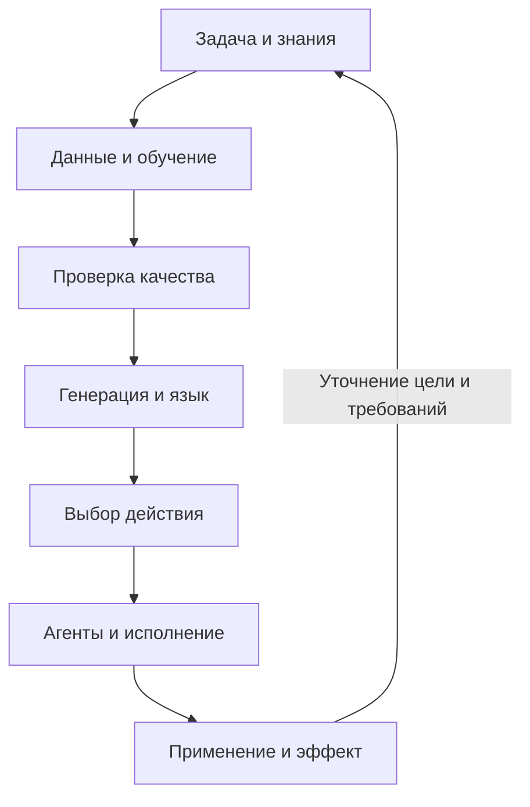

# Тренды ИИ

[[Учёба]]

## Что мы прошли

Утверждения, формулы и методы из материалов курса в порядке основных блоков Бухановского 2026. Подробные выводы, примеры и атрибуция источников сохранены в темах по ссылкам; дополнительные выводы Николенко включены рядом с соответствующим методом.

### Понятия ИИ, агенты и знания

- **Определения:** различаются мышление/действие и сходство с человеком/рациональность. Узкий ИИ решает ограниченный класс задач; широкое переиспользование фундаментальной модели само по себе не устанавливает наличие AGI. Тест Тьюринга оценивает наблюдаемое поведение в заданном протоколе, а не доказывает сознание или универсальность.
- **Агент:** наблюдения среды → состояние и память → выбор действия → инструмент/эффектор → результат и новое наблюдение. Harness организует цикл, инструменты, память, ограничения и проверку; языковая модель — один из компонентов. BDI разделяет beliefs, desires, intentions; BDIAR добавляет действие и результат.
- **Мультиагентность:** общая цель, локальные правила, начальные состояния и топология задают динамику; кооперация, конкуренция и переговоры меняют коллективный результат. Дебаты: независимые ответы → обмен критикой → уточнение → согласование. Большинство может повторять общую ошибку; эмерджентность и фазовые режимы требуют проверки в конкретной системе.
- **Композитный ИИ:** объединяет разные модели, программы и методы через интерфейсы. Мета-агент подбирает роли, инструменты, топологию и протоколы; RLHF использует обратную связь людей, RLAIF — оценку ИИ.
- **Знания:** правила и механизм вывода, семантические сети, фреймы и сценарии явно представляют отношения. Факт графа знаний — тройка `(субъект, отношение, объект)`. Certainty factor $\in[-1,1]$, нечёткая принадлежность $\in[0,1]$ и вероятность имеют разный смысл и не взаимозаменяемы.
- **Графовый RAG:** план отношений → извлечение существующих путей/троек → ответ с опорой на них. При извлечении графа из текста проверяются направление и смысл отношений; сопутствующее упоминание не превращается в определяющий факт. RoG и GraphMERT представлены как конкретные подходы из лекции.

Подробно: [[ИИ — определения, знания и общий интеллект]], [[ИИ — история и тест Тьюринга]], [[ИИ — LLM-агенты, композитный ИИ и коллективные эффекты]], [[ИИ — агенты, взаимодействия и сложные системы]], [[ИИ — представление знаний и графы знаний]].

### Данные и устройство обучения

- **Постановки:** supervised learning использует $(x_i,y_i)$; регрессия предсказывает число, классификация — категорию; обучение без учителя ищет структуру без заданных меток, RL — поведение по вознаграждению взаимодействий. Модальность и метод моделирования — разные оси классификации.
- **Конвейер:** цель → сбор и подготовка данных → признаки и класс модели → обучение → независимая проверка → способ применения. Масштабирование, обработка выбросов и сэмплирование зависят от задачи; синтетические данные проверяют на разнообразие и реалистичность.
- **Эмпирический риск:** $\widehat R(\theta)=N^{-1}\sum_iL(y_i,f(x_i;\theta))$. Малый риск на train не гарантирует обобщения; сложность, шум, объём и смещение данных влияют на переобучение.
- **Нейрон:** $z=w^\top x+b$, $h=g(z)$; в пороговом примере $h=1$ при $z>0$, иначе $0$. Сеть — композиция таких преобразований.
- **Ансамбли и перенос:** bagging агрегирует модели на вариантах данных, $M_A=\sum_i a_iM_i$; boosting последовательно исправляет остаточную ошибку; stacking использует метамодель. Transfer learning переиспользует обученное представление, fine-tuning меняет параметры; online learning обновляется по поступлению данных, AutoML ищет модель/конвейер по метрике и ограничениям.

Подробно: [[ИИ — данные и постановки задач обучения]], [[ИИ — модели и методы машинного обучения]].

### Вероятности и байесовский вывод

- **Условие и маргинализация:** $p(x)=\sum_yp(x,y)$, $p(x\mid y)=p(x,y)/p(y)$ при $p(y)>0$; независимость означает $p(x,y)=p(x)p(y)$. Для непрерывных величин используются плотности и интегралы.
- **Байес:** $p(y\mid x)=p(x\mid y)p(y)/\sum_{y'}p(x\mid y')p(y')$ при положительном знаменателе. Базовая частота влияет на положительный прогноз: $Precision=TPR\cdot\pi/[TPR\cdot\pi+FPR(1-\pi)]$ для доли положительных $\pi$.
- **Параметры:** $p(\theta\mid D)=p(D\mid\theta)p(\theta)/p(D)$, $p(D)=\int p(D\mid\theta)p(\theta)d\theta$. ML максимизирует $p(D\mid\theta)$, MAP — $p(D\mid\theta)p(\theta)$; байесовский прогноз усредняет $p(x_{new}\mid\theta)$ по posterior.
- **Монетка:** при $n$ орлах и $m$ решках $p(D\mid\theta)=\theta^n(1-\theta)^m$ для конкретной последовательности; $\widehat\theta_{ML}=n/(n+m)$ при $n+m>0$. Prior $\operatorname{Beta}(\alpha,\beta)$, $\alpha,\beta>0$, даёт posterior $\operatorname{Beta}(\alpha+n,\beta+m)$; прогноз орла $(n+\alpha)/(n+m+\alpha+\beta)$. При равномерном prior — правило Лапласа $(n+1)/(n+m+2)$.
- **Бета-нормировка:** $B(\alpha,\beta)=\int_0^1u^{\alpha-1}(1-u)^{\beta-1}du=\Gamma(\alpha)\Gamma(\beta)/\Gamma(\alpha+\beta)$; плотность Beta равна $\theta^{\alpha-1}(1-\theta)^{\beta-1}/B(\alpha,\beta)$.

Подробно: [[ИИ — байесовский вывод и обучение по данным]].

### Регрессия и регуляризация

- **Линейная модель:** $f(x;w)=w_0+\sum_jx_jw_j$; после добавления единичной координаты $f=x^\top w$. Нелинейные признаки $\phi(x)$ сохраняют линейность по весам: $f=\phi(x)^\top w$.
- **МНК:** $RSS=\|t-Xw\|_2^2$, $\nabla RSS=2X^\top(Xw-t)$; нормальные уравнения $X^\top X\widehat w=X^\top t$. При независимых столбцах $\widehat w=(X^\top X)^{-1}X^\top t$; без полного ранга эта обратная не существует. Независимый гауссовский шум одинаковой дисперсии связывает ML с минимумом RSS.
- **Штрафы:** ridge минимизирует $\|t-\Phi w\|_2^2+\lambda\sum_{j\ge1}w_j^2$, lasso — ту же ошибку с $\lambda\sum_{j\ge1}|w_j|$; в этом соглашении свободный член не штрафуется. Если штрафуются все координаты, ridge даёт $(\Phi^\top\Phi+\lambda I)^{-1}\Phi^\top t$ при $\lambda>0$. Elastic net сочетает $L_1$ и квадрат $L_2$; lasso способствует нулевым коэффициентам.
- **Байесовская регрессия:** при prior $w\sim\mathcal N(m_0,S_0)$ с положительно определённой $S_0$ и шуме $\mathcal N(0,\beta^{-1}I)$:
  $$S_N^{-1}=S_0^{-1}+\beta\Phi^\top\Phi,\qquad m_N=S_N(S_0^{-1}m_0+\beta\Phi^\top t).$$
  Posterior — $\mathcal N(m_N,S_N)$; для $\phi_*=\phi(x_*)$ прогноз имеет среднее $\phi_*^\top m_N$ и дисперсию $\beta^{-1}+\phi_*^\top S_N\phi_*$: шум и неопределённость весов — разные слагаемые.

Подробно: [[ИИ — линейная регрессия и регуляризация]].

### Классификация

- **Линейная граница:** $a(x)=w^\top x+w_0$; при $w\ne0$ гиперплоскость $a(x)=0$ имеет нормаль $w$, знаковое расстояние $a(x)/\|w\|$. Для нескольких классов выбирают $\arg\max_ka_k(x)$.
- **Фишер:** $S_B=(m_2-m_1)(m_2-m_1)^\top$, $S_W=\sum_{k=1}^2\sum_{x\in C_k}(x-m_k)(x-m_k)^\top$; максимизируется $J(w)=w^\top S_Bw/(w^\top S_Ww)$. При положительно определённой $S_W$ и разных средних оптимальное направление $w\propto S_W^{-1}(m_2-m_1)$.
- **Порождающая классификация:** $p(C_k\mid x)=p(x\mid C_k)\pi_k/\sum_jp(x\mid C_j)\pi_j$; максимум posterior оптимален при одинаковой единичной цене ошибок. Для невырожденных гауссовских классов:
  $$\delta_k(x)=-\tfrac12\log|\Sigma_k|-\tfrac12(x-\mu_k)^\top\Sigma_k^{-1}(x-\mu_k)+\log\pi_k.$$
  Общая ковариация даёт линейные границы LDA, разные ковариации — квадратичные QDA.
- **Логистическая регрессия:** $p=\sigma(w^\top x)$, $\sigma(a)=1/(1+e^{-a})$, $\log[p/(1-p)]=w^\top x$, $\sigma'(a)=\sigma(a)(1-\sigma(a))$. Для бинарных $t_n$ лог-правдоподобие $\ell=\sum_n[t_n\log p_n+(1-t_n)\log(1-p_n)]$, $\nabla_w\ell=\sum_n(t_n-p_n)x_n$; при минимизации $-\ell$ знак меняется.
- **Неопределённые веса:** прогноз интегрирует сигмоиду по posterior и в общем не равен сигмоиде среднего. При гауссовском приближении $\mu_a=w_{MAP}^\top x$, $s=x^\top\Sigma_Nx$, $p(C_1\mid x,D)\approx\sigma(\mu_a/\sqrt{1+\pi s/8})$; используется $\sigma(a)\approx\Phi(\sqrt{\pi/8}\,a)$.
- **Softmax:** $p_k=e^{a_k}/\sum_je^{a_j}$, $a_k=w_k^\top\phi$; вероятности положительны и суммируются в $1$.

Подробно: [[ИИ — классификация, дискриминанты и логистическая регрессия]].

### Нейросети и оптимизация

- **Активации:** порог, сигмоида, $\tanh$, ReLU $\max(0,z)$ меняют представление после взвешенной суммы. Прямой проход вычисляет значения, backprop — производные по цепному правилу:
  $$\frac{\partial L}{\partial v}=\sum_{u:\,v\to u}\frac{\partial L}{\partial u}\frac{\partial u}{\partial v}.$$
- **Спуск:** $w_{t+1}=w_t-\eta_tg_t$, $\eta_t>0$; полный градиент берётся по всей выборке, mini-batch $g_t=|B_t|^{-1}\sum_{n\in B_t}\nabla L_n(w_t)$. Слишком большой шаг может повысить потерю; глобальный минимум нелинейной сети не гарантирован.
- **Момент:** $v_{t+1}=\mu v_t-\eta\nabla L(w_t)$, $w_{t+1}=w_t+v_{t+1}$, $0\le\mu<1$; у Нестерова градиент вычисляется в $w_t+\mu v_t$.
- **Adagrad:** $G_{t,ii}=\sum_{\tau=1}^tg_{\tau,i}^2$, $w_{t+1,i}=w_{t,i}-\eta g_{t,i}/\sqrt{G_{t,ii}+\varepsilon}$. Накапливаемая сумма может чрезмерно уменьшать шаг; RMSprop/Adadelta представлены как варианты адаптации.
- **Adam:** $m_t=\beta_1m_{t-1}+(1-\beta_1)g_t$, $v_t=\beta_2v_{t-1}+(1-\beta_2)g_t^{\odot2}$; при нулевых начальных моментах $\widehat m_t=m_t/(1-\beta_1^t)$, $\widehat v_t=v_t/(1-\beta_2^t)$, $w_{t+1}=w_t-\eta\widehat m_t/(\sqrt{\widehat v_t}+\varepsilon)$, $0\le\beta_1,\beta_2<1$, $\varepsilon>0$.
- **Muon, схема слайда:** $B_t=\mu B_{t-1}+G_t$, $O_t=\operatorname{NewtonSchulz5}(B_t)$, $\theta_t=\theta_{t-1}-\eta O_t$. Это фрагмент для матричных параметров; отсутствующие детали процедуры не считаются готовой реализацией.

Подробно: [[ИИ — нейросети, обратное распространение и градиентный спуск]].

### Статистика и неопределённость

- **Распределение:** $F(x)=P(X\le x)$; при наличии плотности $F(x)=\int_{-\infty}^xf(t)dt$. Квантиль $q_p=\inf\{x:F(x)\ge p\}$. При существовании моментов $\mu=E[X]$, $\sigma^2=E[(X-\mu)^2]$; для плотности $E[X]=\int xf(x)dx$.
- **Нормальное распределение:** $f(x)=e^{-(x-\mu)^2/(2\sigma^2)}/(\sigma\sqrt{2\pi})$, $\sigma>0$; $q_p=\mu+\sigma\Phi^{-1}(p)$. $\Phi^{-1}(0{,}975)\approx1{,}960$, $\Phi^{-1}(0{,}99)\approx2{,}326$.
- **Оценка и интервал:** статистика случайна до наблюдения выборки; параметр частотной модели фиксирован. Уровень доверия описывает долю покрытий параметра при повторении процедуры; байесовский интервал задаёт posterior-массу при выбранной модели и prior.
- **Доля:** для независимых одинаково распределённых индикаторов $\widehat p=k/n$, $E[\widehat p]=p$, $\operatorname{Var}\widehat p=p(1-p)/n$. При достаточных числах успехов/неуспехов интервал Вальда $\widehat p\pm z_{1-\alpha/2}\sqrt{\widehat p(1-\widehat p)/n}$ приближённый; около $0/1$ и на малых выборках ненадёжен.
- **Размер выборки:** для полуширины $\Delta$ и принятой доли $p$, $n_0\approx z^2p(1-p)/\Delta^2$; при выборке без возвращения из конечной совокупности размера $M$, $n\approx Mn_0/(M-1+n_0)$, округление вверх. Нормальное приближение сохраняет свои ограничения.
- **Порядковые статистики:** сортировка $X_{(1)}\le\cdots\le X_{(n)}$ задаёт минимум, максимум и квантили. Boxplot использует медиану, квартили, $IQR=Q_3-Q_1$ и границы $Q_1-1{,}5IQR$, $Q_3+1{,}5IQR$; точки за ними — кандидаты в выбросы, не автоматически ошибки.

Подробно: [[ИИ — интервальные оценки и неопределённость]].

### Метрики и проверка качества

- **Регрессия:** при $e_i=y_i-f_i$, $BIAS=n^{-1}\sum_ie_i$, $MAE=n^{-1}\sum_i|e_i|$, $RMSE=\sqrt{n^{-1}\sum_ie_i^2}$. Знаковые ошибки могут компенсироваться, RMSE сильнее реагирует на большие отклонения.
- **Классификация:** $Accuracy=(TP+TN)/(TP+TN+FP+FN)$, $Precision=TP/(TP+FP)$, $Recall=TP/(TP+FN)$, $F_1=2PR/(P+R)$; $TPR=Recall$, $FPR=FP/(FP+TN)$. Для нулевых знаменателей фиксируют соглашение. ROC меняет TPR/FPR с порогом, AUC оценивает ранжирование; высокая accuracy при дисбалансе может быть малоинформативна.
- **Перекрытие:** $IoU=|A\cap B|/|A\cup B|=TP/(TP+FP+FN)$, $mIoU=k^{-1}\sum_cIoU_c$; в сегментации счёт ведётся по пикселям.
- **Проверка:** $k$-fold CV обучает на $k-1$ частях и проверяет на оставшейся по очереди; bootstrap создаёт выборки с возвращением исходного размера. Временные/групповые зависимости требуют подходящего разбиения; оценки по перекрывающимся данным зависимы, утечка делает оценку недостоверной.
- **Протокол:** benchmark задаёт задачу, данные и метрики, baseline — отправную точку, SOTA — лучший известный результат в конкретном протоколе на определённый момент. OOD-детекция отмечает отличие входа от обучающих условий, но не гарантирует верный ответ в неизвестном режиме.
- **Доверие:** оценивают не только точность, но и устойчивость, объяснимость, безопасность и последствия. Состязательные входы, уклонение, отравление данных/моделей и восстановление сведений — разные угрозы. Понятность условий и раскрытие цели сервиса влияют на этичность взаимодействия.

Подробно: [[ИИ — метрики качества и проверка моделей]], [[ИИ — этика, безопасность и доверие]].

### Генерация и языковые модели

- **Монте-Карло:** событие вероятности $p$ моделируется сравнением $U\sim U[0,1]$ с $p$; дискретный исход — попаданием в интервал накопленных вероятностей. Принятие–отклонение генерирует кандидата из $g$ и принимает с вероятностью $f(x)/(Mg(x))$ при $f\le Mg$.
- **Дискретная генерация:** при $S_0=0$, $S_j=\sum_{i=1}^jp_i$ выбираем $x_j$, если $S_{j-1}\le U<S_j$. В примере оценок границы $0,0.4,0.7,0.9,1$ дают из $0.45,0.06,0.78,0.52,0.88,0.96,0.54,0.46$ оценки $4,5,3,4,3,2,4,4$; точные доли на короткой выборке не гарантированы.

- **Байесова сеть:** ориентированный ациклический граф задаёт $p(x_1,\ldots,x_d)=\prod_ip(x_i\mid x_{pa(i)})$; генерация идёт от родителей к потомкам.
- **Механизмы:** генетический алгоритм повторяет оценку, отбор, скрещивание и мутацию до условия остановки; глобальная оптимальность не гарантирована. GAN обучает генератор через сигнал дискриминатора; VAE использует вероятностное латентное представление; диффузионная модель учится обращать зашумление.
- **Языковая модель:** $p(t_1,\ldots,t_m)=\prod_jp(t_j\mid t_{<j})$. Энкодер строит контекстное представление, авторегрессионный декодер продолжает последовательность, энкодер–декодер преобразует вход в выход. Токен не обязан совпадать со словом.
- **RAG и критик:** поиск → отбор контекста → генерация; критик проверяет и передаёт обратную связь для доработки. Найденный текст и правдоподобный ответ требуют проверки; RAG не равен переобучению весов и не гарантирует отсутствия ошибок.

Подробно: [[ИИ — вероятностная генерация и метод Монте-Карло]], [[ИИ — генеративные модели и языковое моделирование]].

### Решения, рекомендации и области применения

- **СППР:** цели → альтернативы → оценка → последствия → выбор → реализация; данные, модели, предметные знания и объяснение поддерживают ЛПР. Ограниченная рациональность учитывает неполноту информации и вычислений; satisficing ищет удовлетворительный вариант.
- **Рекомендации:** неполная матрица user–item, контекст и обратная связь используются для ранжирования; холодный старт ограничен отсутствием истории. $P@k=k^{-1}\sum_{i=1}^krel_i$; в соглашении лекции $AP@K=\sum_{i=1}^Krel_iP@i/\sum_{i=1}^Krel_i$, $MAP@K=|U|^{-1}\sum_uAP@K(u)$. При отсутствии релевантных объектов в первых $K$ нужно соглашение о нулевом знаменателе; в других протоколах AP знаменатель бывает иным.
- **XAI:** глобальное объяснение описывает закономерности модели, локальное — конкретный ответ. Убедительный текст объяснения не подтверждает его верность; цель владельца сервиса может отличаться от интереса пользователя.
- **Наука:** НИР создаёт знание, ОКР — проверяемый образец и документацию; TRL характеризует готовность технологии. PSE/iPSE связывает предметные инструменты и workflow; научный ассистент требует проверяемых источников, расчётов и экспериментов.
- **Образование:** профессиональные требования → компетенции → программа → курс → материалы → практика → оценка результата. Применение ИИ оценивают по формируемому умению; iLMS объединяет платформу, предметные модели/RAG и обратную связь.
- **Дизайн и двойники:** генеративный дизайн ищет допустимые варианты по ограничениям и критериям; цифровой двойник связывает модели, реальные данные и механизмы их усвоения. Суррогат ускоряет расчёт в границах своей применимости, цифровой полигон проверяет сценарии и экстремальные условия.
- **Городской дизайн:** социальная группа → жизненная ситуация → потребности → сервисы → параметры и варианты проекта → проверка норм, функций и экономики. Мастер-план включает проект и график реализации; визуального сходства с застройкой недостаточно.

- **Промышленность и кадры:** прогноз связывают с допустимым действием, расписанием, риском и ответственностью. Карьерные графы описывают переходы и сценарии численности; средняя точность не отражает цену ошибки в опасном классе.
- **Экономика:** эффект возникает через экономию и изменение выпуска/качества; KPI связывают с процессом и результатом. В иллюстративной модели лекции:
  $$\dot K\sim(1-a_K)^\alpha(1-a_L)^{1-\alpha}K^\alpha A^{1-\alpha}L^{1-\alpha}-\Delta_K,\qquad \dot A\sim(a_KK)^\beta(a_LL)^\gamma A^\theta.$$
  $K$ — капитал, $A$ — технология, $L$ — труд с навыками; $a_K,a_L$ — доли ресурсов на развитие технологии. Модель требует определённых параметров и проверки; отдельные успешные кейсы и ROI не гарантируют такой же эффект в другом проекте. Человеческий капитал включает здоровье, знания, умения, навыки и культуру.

Подробно: [[ИИ — интеллектуальные системы поддержки решений]], [[ИИ — рекомендательные системы и объяснимость]], [[ИИ — исследования, eScience и научные ассистенты]], [[ИИ — образовательные системы и учебная аналитика]], [[ИИ — генеративный дизайн и цифровые двойники]], [[ИИ — промышленное планирование и кадровые модели]], [[ИИ — экономика внедрения и человеческий капитал]].

## Как устроен курс

Курс отвечает на один вопрос: **как превратить задачу человека в работающую и проверяемую систему ИИ?** Каждая следующая часть добавляет недостающий компонент: знания и данные, модель, проверку, генерацию вариантов, выбор действия, организацию исполнения и оценку эффекта.

**Дополнительная схема для понимания:** это связь понятий курса, а не требование использовать все технологии в каждом проекте. Простая задача может обойтись без генерации или нескольких агентов.

Основной порядок и прикладные примеры задают лекции **А. В. Бухановского**; **С. Николенко** раскрывает историю, вероятностные основы и математику методов внутри тех же тем. Первое занятие заранее показывает агентов как пример системы; их подробное устройство изучается после моделей, генерации и решений.

В начале этой страницы остаётся справочник «Что мы прошли». Для последовательного чтения ниже дан один маршрут; в конце каждой темы есть содержательный переход к следующей. Внутри тем рисунки стоят рядом с объяснением, а пользовательские фотографии и скриншоты сохраняют собственные подписи. Дополнительные пояснения и схемы отделены от содержания преподавателей.

## Подробные темы

### Понятия и способы описывать знания

Сначала отделяем смысл задачи от названия технологии. История показывает происхождение вопросов, а явные знания — первый способ построить решение.

1. [[ИИ — определения, знания и общий интеллект]] — Чем отличаются определение, метод, система и ожидания от AGI; тесты с твоими поясняющими изображениями.
2. [[ИИ — история и тест Тьюринга]] — Как от автоматов и вычислений пришли к проверке поведения и ограничениям перцептрона.
3. [[ИИ — представление знаний и графы знаний]] — Как факты, правила, уверенность и графы дают основание для вывода.

### Данные и обучение моделей

От постановки и выборки переходим к механизму обучения. Вероятности, регрессия, классификация и нейросети раскрывают один цикл с разными формами ответа. Основной порядок Бухановского дополнен здесь математическими разборами Николенко.

4. [[ИИ — данные и постановки задач обучения]] — Как наблюдение становится объектом, признаком, меткой и выборкой.
5. [[ИИ — модели и методы машинного обучения]] — Что обучается, почему важны новые данные, как работают нейрон, ансамбли и перенос.
6. [[ИИ — байесовский вывод и обучение по данным]] — Как данные обновляют предположения: условные вероятности, тест, ML/MAP и монетка.
7. [[ИИ — линейная регрессия и регуляризация]] — Как получить числовой прогноз: МНК, признаки, регуляризация и распределение параметров.
8. [[ИИ — классификация, дискриминанты и логистическая регрессия]] — Как выбрать класс: геометрия границ, Фишер, LDA/QDA, сигмоида и softmax.
9. [[ИИ — нейросети, обратное распространение и градиентный спуск]] — Как композиция операций обучается: прямой проход, производные и шаг оптимизатора.

### Проверка качества и последствий

У обученной модели проверяем не только среднюю ошибку: нужны изменчивость оценки, независимый протокол и последствия применения.

10. [[ИИ — интервальные оценки и неопределённость]] — Как выразить разброс и точность оценки: распределения, квантили, интервалы и объём данных.
11. [[ИИ — метрики качества и проверка моделей]] — Как выбрать меру ошибки и честно получить её оценку: матрица ошибок, CV, бутстреп и OOD.
12. [[ИИ — этика, безопасность и доверие]] — Как связать техническое качество с ответственностью, безопасностью и интересами людей.

### Генерация, язык и проектирование

Теперь создаём новые варианты. Методы генерации переходят в языковые модели, а проверка достоверности текста — в проверку допустимости реального проекта.

13. [[ИИ — вероятностная генерация и метод Монте-Карло]] — Как синтезировать варианты: случайные числа, распределения, эволюция, GAN, VAE и диффузия.
14. [[ИИ — генеративные модели и языковое моделирование]] — Как текст превращается в токены, почему ответ бывает неверным и что меняют RAG и критик.
15. [[ИИ — генеративный дизайн и цифровые двойники]] — Как перейти от изображения к работающему проекту: функции, ограничения, ценности, двойники и испытания.

### Поддержка выбора

Из вариантов нужно выбрать действие или список рекомендаций. Возвращаем цели, критерии и человека в контур решения.

16. [[ИИ — интеллектуальные системы поддержки решений]] — Как прогноз и знания помогают выбрать действие: архитектура СППР, наводнения и мореплавание.
17. [[ИИ — рекомендательные системы и объяснимость]] — Как ранжировать варианты под пользователя, оценивать список и объяснять опору модели.

### Агенты и коллективная работа

Действие требует наблюдения результата и нового шага. Когда участников несколько, к индивидуальному циклу добавляются координация, топология и коллективные ошибки.

18. [[ИИ — агенты, взаимодействия и сложные системы]] — Как локальные правила и связи порождают поведение нескольких участников.
19. [[ИИ — LLM-агенты, композитный ИИ и коллективные эффекты]] — Как устроить действующего LLM-агента и коллектив: harness, инструменты, оркестрация, RLAIF и ошибки.

### Применение и экономика

Знакомые компоненты собираются в процессы науки, образования и производства. Последняя тема оценивает, изменил ли весь процесс результат и оправдал ли затраты.

20. [[ИИ — исследования, eScience и научные ассистенты]] — Как связать источники, гипотезы, расчёты и эксперименты в научную среду.
21. [[ИИ — образовательные системы и учебная аналитика]] — Как подчинить инструменты ИИ формированию компетенций и обратной связи.
22. [[ИИ — промышленное планирование и кадровые модели]] — Как превратить сценарии в выполнимый план с ресурсами, людьми и ограничениями.
23. [[ИИ — экономика внедрения и человеческий капитал]] — Как проверить эффект всего внедрения: KPI, капитал, компетенции, неудачи и риск.

## Карта тем

[[Тренды ИИ — карта тем.canvas|Открыть карту тем]] — зависимости между понятиями. Линейный порядок чтения дан выше; перекрёстная связь на карте объясняет зависимость, а не требует читать курс в другом порядке.

## Предоставленные источники

### Основные презентации Бухановского

| Занятие | Источник | Что раскрывает |
|---|---|---|
| 1 | [[Тренды-ИИ-(занятие 1)-2026.pdf]] | Понятия, знания и модели, введение в агента |
| 2 | [[Тренды-ИИ-(занятие 2)-2026.pdf]] | Данные, обучение, ансамбли и перенос |
| 3 | [[Тренды-ИИ-(занятие 3)-2026.pdf]] | Распределения, интервалы, качество и безопасность |
| 4 | [[Тренды-ИИ-(занятие 4)-2026.pdf]] | Генерация, LLM, RAG, критик и дизайн |
| 5 | [[Тренды-ИИ-(занятие 5).pdf]] | Поддержка решений, рекомендации и объяснимость |
| 6 | [[Тренды-ИИ-(занятие 6).pdf]] | Агенты, взаимодействия и коллективные эффекты |
| 7 | [[Тренды-ИИ-(занятие 7).pdf]] | Научная и образовательная деятельность |
| 8 | [[Тренды-ИИ-(занятие 8).pdf]] | Инженерия, промышленность, экономика и компетенции |

Для занятий 1–4 используются редакции 2026. Все предыдущие версии сохранены: [[Тренды-ИИ-(занятие 1).pdf]], [[Тренды-ИИ-(занятие 2).pdf]], [[Тренды-ИИ-(занятие 3).pdf]], [[Тренды-ИИ-(занятие 4).pdf]]. Содержательные примеры из них остаются в темах, в том числе если не повторены в новом PDF.

### Дополняющие материалы Николенко

- [[01_intro_08fc149b2d.pdf]] — «Что такое AI? Терминология и история», 21 октября 2026 года, 104 слайда: определения, история, модальности и постановки задач.
- [[02_bayes_7320f29c30.pdf]] — «GOFAI и вероятностные основы обучения», 28 октября 2026 года, 99 слайдов: явные знания, графы, условные вероятности и Байес.
- [[lecture_343_slides_web_2026_11_05_d8868e4aea.pdf]] — «Регрессия и классификация, нейронные сети», 3 ноября 2026 года, 69 слайдов: выводы формул, геометрия и обучение.
- [[Лекция 1 — Что такое AI (конспект).md]] — ранее предоставленный текстовый конспект. Это дополнительный источник; его записи не приписываются Бухановскому.

Точный источник каждой темы указан в её конце. Подписи к иллюстрациям различают преподавательские слайды, пользовательские пояснения и дополнительные схемы.

## Охват и ограничения

В общих темах сохранён материал восьми занятий Бухановского, всех трёх предоставленных презентаций Николенко и дополнительного текстового конспекта. Новые редакции Бухановского 1–4 содержат 179 слайдов, три презентации Николенко — 272 слайда. Эти числа описывают источники, а не личный прогресс читателя.

Статичные рисунки и таблицы доступны непосредственно в заметках. Отсутствующие видео, чёрные области демонстраций и устные пояснения не восстанавливаются по догадке. В частности, статичный интерфейс не доказывает работу показанного инструмента в динамике.

Исторические, нормативные и коммерческие сведения рассматриваются в контексте лекций. Антипримеры ошибочных ответов не являются справочными данными. Исправления формул и существенные ограничения стоят рядом с соответствующим утверждением; сохранены полные математические выводы и конкретные примеры.
